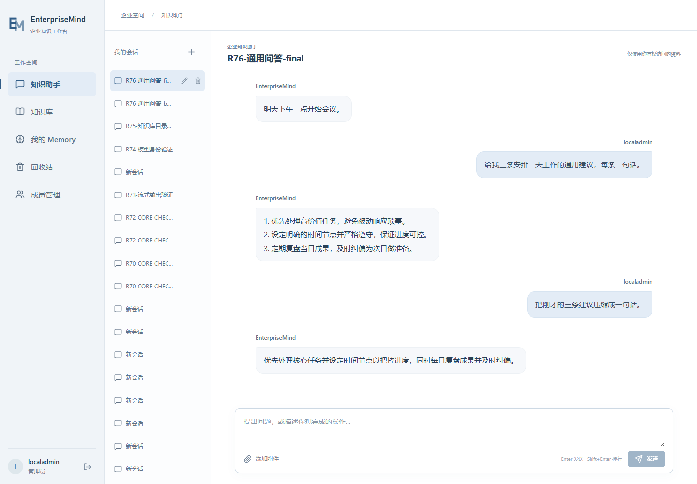
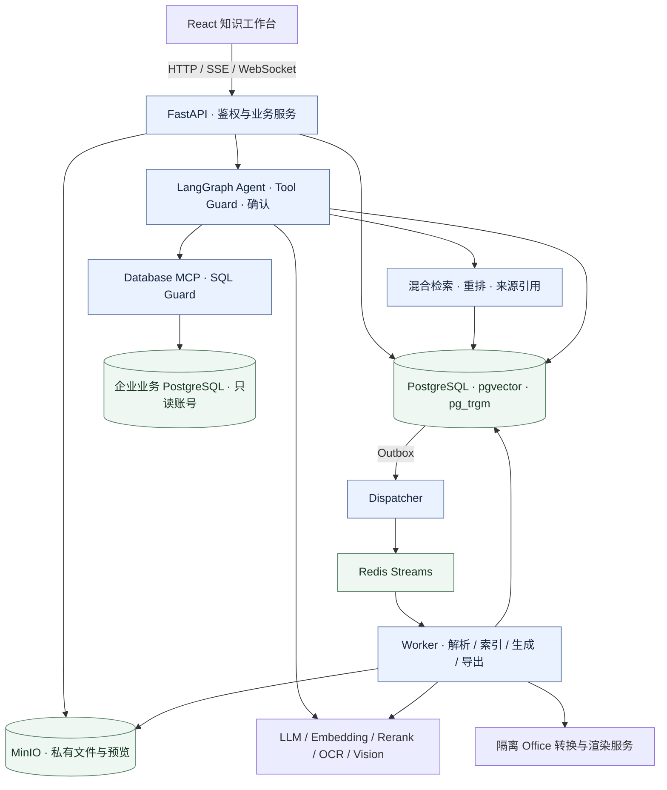

# EnterpriseMind

面向单一企业私有化部署的知识库 Agent，将企业文档、只读业务数据库和自然语言工作流接在同一个知识工作台中。

项目关注从“回答一个问题”到“完成一项可确认、可追溯的操作”：按权限检索资料、定位回答来源、生成文件，并由用户确认后写入知识库。

[运行与配置](#运行与配置) · [Compose 部署](deploy/README.md) · [本机运行配置](deploy/local/README.md)

## 界面预览



会话管理、消息输入与流式回答界面。

## 核心工程价值

- **权限贯穿全链路**：公共库与部门库隔离；检索、引用预览、下载和工具执行重新检查权限。业务数据库通过独立只读 MCP 接入，并由 SQL AST 防护限制查询。
- **操作具有明确边界**：幂等请求、资源版本检查、确认与消歧共同约束写操作；覆盖、删除和生成文件入库遵循各自的确认流程。
- **任务状态可恢复**：PostgreSQL 保存任务真实状态，Outbox 与 Redis Streams 衔接 Dispatcher、Worker；Agent 使用 LangGraph Checkpoint 支持停止与有界恢复。
- **回答与产物可追溯**：文档保留来源单元和定位锚点，回答引用可打开授权预览；数据库导出和基础图表保留查询来源与统计口径。
- **工程检查覆盖关键逻辑**：后端静态检查与离线回归覆盖业务规则、Agent 工具和任务协议，前端检查覆盖类型、流式消息与预览坐标。

## 架构



模型、OCR 和 Office 转换服务按能力配置；业务数据库通过独立只读连接接入。

## 已实现功能

| 能力 | 功能 | 使用条件 |
| --- | --- | --- |
| 身份与知识库 | 用户／部门管理、公共与部门知识库、文件夹、回收站、覆盖与重试 | 面向单企业；关键操作遵循权限、资源版本和确认规则 |
| 文档处理与预览 | PDF、Markdown、文本、CSV、Office 和图片解析；OCR／Vision、鉴权预览与来源高亮 | 旧 Office 使用隔离转换服务；OCR／Vision 使用对应 Provider |
| RAG 与会话 | 混合检索、重排、引用、SSE、会话附件、停止／继续、授权知识库目录查询 | 配置 LLM、Embedding；按检索配置启用 Rerank |
| Memory 与受控操作 | 个人 Memory、工具参数校验、确认／拒绝／消歧、幂等响应 | Memory 与工具操作遵循当前用户权限 |
| 内容生成与入库 | 基于授权来源生成草稿，导出 DOCX／PDF／Markdown／XLSX，下载与确认入库 | 配置模型及所需文件生成服务；写入知识库须经用户确认 |
| 业务数据库与图表 | 只读 Database MCP、Schema 快照、分页查询、XLSX／CSV 导出；柱／线／饼图及 PNG／PDF／XLSX／CSV 导出 | 配置只读业务 PostgreSQL 与 MCP；查询遵循 SQL Guard 和数据授权 |
| 文档翻译 | 授权原文逐段处理、指定章节、引用与译后总结 | 配置 LLM；单次最多 16 段、每段原文最多 1400 字符 |

## 技术栈

| 层次 | 主要技术 |
| --- | --- |
| 前端 | React 19、TypeScript、Vite、PDF.js；Playwright 用于浏览器验证 |
| 后端与 Agent | Python 3.13、FastAPI、Pydantic、SQLAlchemy、Alembic、LangGraph |
| 数据与任务 | PostgreSQL、pgvector、pg_trgm、Redis Streams、MinIO |
| 文档与数据库 | PyMuPDF、python-docx、python-pptx、openpyxl、pglast、MCP |
| 质量检查 | Ruff、Mypy、pytest、Node 内置测试；uv 与 npm 锁文件 |

依赖版本以 [backend/pyproject.toml](backend/pyproject.toml)、[backend/uv.lock](backend/uv.lock) 和 [frontend/package-lock.json](frontend/package-lock.json) 为准。模型与外部服务通过 Provider 配置接入。

## 运行与配置

使用 Python 3.13、Node.js 24、uv，以及带 pgvector 和 `pg_trgm` 的 PostgreSQL 18、Redis、MinIO。安装锁定依赖：

```powershell
uv sync --project backend --locked --python 3.13.15
npm --prefix frontend ci
```

启动前须完成以下准备：

1. 准备独立数据库、Redis 与 MinIO，以及应用、迁移、备份和 Checkpoint 数据库角色；按环境设置连接地址和专用 Secret 文件路径。
2. 使用 CLI 的 `provision-database` 预配置角色，以迁移身份执行 `migrate`、`checkpoint-init`，并执行 `storage-init` 初始化私有对象存储。迁移版本为 `0016_database_csv_export`；首次空系统初始化时设置自选管理员用户名与密码文件。
3. 按所需能力配置 Provider、Tokenizer 和 RAG 参数。启用 Embedding 后，以迁移身份执行 `build-vector-index`；API、Dispatcher 与 Worker 使用各自的进程环境和运行身份。

初始化和运行命令通过 `.\backend\.venv\Scripts\python.exe -m enterprise_mind.cli <命令> --help` 查看参数。Linux / Compose 的配置、Secret 与初始化步骤见[部署说明](deploy/README.md)；Windows / WSL 启停脚本及其环境前置条件见[本机运行配置](deploy/local/README.md)。没有默认管理员账号或密码。

| 配置入口 | 用途 |
| --- | --- |
| [.env.example](.env.example)、[应用配置](config/application.yaml) | 数据库、Redis、MinIO、Origin 与运行参数；应用直接读取进程环境，不自动加载 `.env` |
| [Provider 模板](config/providers.example.yaml)、[RAG 模板](config/rag.models.example.yaml) | LLM、Embedding、Rerank、OCR、Vision 与配套检索参数 |
| [模型环境模板](config/model-env.example.ps1)、[Tokenizer 清单](config/tokenizers.yaml) | 模型配置和 Secret 路径、Tokenizer 来源与摘要 |
| [MCP 客户端模板](config/database.example.yaml)、[MCP 服务端模板](deploy/config/database-mcp-server.yaml) | MCP 端点、身份与只读业务数据库连接 |

Secret 文件使用无 BOM、非空、单行 UTF-8；密码和 API Key 通过 `*_FILE` 引用，不写入 YAML。默认 [Provider 配置](config/providers.yaml) 中各模型为 `null`；复制模板后须填写匹配的服务、凭据和 Tokenizer 才能启用相应能力。

完成上述初始化并加载对应环境后，在仓库根目录分别启动三个后端进程：

```powershell
# API 终端；Origin 与前端开发地址一致。
$env:EM_PUBLIC_ORIGIN = 'http://127.0.0.1:5173'
& ./backend/.venv/Scripts/python.exe -m enterprise_mind.cli serve --host 127.0.0.1 --port 18000
```

```powershell
# Dispatcher 终端
& ./backend/.venv/Scripts/python.exe -m enterprise_mind.cli dispatch
```

```powershell
# Worker 终端
& ./backend/.venv/Scripts/python.exe -m enterprise_mind.cli worker
```

另开终端执行 `npm --prefix frontend run dev`，访问 `http://127.0.0.1:5173`。前端开发代理将 `/api` 和 `/health` 转到 `127.0.0.1:18000`；`/health/ready` 检查基础依赖就绪状态。

## 使用流程

可以按以下流程体验知识工作台：

1. 管理员创建知识库，上传一份包含明确事实的 Markdown，等待处理完成。
2. 在会话中询问资料中的问题，观察流式回答，打开引用核对原文与高亮。
3. 请求基于授权资料生成简短报告，查看草稿与来源，再生成并下载文件。
4. 确认将生成文件写入知识库，等待索引后追问新文档；也可拒绝确认，观察操作终止。

数据库查询与图表需另外准备只读业务数据库和 MCP 服务；Office／图片处理需配置对应转换或模型能力。

## 通过的工程检查

2026-10-10 本地工程检查结果：前端 TypeScript 类型检查、8 项测试与生产构建通过；后端 Ruff、Mypy 与 690 项离线测试通过。检查覆盖范围为前端工程构建、静态规则和离线回归。

从仓库根目录运行离线后端检查：

```powershell
.\backend\.venv\Scripts\python.exe scripts/check_backend.py
```

安装前端锁定依赖后运行检查：

```powershell
npm --prefix frontend ci
npm --prefix frontend run check
npm --prefix frontend test
npm --prefix frontend run build
```

集成入口为 `scripts/check_backend.py --integration --ingestion --database`，需要独立 PostgreSQL、业务 PostgreSQL、Redis、MinIO 测试夹具及对应 Secret。配置以 [compose.test.yaml](compose.test.yaml) 和脚本参数为准；测试容器使用临时存储。

## 目录

```text
backend/       Python API、Agent、业务服务、迁移与测试
frontend/      React 工作台、组件与浏览器测试
config/        应用、Agent、RAG 与 Provider 配置模板
deploy/        部署组件、隔离服务与备份恢复说明
scripts/       检查、初始化、评测与运维脚本
evals/         评测材料与用例入口
assets/        作品展示截图
```

## 许可

本项目当前作为公开作品展示，**暂不授予开源许可**。原创内容授权状态见 [COPYRIGHT.md](COPYRIGHT.md)，依赖及素材说明见 [THIRD_PARTY_NOTICES.md](THIRD_PARTY_NOTICES.md)；第三方组件继续适用各自许可。
