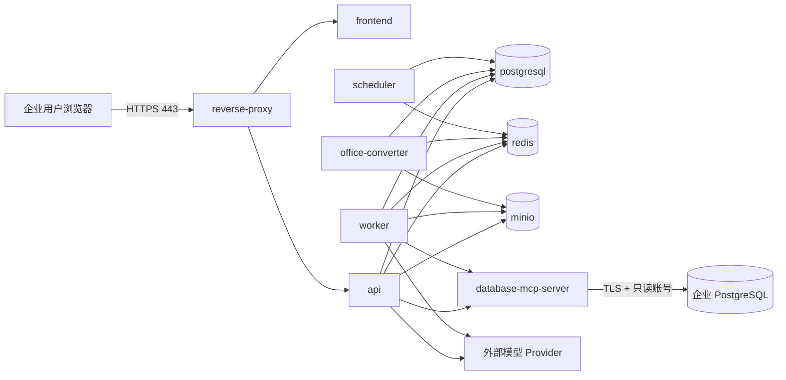

# EnterpriseMind V1 容器编排、网络与配置设计（确认稿）

> 状态：确认稿  
> 日期：2026-09-12  
> 项目：EnterpriseMind  
> 适用范围：V1 单企业、单机 Docker Compose 私有化部署  
> 前置文档：《需求说明书》《系统总体架构设计》《数据库表设计》《数据库关系与约束设计》《文档处理状态机与任务协议》《智能体编排状态与检查点设计》《工具参数结构、风险等级与确认协议》《数据库模式快照与 SQL 防护规则》

## 1. 目标与边界

本文确定 EnterpriseMind V1 的：

- Docker Compose 服务拆分；
- 镜像与运行时版本；
- 容器网络、端口和出站边界；
- 持久卷、临时空间和 Secret 装载；
- 启动顺序、迁移、健康检查和故障恢复；
- 应用、RAG、Provider、Worker 和 Database MCP 配置来源；
- 日志、资源限制、备份、恢复和升级边界。

本文不新增业务功能、数据库表、用户页面、Agent Tool 或对外业务 API。V1 不建设：

- Kubernetes、Docker Swarm、服务网格或多主机调度；
- PostgreSQL、Redis、MinIO 或 API 高可用集群；
- 自动扩缩容、跨机房容灾或零停机迁移承诺；
- 内置 Prometheus、Grafana、ELK、Jaeger 或日志审计平台；
- 本地 LLM、Embedding、Rerank、Vision 或 OCR 推理服务；
- 公网 Database MCP、MinIO Console、PostgreSQL、Redis 或管理调试端口；
- 在线模型配置、Prompt 配置或运行参数管理页面；
- SQL、数据库结果、Prompt、思维链或 Secret 的持久化 Trace。

V1 没有固定 SLA 和高并发目标。本设计提供可直接实施的单机首版基线，资源配额和并发值只可根据《测试策略与 V1 验收用例》的实际压测结果调整。

## 2. 部署假设

### 2.1 生产环境

- 生产宿主机使用受支持的 64 位 Linux，首版固定 `linux/amd64`。
- 使用仍在安全支持期内的 Docker Engine 和 Docker Compose v2。
- Compose Project Name 固定为 `enterprise-mind`，避免卷和网络名称随目录漂移。
- 宿主机时间同步启用；服务端、数据库和日志统一使用 UTC，前端按用户时区展示。
- 所有模型能力通过配置的外部或企业内网 Provider API 使用，不部署模型容器。
- 企业业务 PostgreSQL 独立存在，只允许 Database MCP 专用只读账号访问。
- 生产域名、TLS 证书、出站代理、备份目标和 Secret 由部署环境提供。
- PostgreSQL、MinIO 和备份所在磁盘必须启用企业认可的静态加密；V1 不为此额外部署 KMS 服务。

生产首版建议宿主机至少 8 vCPU、32 GiB 内存和 SSD。实际磁盘容量必须按原文件、派生文件、Embedding、数据库导出和 30 天回收站数据量计算，不能把该建议解释为容量承诺。

### 2.2 开发环境

Windows 开发机通过 WSL2 中的 Docker Engine 和 `docker compose` 运行同一拓扑。开发覆盖文件可以：

- 只把 Web 端口绑定到 `127.0.0.1`；
- 使用开发证书或仅本机 HTTP；
- 挂载源代码并启用热重载；
- 降低资源限制和 Worker 并发。

开发配置不得改变生产的权限公式、数据保留、SQL Guard、确认协议和 Secret 隔离语义。生产 Compose 不挂载源代码。

## 3. 版本与镜像基线

### 3.1 直接版本

| 组件 | V1 固定版本 | 选择说明 |
|---|---:|---|
| Python | `3.13.15` | 成熟维护版本；当前已确认的 LangGraph 明确声明支持 Python 3.13 |
| FastAPI | `0.141.1` | 当前稳定修复版本 |
| LangGraph | `1.2.11` | 沿用编排详细设计 |
| LangGraph PostgreSQL Checkpointer | `3.1.2` | 沿用检查点详细设计 |
| LangChain | `1.4.0` | 仅用于 Provider、消息和 Tool Calling 组件适配 |
| pglast | `8.4` | 沿用 PostgreSQL AST SQL Guard 设计 |
| MCP Python SDK | `2.2.0` | 当前稳定 v2 补丁版，原生支持 MCP `2026-07-28`；V1 不启用 Tasks 扩展 |
| React | `19.2.7` | 采用 19.2 系列最新补丁版，不在首版立即采用刚发布的 19.3 次版本 |
| Node.js | `24.21.0 LTS` | 只用于前端构建，不进入最终运行镜像 |
| Nginx | `1.30.4` | 当前稳定分支补丁版本 |
| PostgreSQL | `18.6` | 沿用数据库设计 |
| pgvector | `0.8.6` | 沿用数据库设计 |
| pg_trgm | PostgreSQL 18.6 内置扩展 | 不单独安装第三方版本 |
| Redis Open Source | `8.10.1` | 采用包含 2026 年 8 月安全修复的 8.10 补丁版；仅承担短期队列、缓存和事件 |
| LibreOffice | `26.2.6` | 采用较成熟的 26.2 稳定分支最新补丁版，不使用刚发布的 26.8 首个版本 |
| MinIO | `RELEASE.2025-10-15T17-29-55Z` | 已确认架构下可用的最后安全修复版本，必须使用固定源码标签自建制品 |
| MCP 协议 | `2026-07-28` | 采用当前正式协议与请求级无状态模型 |

Python 3.14 虽是更新的特性版本，但当前 `langgraph 1.2.11` 包元数据明确列出的 CPython 支持到 3.13，因此 V1 先使用 Python 3.13.15。React 19.3 在本文日期前仅发布数日，V1 采用已包含后续补丁且使用时间更长的 React 19.2.7。

### 3.2 基础镜像

| 构建目标 | 基础镜像或来源 |
|---|---|
| Backend 构建与运行 | `python:3.13.15-slim-bookworm` |
| Frontend 构建阶段 | `node:24.21.0-bookworm-slim` |
| Frontend/反向代理运行 | `nginx:1.30.4-alpine3.24-slim` |
| EnterpriseMind PostgreSQL | `pgvector/pgvector:0.8.6-pg18-bookworm` |
| Redis | `redis:8.10.1-alpine3.23` |
| Office 转换 | 以 Backend Debian 基础镜像构建，安装固定 LibreOffice 26.2.6 制品 |
| MinIO | 从 MinIO 固定源码标签构建内部镜像 |

标签只用于说明人类可读版本。生产发布清单必须把每个外部基础镜像和最终内部镜像固定到目标架构的 OCI digest；不得使用 `latest`、`stable`、`pg18`、`3.13` 等浮动标签启动生产。

### 3.3 应用依赖锁定

- Python 直接和传递依赖写入带 SHA-256 的锁文件。
- npm 依赖保留 lockfile，并在构建时使用不可修改锁文件的安装方式。
- 前端构建后只复制静态产物到 Nginx 镜像，不携带 Node.js、npm 缓存或源代码。
- Backend 多阶段构建只复制虚拟环境、应用代码、Prompt 和受控配置，不携带编译器、包管理缓存或测试数据。
- 生产镜像生成 SBOM 并执行漏洞扫描；有未处理高危/严重漏洞时不得进入生产。
- 依赖升级只通过显式变更和完整测试，不在容器启动时联网更新。

### 3.4 MinIO 维护风险

MinIO 开源仓库已于 2026-04-25 归档，最后发布的 `RELEASE.2025-10-15T17-29-55Z` 是安全修复版本。由于 V1 已确认使用 MinIO，本阶段不擅自替换对象存储，但必须遵守：

1. 从固定发布标签自建镜像，校验上游 Commit/制品摘要，并保存源码、SBOM、构建日志和 digest。
2. MinIO 不开放企业用户网络或公网，只能由授权内部服务访问。
3. 上线前完成该版本漏洞扫描和已知 CVE 复核。
4. 正式生产必须获得仍受支持的 MinIO 发行渠道，或形成明确的风险接受记录；未满足时只能用于开发和封闭验收。
5. 后续更换对象存储属于单独架构变更，不在本阶段顺带扩展。

这项发布门槛不改变当前 `storage_objects`、MinIO Object Key 和清理事务设计。

## 4. Compose 服务清单

V1 使用 10 个长期运行服务，不按文档类型或 Provider 再拆更多 Worker：

| Compose 服务 | 镜像 | 单实例/可扩展 | 职责 |
|---|---|---|---|
| `reverse-proxy` | Nginx | 单实例 | TLS、静态/接口路由、上传限制、SSE 和 WebSocket 代理 |
| `frontend` | Nginx + React 静态产物 | 可替换，无状态 | 只提供前端静态文件 |
| `api` | Backend | 可多实例 | FastAPI、鉴权、业务 API、Agent Run、SSE/WebSocket |
| `worker` | Backend Worker | 可多实例 | 解析、OCR/Vision 调用、Chunk、Embedding、索引、对象清理和 Schema 刷新任务 |
| `office-converter` | 受限转换镜像 | 可多实例，首版 1 个 | DOC/DOCX、PPT/PPTX、XLS/XLSX 到预览格式的隔离转换 |
| `scheduler` | Backend Scheduler | 单实例 | Outbox 投递、到期清理、租约恢复和周期维护 |
| `postgresql` | pgvector PostgreSQL | 单实例 | EnterpriseMind 业务状态、Checkpoint、全文和向量数据 |
| `redis` | Redis | 单实例 | 至少一次任务投递、短期缓存和实时事件 |
| `minio` | 固定 MinIO 内部镜像 | 单实例 | 原文件、预览、派生、生成和导出对象 |
| `database-mcp-server` | 独立 MCP 镜像 | 单实例 | 企业 PostgreSQL Schema 抓取和双重校验后的只读查询 |

另有两个只执行一次并正常退出的部署任务：

- `migrate`：执行 EnterpriseMind PostgreSQL 迁移，并在全新空系统中幂等创建首个管理员；
- `storage-init`：创建唯一私有 Bucket、最小权限账号和必要策略。

一次性任务不是常驻服务，也不加入自动重启。

### 4.1 明确合并项

- 通用处理、OCR 和 Embedding 任务统一由 `worker` 承载，通过任务类型和并发槽限制资源。
- LibreOffice 因文件解析攻击面和资源占用单独放入 `office-converter`。
- 不单独部署 WebSocket Gateway；由 `api` 提供 WebSocket，由 Redis 分发事件。
- 不单独部署向量数据库；pgvector 位于 EnterpriseMind PostgreSQL。
- 不单独部署模型服务；全部通过 Provider 接口调用。
- 不额外部署搜索服务；关键词、`pg_trgm` 和 pgvector 都在 PostgreSQL。

## 5. 服务关系



禁止的直接连接：

- 浏览器不能直连 API 以外的内部服务；
- `frontend`、`reverse-proxy`、`office-converter` 和 `scheduler` 不能访问企业 PostgreSQL；
- `database-mcp-server` 不能访问 EnterpriseMind PostgreSQL、Redis 或 MinIO；
- EnterpriseMind `api`、`worker` 和 `scheduler` 不能直连企业 PostgreSQL；
- 企业 PostgreSQL 不能主动连接 EnterpriseMind 内部网络；
- 任何服务都不能访问 Docker Socket。

## 6. 网络设计

### 6.1 Compose 网络

| 网络 | `internal` | 成员 | 用途 |
|---|---:|---|---|
| `ingress_net` | 否 | `reverse-proxy` | 承接宿主机发布端口，不放入任何内部服务 |
| `edge_net` | 是 | `reverse-proxy`、`frontend`、`api` | 反向代理到静态前端和 API 的内部路径 |
| `core_net` | 是 | `api`、`worker`、`office-converter`、`scheduler`、`postgresql`、`redis`、`minio` | EnterpriseMind 内部状态与对象访问 |
| `mcp_net` | 是 | `api`、`worker`、`database-mcp-server` | 内部 MCP Streamable HTTP |
| `provider_egress_net` | 否 | `api`、`worker` | 只经企业出站代理访问配置的 Provider HTTPS 地址 |
| `enterprise_db_egress_net` | 否 | `database-mcp-server` | 只访问唯一企业 PostgreSQL 地址和端口 |

Compose 网络本身不能证明精确目的地址白名单。生产宿主机防火墙或企业出站代理必须进一步限制：

- `api`、`worker` 只访问已配置 Provider 的 HTTPS 目标；
- `database-mcp-server` 只访问已登记企业 PostgreSQL 的单一地址、端口和必要 DNS；
- 其他服务不允许任意互联网出站；
- 宿主机 Docker 管理接口不监听 TCP 公网地址。

### 6.2 端口

| 服务 | 容器端口 | 是否发布到宿主机 |
|---|---:|---:|
| `reverse-proxy` | `8443`；可选 `8080` 仅重定向 | 发布为宿主机 `443`；可选 `80` |
| `frontend` | `8080` | 否 |
| `api` | `8000` | 否 |
| `postgresql` | `5432` | 否 |
| `redis` | `6379` | 否 |
| `minio` | `9000` | 否 |
| `database-mcp-server` | `8001` | 否 |
| `worker`、`office-converter`、`scheduler` | 无监听端口 | 否 |

MinIO Console 不启动或不暴露。PostgreSQL、Redis、MCP 和内部健康端点都不得通过 `ports` 发布；Compose 内部服务发现使用固定服务名，不写死容器 IP。

### 6.3 外部企业 PostgreSQL

- 生产默认 `ssl_mode = verify-full`，并通过只挂载给 MCP 的 CA Secret 校验证书。
- 如果企业数据库环境暂时只能使用其他 SSL 模式，管理员必须显式配置并承担相应环境风险；不得自动降级。
- 数据库只读密码或客户端证书只挂载到 `database-mcp-server`。
- `database_sources.secret_ref` 只能引用 MCP 容器内允许列表中的 Secret 名称，不能成为任意文件路径。

## 7. 反向代理与前端交付

### 7.1 路由

| 路径 | 上游 |
|---|---|
| `/api/v1/*` | `api:8000` |
| `/api/v1/agent-runs/*/events` | `api:8000`，关闭代理缓冲 |
| `/api/v1/ws/document-processing` | `api:8000`，启用 WebSocket Upgrade |
| 其他路径 | `frontend:8080`，SPA fallback 到 `index.html` |

反向代理不得提供 MinIO、MCP、Redis 或 PostgreSQL 通用代理。文件下载和预览继续通过鉴权 API 流式返回，浏览器不直接访问内部 MinIO。

### 7.2 请求与流式响应

- `client_max_body_size` 与应用 `upload.max_bytes` 使用同一值，首版为 100 MiB。
- 上传流式写入 MinIO 暂存对象，不先把完整文件放入 API 内存。
- SSE 关闭 Nginx 响应缓冲和缓存，并保留 15 秒心跳。
- WebSocket 只转发已定义路径，鉴权仍由 API 建连后的第一条消息完成。
- 普通 API 代理超时与 Provider/Agent 长运行超时分开，不用一个无限超时覆盖所有接口。
- 浏览器请求只允许已配置生产 Origin；不使用 `*` CORS。

### 7.3 TLS 与响应头

- 生产把宿主机 443 映射到非 root Nginx 的容器 8443，只接受 TLS 1.2/1.3，并优先 TLS 1.3。
- 证书和私钥通过只读 Secret 文件挂载给 `reverse-proxy`。
- HTTP 端口如启用，只返回到 HTTPS 的重定向。
- 隐藏 Nginx 版本，启用 HSTS、`X-Content-Type-Options`、合理 CSP 和禁止不需要的 iframe 嵌入。
- 前端 `index.html` 不长期缓存；带内容摘要的静态资源可以长期不可变缓存。

## 8. 持久卷与临时空间

### 8.1 持久数据

V1 只有两个运行数据卷：

| 卷 | 挂载服务 | 内容 | 备份 |
|---|---|---|---:|
| `postgres_data` | `postgresql` | 业务状态、Checkpoint、全文、Embedding、Schema 快照 | 必须 |
| `minio_data` | `minio` | 原始、预览、派生、生成和导出对象 | 必须 |

Redis 不挂持久卷。任务事实和 Outbox 均在 PostgreSQL；Redis 重启后由 Dispatcher 根据未完成 Outbox 和数据库任务状态恢复投递。禁止把 Redis 当作业务恢复来源。

### 8.2 MinIO Bucket

首版只创建一个私有 Bucket：`enterprise-mind`。对象按服务端生成前缀隔离：

```text
original/
preview/
derived/
generated/
export/
staging/
```

- Bucket 禁止匿名访问和公共列表。
- Object Key 只由服务端生成，不使用用户原始文件名拼接。
- 不启用会阻止既有“永久删除”语义的对象版本保留；若部署环境强制版本化，永久清理必须删除全部版本。
- 不使用 Bucket 生命周期替代 PostgreSQL 驱动的回收站和 Outbox 清理。
- 应用账号只具有该 Bucket 所需对象权限，MinIO Root 凭据只用于初始化和受控恢复。

### 8.3 临时空间

- `api`、`worker`、`office-converter` 和 `database-mcp-server` 根文件系统默认只读。
- `/tmp` 使用限制大小的 `tmpfs`。
- Office 转换使用独立 `tmpfs` 工作目录，首版上限 2 GiB；任务完成或失败立即清理。
- 原文件和结果文件尽可能流式经过 MinIO，不进入容器可持久层。
- 不把源代码目录、宿主机根目录、Docker Socket 或用户目录挂入生产容器。

## 9. Secret 与身份隔离

### 9.1 装载规则

- Secret 使用 Compose Secret 或企业 Secret 管理器以文件形式挂载到 `/run/secrets/*`。
- `.env`、Compose YAML、镜像、Git 配置和命令行参数不得包含 Secret 值。
- 每个服务只挂载其实际需要的 Secret。
- 应用配置统一读取 `*_FILE` 指定文件，不把 Secret 回填到日志或错误响应。
- Secret 文件只读，权限限定为服务运行 UID/GID。
- 轮换时先写新 Secret，滚动重建使用方并验证连接，再撤销旧值。

### 9.2 Secret 矩阵

| Secret | 使用服务 | 不得提供给 |
|---|---|---|
| TLS 私钥 | `reverse-proxy` | 其他全部服务 |
| EnterpriseMind PostgreSQL 应用密码 | `api`、`worker`、`office-converter`、`scheduler` | 前端、MCP、MinIO |
| PostgreSQL 迁移密码 | `migrate` | 长期运行服务 |
| PostgreSQL 初始化超级用户密码 | `postgresql` 初始化入口、受控恢复任务 | 应用、Worker、MCP |
| 首个管理员初始化密码 | 仅首次空系统初始化时的 `migrate` | 全部长期服务、前端、MCP、镜像和 Git |
| Redis ACL 配置及服务端凭据 | `redis`、`api`、`worker`、`office-converter`、`scheduler` | 前端、MCP |
| MinIO 应用访问密钥 | `api`、`worker`、`office-converter` | 前端、MCP、scheduler |
| MinIO Root 密钥 | `minio`、`storage-init`、受控恢复任务 | API、Worker、前端、MCP |
| 访问令牌签名密钥 | `api` | Worker、前端、MCP |
| Provider API Key | 需要对应 Provider 的 `api`、`worker` | 前端、Office、MCP、scheduler |
| MCP 内部服务认证密钥 | `api`、`worker`、`database-mcp-server` | 其他服务 |
| 企业 PostgreSQL 只读密码/客户端证书 | `database-mcp-server` | EnterpriseMind API、Worker、PostgreSQL |

业务数据库配置中的 `secret_ref` 只保存允许的 Secret 别名，不保存上述 Secret 内容。

首个管理员创建成功后，部署方必须移除 `EM_BOOTSTRAP_ADMIN_PASSWORD_FILE` 及其对应 Secret；后续迁移在已有用户时不要求该 Secret，也不能用它恢复或重置账号。

## 10. PostgreSQL 角色与初始化

### 10.1 角色

| 角色 | 登录 | 用途 |
|---|---:|---|
| `enterprise_mind_owner` | 否 | 持有 Schema 和对象，不供服务登录 |
| `enterprise_mind_migrator` | 是 | 仅 `migrate` 使用，执行受控迁移 |
| `enterprise_mind_app` | 是 | API、Worker、Office 和 Scheduler 的运行时最小权限 |
| `enterprise_mind_backup` | 是 | 外部备份任务只读使用 |

运行时角色不是超级用户，不具有建库、建角色、复制或绕过行安全权限。Database MCP 的企业数据库只读账号完全独立，不出现在 EnterpriseMind PostgreSQL。

### 10.2 扩展与迁移

空数据库初始化顺序：

1. 创建非登录 owner 和最小登录角色。
2. 创建 EnterpriseMind 数据库。
3. 安装固定 `vector` 和内置 `pg_trgm` 扩展。
4. 执行版本化迁移。
5. 写入必需的无敏感初始配置，不写示例用户、示例文档或企业业务数据。
6. 锁定初始化过程；仅当 `iam.users` 为空时，从部署配置读取首个管理员用户名、从专用 Secret 文件读取密码，校验后写入一个无部门的 `active` 管理员。
7. 校验迁移版本、扩展版本、首个管理员和关键约束。

`api` 和 `worker` 启动时只检查迁移版本，不自动执行迁移。`migrate` 使用 PostgreSQL advisory lock 保证同一时刻只有一个迁移和初始化进程；空用户表缺少用户名、密码 Secret 或密码不符合统一策略时必须非零退出。创建成功后的重复执行只校验已有用户，不新增、覆盖或重置管理员；表非空但没有管理员时视为异常并失败，不能自动提升普通用户。其他服务不得绕过失败继续启动。

## 11. Redis 配置

Redis 只承担短期任务投递、授权后热点缓存和实时事件：

- 关闭 RDB 和 AOF 持久化；
- 禁用默认匿名访问，使用 ACL 账号和 Secret；
- `maxmemory` 首版为 512 MiB；
- `maxmemory-policy = noeviction`，内存不足时让发布失败并由 PostgreSQL Outbox 重试，不能静默淘汰队列；
- 消息只包含事件、聚合和任务 ID，不包含文件正文、Chunk、SQL、结果行、Prompt、Token 或 Secret；
- Worker 成功提交 PostgreSQL 业务结果后才确认消息；
- Redis 重启不改变 PostgreSQL 中的任务真实状态。

缓存键必须有 TTL 和命名空间；权限、快照或模型配置变化时按对应详细设计失效。

## 12. 配置来源与优先级

### 12.1 配置分层

配置优先级从低到高：

```text
Git 固定配置文件
→ 部署环境非敏感覆盖
→ Secret 文件
```

不得从数据库在线修改模型、Prompt、RAG 或运行参数。未知配置键、类型错误、超出安全边界或必填配置缺失时，服务启动失败，不使用隐式危险默认值。

### 12.2 Git 管理配置

| 文件 | 内容 | 禁止内容 |
|---|---|---|
| `config/application.yaml` | API、Worker、保留期、分页、超时和并发首版值 | Secret、主机密码 |
| `config/rag.yaml` | 已确认 Chunk、召回、RRF、Rerank、Context 和 HNSW 参数 | Provider Key、企业数据 |
| `config/providers.yaml` | Provider 类型、基础地址、模型稳定键、超时、重试和能力 | API Key、Prompt 正文 |
| `prompts/**` | 版本控制的系统 Prompt 模板 | Secret、用户或企业数据 |

配置和 Prompt 变化通过代码评审、测试和新镜像发布，不写 `model_configs`、`prompt_versions` 或在线历史表。

### 12.3 部署环境变量

环境变量只承载部署差异和 Secret 文件路径：

| 变量 | 必填 | 示例语义 |
|---|---:|---|
| `EM_ENV` | 是 | `production` / `development` / `test` |
| `EM_PUBLIC_ORIGIN` | 生产必填 | 唯一外部 HTTPS Origin |
| `EM_LOG_LEVEL` | 否 | 生产默认 `INFO`，禁止 `DEBUG` |
| `EM_POSTGRES_HOST` / `EM_POSTGRES_PORT` / `EM_POSTGRES_DATABASE` | 是 | EnterpriseMind PostgreSQL 非密钥地址 |
| `EM_POSTGRES_PASSWORD_FILE` | 是 | 应用数据库 Secret 文件 |
| `EM_REDIS_HOST` / `EM_REDIS_PORT` | 是 | Redis 内部服务地址 |
| `EM_REDIS_PASSWORD_FILE` | 是 | Redis ACL Secret 文件 |
| `EM_MINIO_ENDPOINT` / `EM_MINIO_BUCKET` | 是 | 内部 MinIO 地址和唯一 Bucket |
| `EM_MINIO_ACCESS_KEY_FILE` / `EM_MINIO_SECRET_KEY_FILE` | 是 | MinIO 应用 Secret 文件 |
| `EM_MCP_ENDPOINT` | 是 | 内部 MCP Streamable HTTP 地址 |
| `EM_MCP_AUTH_SECRET_FILE` | 是 | MCP 内部认证 Secret |
| `EM_PROVIDER_PROXY_URL` | 视环境 | 企业 HTTPS 出站代理的非密钥地址 |
| `EM_TOKEN_SIGNING_KEY_FILE` | 是 | API 令牌签名 Secret |
| `EM_BOOTSTRAP_ADMIN_USERNAME` | 首次空系统初始化必填 | 首个管理员规范化前用户名，不提供内置默认值 |
| `EM_BOOTSTRAP_ADMIN_PASSWORD_FILE` | 首次空系统初始化必填 | 只供 `migrate` 读取的首个管理员密码 Secret；已有用户时不得用于覆盖或重置 |

Provider Key 使用与 Provider 稳定键对应的显式 `*_FILE` 变量；不允许任意字符串自动映射成环境变量名。

## 13. V1 配置基线

### 13.1 API 与上传

| 配置键 | 首版值 |
|---|---:|
| `api.workers` | `2` |
| `api.regular_request_timeout_seconds` | `60` |
| `api.sse_heartbeat_seconds` | `15` |
| `api.websocket_idle_timeout_seconds` | `600` |
| `upload.max_bytes` | `104857600`（100 MiB） |
| `upload.allowed_extensions` | PDF、DOC/DOCX、PPT/PPTX、XLS/XLSX、CSV、Markdown、TXT、PNG、JPG/JPEG、WEBP |

扩展名、MIME 和内容检测必须同时通过；配置不能增加需求范围外的可执行文件、压缩包或任意二进制上传。

### 13.2 数据库连接池

| 配置键 | 首版值 |
|---|---:|
| `postgres.max_connections` | `100` |
| `postgres.api_pool_max_per_process` | `10` |
| `postgres.worker_pool_max` | `10` |
| `postgres.office_pool_max` | `5` |
| `postgres.scheduler_pool_max` | `5` |
| `postgres.connection_timeout_seconds` | `5` |
| `postgres.statement_timeout_seconds` | 按具体业务路径设置，不使用无限全局值 |

连接池上限包含 LangGraph Checkpointer 使用量，所有应用池总和必须为迁移、健康检查、备份和管理员连接保留余量。

### 13.3 Worker 与 Outbox

| 配置键 | 首版值 |
|---|---:|
| `worker.concurrency` | `2` |
| `office_converter.concurrency` | `1` |
| `worker.lease_seconds` | `120` |
| `worker.lease_renew_interval_seconds` | `30` |
| `outbox.poll_interval_seconds` | `1` |
| `outbox.claim_batch_size` | `100` |
| `outbox.published_retention_days` | `7` |
| `provider.max_retries` | `3` |

长任务必须持续续租；租约时间不是 Provider 总超时。Worker 扩容增加消费者数量，不改变至少一次投递和数据库幂等语义。

### 13.4 Agent 与确认

沿用已确认值：

| 配置键 | 首版值 |
|---|---:|
| `agent.max_tool_calls` | `12` |
| `agent.max_replans` | `2` |
| `tool.max_retries` | `3` |
| `agent.pending_action_ttl_seconds` | `900` |
| `agent.history_summary_trigger_tokens` | `12000` |
| `agent.history_recent_tokens` | `6000` |

达到摘要阈值时只压缩较早且尚未摘要的消息，并至少保留最新 `6000` Token 的原文；如果具体 Provider 的输入窗口不足以容纳当前输入、近期原文、RAG/Tool 上下文和输出预留，启动时必须下调这两个值且保持“触发阈值大于近期原文保留量”，不能在运行中静默截断企业事实来源。

### 13.5 Database MCP

| 配置键 | 首版值 |
|---|---:|
| `database_mcp.protocol_version` | `2026-07-28` |
| `database_mcp.query_timeout_seconds` | `15` |
| `database_mcp.lock_timeout_seconds` | `1` |
| `database_mcp.transaction_timeout_seconds` | `20` |
| `database_mcp.page_size_default` | `100` |
| `database_mcp.page_size_max` | `100` |
| `database_mcp.result_max_bytes` | `1048576`（1 MiB） |
| `database_mcp.sql_max_bytes` | `65536` |
| `database_mcp.parameter_max_count` | `100` |
| `database_mcp.max_concurrent_queries` | `5` |
| `database_export.max_rows` | `100000` |
| `database_export.max_bytes` | `536870912`（512 MiB） |
| `database_export.timeout_seconds` | `300` |

导出达到任一上限时失败并要求缩小条件，不生成被描述为“完整”的截断文件。SQL、参数和结果仍不得进入持久配置、日志或指标。

### 13.6 RAG 与保留

- `config/rag.yaml` 完整复用《检索增强生成参数与离线评测方案》，本阶段不复制或修改其数值。
- 知识库、文件夹和文档回收站固定 30 天。
- Checkpoint、旧文档代次、Outbox 和对象清理复用各自详细设计，不增加审计保留。
- 模型校准值在选定具体 Provider 后通过离线评测确定；未校准前不能伪造默认阈值。

## 14. Provider 出站配置

### 14.1 文件配置

每个 Provider 在 `config/providers.yaml` 中只定义：

```text
稳定 provider_key
能力类型
HTTPS base_url
模型稳定 key
请求超时
最大批大小或上下文限制
对应 Secret 文件变量名
```

V1 不提供管理页面或数据库表修改这些内容。Provider base URL 必须匹配出站允许列表，禁止模型、用户请求或文档内容提供任意 URL。

### 14.2 超时首版值

| 能力 | 单次请求超时 |
|---|---:|
| LLM | `120` 秒 |
| Embedding | `60` 秒 |
| Rerank | `30` 秒 |
| Vision | `120` 秒 |
| OCR | `120` 秒 |

临时网络错误、限流、超时和允许重试的部分 5xx 最多重试 3 次；鉴权失败、参数错误和模型不存在不重试。超时和重试发生在适配层，不靠反向代理无限延长请求。

## 15. 容器安全基线

### 15.1 所有服务

- 禁止 `privileged: true`。
- 禁止宿主机网络、PID、IPC 和 Docker Socket。
- 使用默认 seccomp，并设置 `no-new-privileges`。
- 只添加实际需要的 Linux capability；应用、前端、代理和 MCP 默认 `cap_drop: [ALL]`。
- 应用、前端、代理、Worker、Office 和 MCP 使用固定非 root UID/GID。
- 根文件系统只读；只对数据卷和受限 tmpfs 开写权限。
- 设置 CPU、内存和 PID 上限，避免单个转换或查询拖垮宿主机。
- 健康检查、错误页和启动日志不输出环境变量、Secret、内部 DSN 或堆栈。

数据镜像首次初始化可能需要其官方入口完成卷权限设置；初始化完成后必须按镜像支持方式降权运行，不能为方便而给长期容器额外宿主机权限。

### 15.2 服务差异

- `office-converter` 无 Provider 和 MCP 网络，不挂载源代码，任务目录每次清空。
- `database-mcp-server` 无 EnterpriseMind PostgreSQL、Redis 和 MinIO Secret。
- `frontend` 镜像只包含静态产物和 Nginx 配置。
- `scheduler` 只运行一个实例，并使用 PostgreSQL 锁确保周期任务单活。
- `migrate` 完成后退出，其高权限 Secret 不挂载给其他服务。

## 16. 资源与并发首版值

以下是单机起点，不是 SLA：

| 服务 | CPU 上限 | 内存上限 | 进程/并发 |
|---|---:|---:|---:|
| `reverse-proxy` | `0.5` | `256 MiB` | 1 |
| `frontend` | `0.25` | `128 MiB` | 1 |
| `api` | `2` | `2 GiB` | 2 Uvicorn Worker |
| `worker` | `4` | `6 GiB` | 2 任务 |
| `office-converter` | `2` | `4 GiB` | 1 转换任务 |
| `scheduler` | `0.5` | `512 MiB` | 1 |
| `postgresql` | `4` | `8 GiB` | `max_connections = 100` |
| `redis` | `1` | `1 GiB` | 单实例，数据上限 512 MiB |
| `minio` | `2` | `2 GiB` | 单实例 |
| `database-mcp-server` | `1` | `1 GiB` | 最多 5 个查询 |

Compose CPU 配额允许在宿主机上按需抢占，但内存上限必须保留宿主机、页缓存、Docker 和备份工具空间。若 PostgreSQL 或 Worker 发生内存压力，先降低 Worker/Office 并发，不通过取消数据库安全限制换取吞吐。

## 17. 健康检查与启动顺序

### 17.1 健康语义

| 服务 | Liveness | Readiness |
|---|---|---|
| `reverse-proxy` | Nginx 进程可响应本地探针 | frontend 和 API 路由可用 |
| `frontend` | 静态服务器可响应 | `index.html` 和版本文件存在 |
| `api` | 事件循环存活 | 迁移版本正确，PostgreSQL、Redis、MinIO 可用 |
| `worker` | 主循环和心跳存活 | PostgreSQL、Redis、MinIO 可用 |
| `office-converter` | 消费循环存活 | LibreOffice 可执行，PostgreSQL、Redis、MinIO 可用 |
| `scheduler` | 主循环存活 | 已连接 PostgreSQL、Redis并可竞争单活锁 |
| `postgresql` | `pg_isready` | 目标数据库可连接且迁移版本可由应用检查 |
| `redis` | ACL `PING` | 可读写受控健康键 |
| `minio` | MinIO live 探针 | Bucket 存在且应用账号可执行受控检查 |
| `database-mcp-server` | MCP 进程可响应内部探针 | 解析器和只读连接组件加载成功 |

Database MCP Readiness 不要求企业数据库已经配置或持续在线；数据源状态由业务接口返回。Provider API 也不参与 API 容器启动 Readiness，避免短暂上游故障阻止基础页面和管理功能启动。

### 17.2 启动流程

```text
postgresql、redis、minio 通过健康检查
→ migrate 完成迁移并确保空系统已创建首个管理员后成功退出
→ storage-init 成功退出
→ api、worker、office-converter、scheduler、database-mcp-server
→ frontend
→ reverse-proxy
```

Compose 使用健康检查配合 `depends_on.condition = service_healthy`，一次性任务使用 `service_completed_successfully`。仅按容器创建顺序启动不算依赖就绪。

### 17.3 重启策略

- 长期服务使用 `unless-stopped`。
- `migrate` 和 `storage-init` 使用 `restart: "no"`。
- 业务任务依赖 PostgreSQL 租约、幂等键和 Outbox 恢复，不依赖无限容器重启。
- 反复启动失败时保留安全错误码并停止盲目重启，避免日志风暴。

## 18. 日志、指标和诊断

### 18.1 服务日志

- 服务向 stdout/stderr 输出结构化 JSON 日志。
- 生产默认 `INFO`，不得启用 SQL 驱动、HTTP 请求体、模型正文或文件正文调试日志。
- Docker 日志驱动采用本地轮转，首版每文件 20 MiB、最多 5 个文件。
- 日志只保留请求 ID、允许的业务关联 ID、服务、阶段、状态、安全错误码和耗时。
- 登录失败、权限拒绝和 Tool 失败是运行诊断，不扩展为审计表或审计页面。

### 18.2 永久禁止内容

日志、指标、SSE、WebSocket、异常响应和 Trace 均不得包含：

- Secret、Token、密码、签名 URL 和完整 DSN；
- Prompt、思维链和模型请求/响应全文；
- Database MCP SQL、SQL 摘要、参数、结果行和列值；
- 未授权 Schema、关系、字段和注释；
- Chunk 正文、Memory 正文和完整文件内容；
- MinIO Object Key 和宿主机内部路径。

### 18.3 指标边界

V1 只产生总体延迟、错误分类、队列长度、任务吞吐、模型调用、RAG 候选数量和 Database MCP 截断/超时计数。指标标签不得使用用户名、问题文本、文件名、表名或高基数业务 ID。本阶段不部署独立指标或 Trace 后端，可接入企业已有平台。

## 19. 备份与恢复

### 19.1 备份对象

| 对象 | 方法 | 是否必须 |
|---|---|---:|
| EnterpriseMind PostgreSQL | 受控物理或逻辑备份，包含扩展与迁移版本 | 是 |
| MinIO `enterprise-mind` Bucket | 使用 S3/MinIO 工具镜像到宿主机外备份目标 | 是 |
| Git 配置、Prompt、迁移和镜像清单 | Git 与制品仓库 | 是 |
| Secret | 企业 Secret 管理器独立备份 | 是 |
| Redis | 不备份 | 否 |
| 容器可写层和 tmpfs | 不备份 | 否 |

备份文件必须离开当前 Docker 数据盘和宿主机，采用加密存储并生成校验摘要。不能把 `docker volume` 存在视为备份。

### 19.2 最小策略

- PostgreSQL 和 MinIO 每日至少一次增量或完整备份。
- 每次生产迁移、基础镜像大版本升级或存储变更前创建可恢复备份。
- 保留窗口由企业策略确定；在尚未给出企业策略时首版保留 30 天。
- Secret 备份与业务数据备份分开保存。
- 备份成功必须包含校验、可读性检查和外部目标写入确认。
- 上线前完成一次空环境恢复；生产后至少每季度抽样恢复验证。

永久删除会立即清理在线 PostgreSQL 和 MinIO 数据；不可变灾备副本按备份保留期自然到期，期间不得用于普通查询或绕过删除恢复。恢复删除发生前的备份时，环境必须先隔离，并依据部署方在系统外依法掌握的删除清单完成复核后才能重新开放；EnterpriseMind 不因此新增删除审计表。

V1 不承诺具体 RPO/RTO；实际数值必须根据数据量、备份耗时和恢复演练结果确定。

### 19.3 一致恢复点

PostgreSQL 记录对象状态，MinIO 保存对象正文。需要完整恢复点时应：

1. 暂停新的上传、覆盖、生成、永久清理和文档任务领取。
2. 等待已领取任务提交或租约结束。
3. 备份 PostgreSQL。
4. 备份 MinIO Bucket。
5. 记录两份备份的时间、迁移版本、镜像 digest 和校验摘要。
6. 恢复任务领取。

恢复后运行对象一致性检查：数据库为 `available` 的对象必须存在；MinIO 中未登记对象不能自动进入知识库，应按安全清理流程处理。

### 19.4 恢复顺序

```text
停止所有 EnterpriseMind 服务
→ 恢复 PostgreSQL
→ 恢复 MinIO
→ 校验扩展和迁移版本
→ 启动 Redis 空实例
→ 启动 API/Worker/Scheduler
→ Dispatcher 根据 PostgreSQL 重投未完成事件
→ 校验登录、上传、检索、引用、任务和 Database MCP
→ 最后开放 reverse-proxy
```

Redis 不从旧快照恢复，避免把过期队列再次当作事实执行。

## 20. 发布、升级与回滚

### 20.1 发布制品

每次发布必须有：

- 应用版本；
- Git Commit；
- Compose 文件摘要；
- 全部镜像 digest；
- Python/npm 锁文件摘要；
- 数据库迁移目标版本；
- SBOM 和漏洞扫描结果；
- 配置版本；
- 备份与恢复验证记录。

### 20.2 升级步骤

1. 在测试环境使用同一镜像 digest 完成回归。
2. 检查宿主机容量、当前任务、数据库、MinIO 和备份状态。
3. 创建并验证迁移前备份。
4. 拉取固定 digest，不直接拉浮动标签。
5. 运行 Compose 配置解析和 Secret 文件存在性检查。
6. 执行 `migrate` 一次性任务；全新空系统同时创建首个管理员，升级已有系统不得改变任何账号凭据。
7. 先更新内部无状态服务，再更新 API、Frontend 和反向代理。
8. 检查所有 Readiness、Worker 消费、Outbox、SSE/WebSocket 和代表性业务闭环。

迁移失败时不得启动依赖新结构的镜像。数据库已经执行且不可逆的迁移不能仅靠切回旧镜像回滚；必须按该迁移的前向修复或已验证备份恢复方案处理。

### 20.3 版本更新规则

- Python、Node.js、Nginx、Redis 和 PostgreSQL 补丁升级优先跟进安全修复，但先完整测试。
- PostgreSQL 大版本、React 次版本、LangGraph、LangChain、FastAPI 和 MCP 协议变化必须做兼容性评审。
- pgvector 参数或版本变化需重新验证索引创建、精确/近似召回和恢复。
- pglast 或 PostgreSQL 升级必须重跑 SQL Guard 攻击语料。
- MinIO 因归档状态，每次上线都重新检查支持渠道和已知漏洞，不能按普通受维护依赖处理。

## 21. 验收用例

### 21.1 服务与网络

| 用例 | 预期结果 |
|---|---|
| 扫描宿主机监听端口 | 只有 443 和可选 80；内部端口未发布 |
| 浏览器访问 API、SSE、WebSocket 和静态资源 | 全部只经 `reverse-proxy` |
| `api` 尝试直连企业 PostgreSQL | 网络或凭据层拒绝 |
| `database-mcp-server` 尝试访问 EnterpriseMind PostgreSQL | 无网络和无 Secret |
| 除 `api` / `worker` 到允许列表 Provider 外的公网出站 | 宿主机出站策略拒绝 |
| MCP 访问非登记企业数据库地址 | 出站策略拒绝 |

### 21.2 配置与 Secret

| 用例 | 预期结果 |
|---|---|
| 缺少必填 Secret | 对应服务启动失败且日志不输出 Secret 路径内容 |
| 配置出现未知键或错误类型 | 启动失败，不静默忽略 |
| 检查镜像、Compose、Git 和 `docker inspect` | 不含 Secret 值 |
| Provider URL 不在允许列表 | 启动或调用被拒绝 |
| 数据源 `secret_ref` 指向任意路径 | MCP 拒绝 |

### 21.3 存储与恢复

| 用例 | 预期结果 |
|---|---|
| Redis 清空并重启 | PostgreSQL Outbox/任务恢复投递，业务事实不丢失 |
| PostgreSQL 或 MinIO 不健康 | 依赖服务 Readiness 失败，不对外宣称可用 |
| 完整备份恢复到空环境 | 登录、文档、检索、引用和对象一致性通过 |
| 恢复时不恢复 Redis | 未完成任务由 PostgreSQL 重建，不重复产生有效结果 |
| MinIO 对象与数据库登记不一致 | 一致性检查报告并按既有安全流程处理 |

### 21.4 容器安全与数据泄漏

| 用例 | 预期结果 |
|---|---|
| 检查容器权限 | 无 privileged、Docker Socket、宿主机根目录挂载 |
| 应用尝试写根文件系统 | 被拒绝；只允许受控 tmpfs/数据卷 |
| Office 转换恶意文件 | 无额外 capability、无 Provider/MCP 网络、任务超时和空间受限 |
| 扫描日志、指标和 Trace | 无 Secret、Prompt、SQL、结果行、Chunk 或 Memory 正文 |
| 生产镜像扫描 | 无未处理高危或严重漏洞 |

### 21.5 启动与升级

| 用例 | 预期结果 |
|---|---|
| PostgreSQL 仅启动但未健康 | `migrate` 和应用不提前启动 |
| 迁移失败 | 非零退出，API/Worker 不绕过启动 |
| MinIO Bucket 未初始化 | API Readiness 失败，`storage-init` 可幂等修复 |
| 使用浮动镜像标签检查发布清单 | 验收失败 |
| 升级 pglast/PostgreSQL | SQL Guard 合法和攻击语料全部通过 |

## 22. 已确认设计结论

1. V1 生产基线是单机 Linux Docker Compose，不引入 Kubernetes、集群或本地模型服务。
2. 只有 `reverse-proxy` 发布 443 和可选 80；全部数据与 MCP 端口仅在内部网络。
3. V1 使用 10 个长期服务；OCR/Embedding Worker 合并，Office 转换独立隔离。
4. Python 3.13.15、MCP Python SDK 2.2.0、Node.js 24.21.0 LTS、Nginx 1.30.4、PostgreSQL 18.6、pgvector 0.8.6、Redis 8.10.1 和既有应用依赖版本固定。
5. 生产镜像固定目标架构 digest，依赖使用锁文件和摘要，不使用浮动标签。
6. MinIO 保留既定需求，但归档版本必须自建、扫描并通过生产支持或风险门槛。
7. PostgreSQL 和 MinIO 是仅有的运行数据卷；Redis 无持久卷，状态由 PostgreSQL 恢复。
8. Secret 通过文件按服务最小挂载，不进入环境值、Git、镜像、日志或 Prompt。
9. Database MCP 与 EnterpriseMind PostgreSQL、Provider 网络和 Secret 完全隔离。
10. 应用配置、RAG 参数、Provider 元数据和 Prompt 由 Git 管理，不新增在线配置表或页面。
11. API、Worker、MCP、导出和 Provider 的首版限制已有集中配置，不能由用户或模型放宽。
12. V1 不新增审计平台；日志和指标只做脱敏运行诊断。
13. 备份必须位于宿主机和 Docker 数据盘之外，并在上线前完成空环境恢复验证。
14. 首个管理员由 `migrate` 在空系统中使用部署配置和独立密码 Secret 幂等创建；重复启动不创建或修改账号。

## 23. 跨文档实现约束

本设计已与《测试策略与 V1 验收用例》（确认稿）对齐，并共同复用：

- 单机 Compose 的 10 个长期服务和两个一次性任务；
- 只有反向代理对外开放；
- PostgreSQL、MinIO、Redis、MCP、Provider 和企业数据库网络隔离；
- 全部固定版本、镜像 digest、依赖锁文件和 MinIO 发布门槛；
- 既有 API、Worker、Agent、RAG、SQL Guard、结果预算和导出限制；
- Secret 文件装载、非 root、只读根文件系统和资源限制；
- Redis 清空恢复、PostgreSQL/MinIO 备份恢复和迁移失败验证；
- 日志、指标、SSE、WebSocket 和 Trace 的敏感信息扫描。

## 24. 官方依据

- [Python 3.13.15](https://www.python.org/downloads/release/python-31315/)
- [Python 3.13.15 官方容器镜像](https://hub.docker.com/_/python/tags?name=bookworm&page=1)
- [Node.js 24.21.0 LTS](https://nodejs.org/en/download)
- [Node.js 发布与 LTS 策略](https://nodejs.org/en/about/previous-releases)
- [FastAPI Release Notes](https://fastapi.tiangolo.com/release-notes/)
- [LangGraph 1.2.11](https://pypi.org/project/langgraph/)
- [LangGraph PostgreSQL Checkpointer 3.1.2](https://pypi.org/project/langgraph-checkpoint-postgres/3.1.2/)
- [LangChain 1.4.0](https://pypi.org/project/langchain/)
- [MCP Python SDK 2.2.0](https://github.com/modelcontextprotocol/python-sdk/releases/tag/v2.2.0)
- [React 官方版本记录](https://react.dev/versions)
- [React npm 版本记录](https://www.npmjs.com/package/react?activeTab=versions)
- [Nginx 稳定版本](https://nginx.org/en/download.html)
- [PostgreSQL 18.6 官方容器镜像](https://hub.docker.com/_/postgres/tags?name=bookworm&page=1)
- [pgvector 0.8.6 与 PostgreSQL 18 容器标签](https://github.com/pgvector/pgvector)
- [Redis Open Source 8.10 版本说明](https://redis.io/docs/latest/operate/oss_and_stack/stack-with-enterprise/release-notes/redisce/redisos-8.10-release-notes/)
- [Redis 官方容器镜像](https://hub.docker.com/_/redis?page=1&tab=tags)
- [MinIO 最后安全发布与仓库归档状态](https://github.com/minio/minio/releases)
- [LibreOffice 26.2.6 Linux x64 发布页](https://sid.libreoffice.org/download/libreoffice-stable/?lang=en-US&type=deb-x86_64&version=26.2.6)
- [MCP 2026-07-28 版本说明](https://blog.modelcontextprotocol.io/posts/2026-07-28/)
- [MCP 2026-07-28 Streamable HTTP](https://modelcontextprotocol.io/specification/2026-07-28/basic/transports)
- [Docker Compose Secret](https://docs.docker.com/compose/how-tos/use-secrets/)
- [Docker Compose 健康检查与启动顺序](https://docs.docker.com/compose/how-tos/startup-order/)
- [Docker Compose 服务安全配置](https://docs.docker.com/reference/compose-file/services/)
- [Docker Volume 与备份恢复](https://docs.docker.com/engine/storage/volumes/)
- [Docker Engine Rootless 模式](https://docs.docker.com/engine/security/rootless/)
