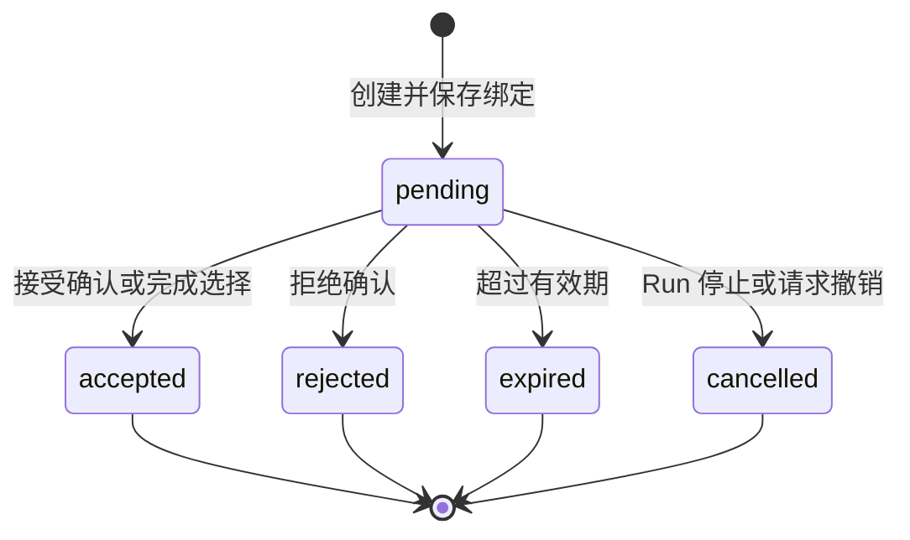

# EnterpriseMind V1 工具参数结构、风险等级与确认协议（确认稿）

> 状态：确认稿  
> 日期：2026-09-12  
> 上游依据：《需求说明书》《系统总体架构设计》《数据库表设计》《数据库关系与约束设计》《API 接口与错误码设计》《智能体编排状态与检查点设计》

## 1. 目的与边界

本文档只定义 EnterpriseMind V1 的 Tool Registry、参数结构、服务端校验、结果信封、风险分级、对象消歧和二次确认协议。所有能力必须复用既有 API、领域服务、数据库表和 LangGraph 状态，不新增业务功能。

本阶段明确不增加：

- 独立搜索、SQL、Shell、代码执行、任意 URL 抓取或通用文件系统 Tool；
- 外部 Tool 市场、插件安装、跨知识库移动、复杂 ACL 或审批流；
- 新的 Run、Tool Call 或 Pending Action 状态；
- 第七种高风险操作或三级以上风险模型；
- 操作日志、安全事件、SQL 审计或 Tool 调用历史页面；
- 由 LLM 直接指定用户身份、权限、风险等级、数据库 SQL、MinIO Object Key、Secret 或服务端并发版本。

V1 中“Tool”只表示 Agent 可请求的受控业务能力。参数校验成功不代表有权执行，LLM 选择了 Tool 也不代表系统必须执行。

## 2. 协议和 Schema 基线

### 2.1 JSON Schema

Tool 的服务端标准输入、输出 Schema 固定采用 JSON Schema Draft 2020-12，并由代码中的 Tool Registry 管理。V1 不新建 Tool 定义表，也不允许运行时从数据库或用户输入动态注册 Tool。

每个 Tool 的标准 Schema 必须包含：

```text
$schema = https://json-schema.org/draft/2020-12/schema
$id = enterprise-mind://tools/{tool_name}/{input|output}/v{schema_version}
type = object
additionalProperties = false
```

FastAPI/Pydantic 模型可以作为实现载体并生成 JSON Schema，但服务端标准 Schema 和语义校验才是最终依据。发送给不同 LLM Provider 的 Function Calling Schema 是标准 Schema 的兼容投影；Provider 接受调用不等于服务端校验通过。

### 2.2 LangChain 与 LangGraph 边界

- LangChain 只承担 Tool Schema、模型 Tool Calling 消息和 Provider 适配。
- EnterpriseMind 使用自有 Tool Gateway 执行参数校验、对象解析、权限、风险、确认、幂等和领域调用。
- 不使用 LangChain 默认 Agent 替代既定 LangGraph。
- LangGraph State 只保存 Tool Call ID 等最小标识，不能保存本协议中的原始结果正文。

### 2.3 Database MCP

V1 的 Database MCP 适配协议以 MCP `2026-07-28` 版本的 Tool 合同为基线；MCP `inputSchema`、可选 `outputSchema` 使用 JSON Schema 2020-12。客户端和服务端使用无协议级会话的现行请求模型，每个请求携带协议版本、客户端身份与能力元数据。

MCP 的 `readOnlyHint`、`destructiveHint` 等 annotation 只能作为展示或兼容提示，不能作为 EnterpriseMind 的鉴权或风险依据。Database MCP 即使声明只读，也仍必须经过 EnterpriseMind SQL Guard，并由 MCP Server 使用只读数据库账号再次限制。

内部文档、文件夹、知识库和 Memory Tool 不对外发布为 MCP Tool；V1 只有企业业务数据库通过独立 Database MCP Server 接入。

## 3. 信任边界与职责

| 层级 | 可以决定 | 不可以决定 |
|---|---|---|
| LLM | 选择已暴露 Tool，生成模型可见业务参数 | 身份、权限、风险、确认结果、并发版本、SQL 安全结论 |
| Tool Registry | Tool 名称、Schema、权限动作、风险解析器、结果策略 | 用户当前是否有权访问某个对象 |
| Tool Gateway | 校验、规范化、对象解析、鉴权、风险、确认、幂等和结果裁剪 | 绕过领域不变量直接修改数据 |
| AuthorizationService | 当前用户可访问和可管理范围 | 信任历史权限摘要替代实时鉴权 |
| 领域服务 | 事务、名称唯一性、`row_version`、Outbox 和业务状态流转 | 信任模型参数直接写库 |
| Database MCP/SQL Guard | 受控 Schema 和只读查询 | 暴露无权限 Schema 或执行写操作 |

用户输入、LLM 参数、Tool 返回文本、RAG 文本、数据库字符串字段和 MCP 返回内容均视为不可信数据。Tool 返回内容只能作为数据进入后续推理，不得被解释为系统指令。

## 4. Tool Registry

### 4.1 Tool 定义

每个注册项至少包含：

```text
name
title
description
schema_version
input_schema
output_schema
required_permission
risk_resolver
persistence_projection
result_projection
retry_policy
```

这些字段保存在 Git 管理的代码和配置中，不写入 PostgreSQL。`required_permission` 和 `risk_resolver` 必须引用服务端固定实现，不能是可由模型生成的表达式。

### 4.2 命名与版本

- Tool 名使用小写 ASCII `snake_case`，必须匹配 `[a-z][a-z0-9_]{2,63}`。
- `schema_version` 从 `1` 开始。
- 增加可选字段且不改变既有语义时可保持 Tool 名；删除字段、改变必填含义或改变结果语义时必须发布新版本，不能让暂停中的 Run 误用新合同。
- Tool 名一旦进入生产 Checkpoint，不在仍可能恢复的 Run 存续期间删除或改名。
- 描述只说明用途和参数，不包含 Prompt、内部表名、无权限对象或 Secret。

### 4.3 动态暴露

绑定给模型的 Tool 集合必须由服务端按当前身份和已启用能力裁剪：

1. 普通用户不接收管理员 Tool Schema。
2. 用户或部门停用时不绑定任何业务 Tool。
3. Database MCP 未配置、停用或无 active Schema 快照时，不绑定 `database_query`。
4. 只在用户明确要求图表时允许计划 `artifact_generate` 的 `artifact_type = chart`。
5. 动态隐藏只减少模型误选，不能替代执行前鉴权。

管理员角色只扩展知识库、用户、部门和 Database MCP 的管理范围，不自动获得其他用户的会话、Memory、生成物或其 Tool 结果访问权。

## 5. 统一调用信封

### 5.1 模型可见参数

模型只生成 `tool_name` 和该 Tool 的业务 `arguments`。模型不能看到或提交运行控制字段。

### 5.2 服务端运行时信封

Tool Gateway 在模型参数校验后组装：

```json
{
  "tool_call_id": "1842",
  "agent_run_id": "391",
  "tool_name": "document_update",
  "schema_version": 1,
  "arguments": {},
  "actor_user_id": "27",
  "permission_scope_version": "...",
  "idempotency_key": "...",
  "pending_action_id": null,
  "request_id": "..."
}
```

规则：

- API 和 JSON 中的所有 `bigint` ID 都以十进制字符串传输。
- `actor_user_id`、`agent_run_id`、`permission_scope_version`、`idempotency_key`、`pending_action_id` 和 `request_id` 均由服务端注入。
- `row_version` 由对象解析器读取并进入执行上下文或确认目标快照，不接受模型自行填写。
- `confirmation_id` 统一使用现有 `pending_action_id`，不再建立第二套确认标识。
- Database MCP 的 SQL 只存在于当前进程的专用运行时对象，不放入上述可序列化信封。

## 6. 公共参数类型

### 6.1 资源选择器

模型可用以下受限结构描述一个对象：

```json
{
  "id": "123",
  "name": "季度报告.pdf",
  "path": "/财务/2026",
  "knowledge_base_id": "8"
}
```

约束：

- `id`、`name`、`path` 至少提供一项；提供服务端此前返回的精确 ID 时优先按 ID 定位。
- `knowledge_base_id` 只用于收窄搜索范围，不能扩大权限。
- `path` 是知识库内展示路径，不是操作系统路径或 MinIO Object Key。
- 修改操作若未得到唯一目标，必须进入消歧，不能取第一条结果。
- 对象解析查询本身必须注入当前可见范围，只生成已授权候选；其后的权限检查仍是执行前的最终判定。
- 服务端解析成功后，执行参数只使用确定的资源 ID 和当前版本，不把模糊文本直接交给 Repository。

### 6.2 暂存文件选择器

Agent 消息附件先经过既有上传校验并产生服务端 `staged_upload_id`。文件类 Tool 只能引用该十进制字符串 ID，不能接收：

- 本地路径、网络路径或任意 URL；
- Bucket、Object Key 或签名下载地址；
- Base64 文件正文；
- 模型声称的 MIME、文件摘要或扫描结果。

### 6.3 分页与集合

- 数组必须定义最大长度和元素唯一性；未定义上限的数组不得进入 Tool Schema。
- 页大小由服务端设置上限；Database MCP 普通查询最终最多返回 100 行。
- 分页游标只能使用服务端签发值，不能由模型拼接偏移、SQL 或过滤表达式。
- 有顺序语义的数组保留顺序；声明为集合的字段规范化后排序去重。

## 7. 参数校验与规范化

Tool Gateway 按以下固定顺序处理：

```text
解析模型 Tool Call
→ 按标准 JSON Schema 校验
→ 语义和长度校验
→ 字符串与集合规范化
→ 对象解析与消歧
→ 生成确定参数和目标快照
→ 读取当前权限
→ 计算风险等级
→ 必要时创建 Pending Action
→ 幂等检查
→ 领域服务执行
→ 结果校验与裁剪
→ 更新 Tool Call
```

规范化规则：

- 拒绝未知字段、未知枚举、非有限数字、超长字符串和非法 ID。
- 不用字符串自动猜测布尔值、日期、ID 或枚举；类型不符直接返回 `VALIDATION_ERROR`。
- 用户可见名称保留原值；唯一性比较值由领域服务执行 NFKC、首尾空白处理和 casefold。
- 名称、描述和文本在校验后再做输出编码，不能依赖前端转义。
- Schema 默认值先应用，再产生规范化参数。
- JSON 对象键顺序不影响摘要；数组除非声明为集合，否则顺序参与摘要。
- JSON Schema 通过后仍必须执行同库移动、目录无环、状态可操作、文件格式、Memory Guard 等领域校验。

## 8. V1 Tool 清单

下表是 V1 允许注册的 Agent Tool。内部对象解析器、AuthorizationService、SQL Guard、结果裁剪器和 Outbox Dispatcher 是实现组件，不是模型可调用 Tool。

### 8.1 知识、数据库与生成物

| Tool | 主要模型参数 | 权限 | 风险 |
|---|---|---|---|
| `knowledge_retrieve` | 问题；可选知识库、文件夹、文档和格式范围 | 当前可访问范围 | `low` |
| `database_query` | 当前自然语言查询、可选页码和页大小 | 当前可查询关系交集 | `low` |
| `artifact_generate` | 任务类型、生成物类型、格式、标题、生成要求、当前 Run 的来源引用；翻译语言或图表类型按任务提供 | 只能生成自己的生成物 | `low` |
| `artifact_save` | 生成物 ID、目标知识库/文件夹、名称、描述 | 生成物所有者且可管理目标库内容 | `high` |

`artifact_generate.task_kind` 只允许 `summary`、`comparison`、`induction`、`content_generation`、`translation`、`translation_summary`、`chart` 和 `database_export`。生成物类型只允许既有 `document`、`spreadsheet`、`chart`、`database_export`：文档输出只允许 DOCX、PDF、Markdown，普通表格输出只允许 XLSX，图表及其数据导出只允许 PNG、PDF、XLSX、CSV，数据库导出只允许 XLSX、CSV；图表类型只允许 `bar`、`line`、`pie`、`table`。翻译任务只支持中文、英文及中英互译，可指定整篇文档或既有来源锚点限定的章节，并必须保留原始来源引用。数据库导出只能引用当前 Run 的 Database Tool 结果，结果行直接写入 MinIO，不经过 LLM Context。未明确要求图表时不得把普通分析自动转为图表任务。

`database_query` 对管理员使用当前 active Schema 中全部已启用全局白名单关系；普通用户还必须与其 active 部门授权取交集。两者都不得绕过 SQL Guard。

### 8.2 文档

| Tool | 主要模型参数 | 权限 | 风险 |
|---|---|---|---|
| `document_upload` | 暂存上传 ID 集合、目标库、文件夹、显示名称、描述 | 可管理目标库内容 | `low` |
| `document_update` | 文档选择器；名称、描述或同库文件夹 | 可管理所属库内容 | `low` |
| `document_delete` | 文档选择器 | 可管理所属库内容 | `high` |
| `document_restore` | 文档选择器 | 可管理所属库内容 | `low` |
| `document_purge` | 回收站文档选择器 | 可管理所属库内容 | `high` |
| `document_overwrite` | 文档选择器、一个暂存上传 ID | 可管理所属库内容 | `high` |
| `document_retry_processing` | 文档选择器 | 可管理所属库内容 | `low` |

`document_update` 只能改变名称、描述和同知识库 `folder_id`。文件类型、上传人、处理状态、代次、Chunk、Embedding 和 Object Key 不出现在 Tool Schema 中。

### 8.3 文件夹

| Tool | 主要模型参数 | 权限 | 风险 |
|---|---|---|---|
| `folder_create` | 知识库、父文件夹、名称 | 可管理目标库内容 | `low` |
| `folder_update` | 文件夹选择器；名称或同库父文件夹 | 可管理所属库内容 | `low` |
| `folder_delete` | 文件夹选择器 | 可管理所属库内容 | 空目录 `low`，非空目录 `high` |
| `folder_restore` | 回收站文件夹选择器 | 可管理所属库内容 | `low` |
| `folder_purge` | 回收站文件夹选择器 | 可管理所属库内容 | `high` |

文件夹和文档移动都只能修改同一知识库内的父级。Tool Schema 不提供目标知识库变更字段。

### 8.4 知识库

| Tool | 主要模型参数 | 权限 | 风险 |
|---|---|---|---|
| `knowledge_base_create` | 名称、类型、描述、部门知识库的部门 | 管理员 | `low` |
| `knowledge_base_update` | 知识库选择器；名称、描述或部门归属 | 管理员 | `low` |
| `knowledge_base_delete` | 知识库选择器 | 管理员 | `high` |
| `knowledge_base_restore` | 回收站知识库选择器 | 管理员 | `low` |
| `knowledge_base_purge` | 回收站知识库选择器 | 管理员 | `high` |

`knowledge_base_update` 只允许部门知识库迁移部门，不支持公共知识库与部门知识库互转。

### 8.5 Memory

| Tool | 主要模型参数 | 权限 | 风险 |
|---|---|---|---|
| `memory_list` | 可选分类、服务端分页游标 | 当前用户自己的 Memory | `low` |
| `memory_create` | 分类、内容 | 当前用户 | `low` |
| `memory_update` | Memory 选择器、分类或内容 | 所有者 | `low` |
| `memory_delete` | Memory 选择器 | 所有者 | `low` |

Memory 写入必须经过 Memory Guard；密码、Token、API Key、高度敏感个人信息和企业敏感知识原文不得写入。删除 Memory 不创建二次确认，因为它不在已确认的六类高风险操作中。

`memory_create` 用于用户明确要求“记住”的场景。系统自动提取不是模型可调用 Tool，也不创建 `tool_calls` 或 Pending Action：本轮回答成功生成后，只从当前用户消息提取长期稳定的偏好、工作上下文或持续任务上下文，以 `source_type = automatic` 写入。候选先经过 Memory Guard，再按用户、`content_fingerprint` 和非空 `memory_key` 去重；内容相同则不写，稳定键相同但内容变化时锁定并更新原 Memory。自动提取失败不改变回答终态，受限内容不得进入日志或错误摘要。

### 8.6 管理员系统操作

| Tool | 主要模型参数 | 权限 | 风险 |
|---|---|---|---|
| `user_update` | 用户选择器；用户名、角色、部门或状态，不含密码 | 管理员 | `low` |
| `department_create` | 名称、状态 | 管理员 | `low` |
| `department_update` | 部门选择器；名称或状态 | 管理员 | `low` |
| `department_delete` | 部门选择器 | 管理员且无用户、无知识库引用 | `low` |
| `database_source_create` | 非密钥连接信息、受控 Secret 引用、状态 | 管理员且尚未配置数据源 | `low` |
| `database_source_update` | 可修改的非密钥连接信息、受控 Secret 引用、状态 | 管理员 | `low` |
| `database_schema_refresh` | 无模型自由参数 | 管理员 | `low` |
| `database_relation_policy_replace` | 关系选择器、启用状态、部门 ID 集合 | 管理员 | `low` |

V1 不提供密码、Token 或 Secret 内容作为 Agent Tool 参数，也不注册密码重置 Tool。管理员通过 Agent 发起“创建本地用户”或“重置用户密码”时，Agent 只返回对应管理页面的受控客户端动作：创建动作可预填用户名、角色、部门和状态等非敏感字段；重置动作只绑定服务端已重新鉴权的目标用户 ID、显示名和 `row_version`。管理员在专用页面直接输入密码并调用既有专用 API，密码不进入模型上下文、Tool 参数、Pending Action 或会话正文。`user_update` 也不允许修改密码。管理员 Tool 不提供模型配置、Prompt 管理、审计、第二数据源或行列级权限能力。

### 8.7 不作为 Agent Tool 的既有操作

- 会话新建、历史读取、重命名、当前 Run 停止/继续由前端和既有 API 完成。
- 会话删除由页面创建高风险 Pending Action，不把“删除当前承载 Run 的会话”建模为 Tool。
- 管理员重置用户密码由受控客户端动作打开专用页面，再由页面直交密码重置 API；该操作不创建 Agent Tool Call 或二次确认。
- 文件预览、生成物下载和回答来源定位由鉴权后的读取接口完成。

这样既保留需求中的会话管理和高风险确认，又避免执行 Tool 时级联删除其自身 Run、Tool Call 和 Pending Action。

## 9. 标准输入示例

以下是 `document_update` 的标准输入 Schema 摘要；其他 Tool 复用相同 ID、选择器、未知字段拒绝和服务端版本注入规则。

```json
{
  "$schema": "https://json-schema.org/draft/2020-12/schema",
  "$id": "enterprise-mind://tools/document_update/input/v1",
  "type": "object",
  "required": ["target", "changes"],
  "properties": {
    "target": {
      "type": "object",
      "properties": {
        "id": {"type": "string", "pattern": "^[1-9][0-9]*$"},
        "name": {"type": "string", "minLength": 1, "maxLength": 500},
        "path": {"type": "string", "minLength": 1, "maxLength": 2000},
        "knowledge_base_id": {"type": "string", "pattern": "^[1-9][0-9]*$"}
      },
      "additionalProperties": false,
      "anyOf": [
        {"required": ["id"]},
        {"required": ["name"]},
        {"required": ["path"]}
      ]
    },
    "changes": {
      "type": "object",
      "minProperties": 1,
      "properties": {
        "name": {"type": "string", "minLength": 1, "maxLength": 500},
        "description": {"type": ["string", "null"], "maxLength": 4000},
        "folder_id": {
          "anyOf": [
            {"type": "string", "pattern": "^[1-9][0-9]*$"},
            {"type": "null"}
          ]
        }
      },
      "additionalProperties": false
    }
  },
  "additionalProperties": false
}
```

该 Schema 不含 `row_version`、`actor_user_id`、目标知识库变更、处理状态或 Object Key。服务端定位文档后读取当前 `row_version`，再执行权限和同库校验。

## 10. 标准结果信封

Tool 适配层必须按输出 Schema 返回当前进程内的统一结果：

```json
{
  "ok": true,
  "code": "OK",
  "data": {},
  "warnings": [],
  "source_refs": []
}
```

失败示例：

```json
{
  "ok": false,
  "code": "RESOURCE_NOT_FOUND",
  "data": null,
  "warnings": [],
  "source_refs": []
}
```

规则：

- `code` 使用《API 接口与错误码设计》的稳定错误码，不把异常类名直接返回模型。
- `data` 只含完成当前推理所需的授权字段，并设置字段、条数和文本长度上限。
- `warnings` 只说明截断、局部来源失败或结果限制，不引入新的 Tool 状态。
- `source_refs` 只使用来源 ID 和安全定位元数据；最终引用仍由 `answer_sources` 持久化。
- Tool Call 持久状态仍严格是 `pending`、`waiting_confirmation`、`running`、`success`、`failed`、`cancelled`。
- Database MCP 的 `data` 可在当前进程内包含授权结果行，但不得进入 Tool 表、Checkpoint、Redis 持久数据、日志、指标或 SSE。
- 未通过输出 Schema 的适配器结果按 `TOOL_EXECUTION_FAILED` 处理，不能把原始内容直接交给模型。

## 11. 参数与结果的持久化投影

`agent.tool_calls` 是执行恢复和幂等状态，不是审计日志。运行时参数与 `tool_calls.arguments` 不是无条件一比一复制。

### 11.1 允许持久化

- 已确定的资源 ID、目标父级 ID、类别、格式、状态枚举和服务端分页控制字段；
- 非敏感名称、描述和修改字段；
- 暂存上传 ID、生成物 ID、Schema 快照 ID 和关系策略 ID；
- 为恢复和幂等所需的受控内容指纹，但不保存对应敏感正文。

### 11.2 禁止持久化

- 密码、Token、API Key、Secret 内容和签名 URL；
- Database MCP SQL、SQL 摘要、结果行、列值和数据库凭据；
- 模型 Prompt、内部推理、异常栈和未经权限过滤的 Schema；
- Memory 内容在 Tool Call 中的副本；
- 生成文件正文、数据库导出数据或完整 RAG Chunk 正文。

Memory 内容只写入 `memory_items.content`，生成文件正文只写入 MinIO，数据库结果只保留在当前进程或明确生成的 MinIO 导出文件。

### 11.3 Database MCP 投影

`database_query` 的运行时输入可包含当前问题和临时 SQL，但 `tool_calls.arguments` 只保留：

```text
database_source_id
schema_snapshot_id
page_size
page_index
```

`result_summary` 只保留：

```text
ok
row_count
has_more
error_code（如有）
```

问题正文从当前用户消息重新读取；恢复时根据当前问题、当前权限和当前 active Schema 快照重新生成 SQL。

## 12. 参数摘要与幂等键

### 12.1 规范化摘要

非 Database MCP Tool 的 `arguments_hash` 计算顺序为：

1. 完成 JSON Schema 和语义校验；
2. 应用默认值并把所有业务 ID 转为十进制字符串；
3. 用已解析的精确目标 ID 替换模糊选择器；
4. 移除明确禁止持久化的字段，并按 Tool 的 `persistence_projection` 加入必要指纹；
5. 对 JSON 执行 RFC 8785 JSON Canonicalization Scheme；
6. 计算 SHA-256，小写十六进制结果写入 `arguments_hash`。

RFC 8785 不替代业务字符串规范化。名称摘要同时包含保留展示语义的校验后 `name` 和用于唯一比较的 NFKC、trim、casefold 后 `name_key`；大整数始终作为字符串参与规范化，避免 JavaScript 数字精度问题。

Database MCP 的摘要只基于允许持久化的控制字段，禁止以 SQL、SQL 摘要或结果行计算。

### 12.2 幂等键

Agent Tool 的 `idempotency_key` 由服务端根据 Run、计划步骤、Tool 名、Schema 版本和参数摘要生成，模型不能提交。恢复或重放同一逻辑步骤必须复用原键；重新规划产生的新逻辑步骤使用新键。

领域服务在业务事务内使用该键或已有唯一约束防止重复副作用。`tool_calls(actor_user_id, idempotency_key)` 唯一；幂等命中时返回原逻辑调用状态，不增加 Tool Call 计数。

## 13. 风险等级

V1 风险等级只有 `low` 和 `high`。`low` 只表示无需二次确认，不表示无需鉴权、参数校验、`row_version` 或幂等保护。

### 13.1 封闭的高风险清单

| 已确认的业务操作 | 对应 Tool/入口 | 风险判定 |
|---|---|---|
| 删除文档或知识库 | `document_delete`、`knowledge_base_delete`，以及对应 API | 固定 `high` |
| 删除非空文件夹 | `folder_delete`，以及对应 API | 解析并锁定目录后发现非空才为 `high`；空目录为 `low` |
| 删除会话 | 会话删除 API | 固定 `high` |
| 手动永久删除回收站内容 | `document_purge`、`folder_purge`、`knowledge_base_purge`，以及对应 API | 固定 `high` |
| 覆盖同名文档 | `document_overwrite`，以及对应 API | 固定 `high` |
| 将 Agent 生成内容写入知识库 | `artifact_save`，以及对应 API | 固定 `high` |

除这六类外，V1 不创建确认。特别是重命名、同知识库移动、恢复、普通上传、失败处理重试、Memory 删除、部门删除、管理员重置用户密码和管理员配置修改均为 `low`。

### 13.2 风险解析器

- 固定风险写在 Tool Registry，模型参数中没有 `risk_level`。
- `folder_delete` 是唯一条件风险 Tool；判定必须在同一知识库事务视图中读取当前子文件夹和文档，不能依据模型描述。
- 风险解析器未知、超时或返回非法值时拒绝执行，不能降级为 `low`。
- MCP annotation、Tool 名中的动词和模型自评风险都不能覆盖本表。

## 14. 对象消歧协议

### 14.1 何时进入消歧

- 精确 ID 不存在、已删除或无权限时返回 `RESOURCE_NOT_FOUND`，不泄露对象是否真实存在。
- 名称、路径、描述或正文解析出多个高相关授权候选时创建 `disambiguation` Pending Action。
- 修改、移动、删除、覆盖和重命名操作不得自动选择多个候选中的第一项。
- Database MCP 的关键查询条件存在多个合理解释时也使用 `disambiguation`，用户选择前不生成并执行猜测 SQL。

候选只来自当前用户已获授权的对象，最多返回 10 个。展示字段限制为候选 ID、类型、名称、知识库、展示路径和必要的安全摘要，不返回完整正文或无权限父级信息。

### 14.2 消歧响应

客户端只能提交一个服务端返回的候选 ID：

```json
{
  "selected_target_id": "123"
}
```

服务端必须验证该 ID 位于当前 Pending Action 的候选集合中。选择成功后原消歧记录变为 `accepted`，Run 回到 `plan`，重新解析参数并重新鉴权。

如果最终操作属于高风险，消歧选择不视为风险确认；原消歧结束后必须创建独立的 `confirmation` Pending Action。同一 Run 同时只允许一个 `pending` 记录。

## 15. 确认绑定

### 15.1 绑定载荷

高风险确认必须绑定下列服务端确定数据：

```json
{
  "binding_version": 1,
  "operation_name": "document_delete",
  "tool_name": "document_delete",
  "tool_schema_version": 1,
  "actor_user_id": "27",
  "permission_scope_version": "...",
  "arguments": {},
  "targets": [],
  "expires_at": "2026-09-12T10:15:00Z"
}
```

`binding_hash` 对该载荷执行 RFC 8785 规范化后计算 SHA-256。API 来源没有 Tool Call 时，`tool_name` 为 `null`，但 `operation_name` 必须存在。

`expires_at` 参与绑定。V1 默认有效期为 15 分钟，由统一配置项 `agent.pending_action_ttl_seconds = 900` 控制；创建后不延长。用户响应时服务端以数据库时间判断是否过期。

### 15.2 目标绑定

`pending_action_targets` 对每个根目标保存资源类型、ID、展示名称、当前 `row_version` 和安全快照。不同操作至少绑定：

| 操作 | 必须进入绑定的目标状态 |
|---|---|
| 文档删除 | 文档 ID、知识库 ID、路径、`row_version`、当前回收状态 |
| 知识库删除 | 知识库 ID、类型、部门、`row_version`、当前活跃子项数量和子树摘要 |
| 非空文件夹删除 | 文件夹 ID、路径、`row_version`、受影响文件夹/文档数量和子树摘要 |
| 会话删除 | 会话 ID、标题、`row_version`、当前消息序号快照 |
| 手动永久删除 | `deletion_batch_id`、根对象、批次状态、批次成员数量和范围摘要 |
| 文档覆盖 | 文档 ID 与 `row_version`、暂存上传 ID、文件摘要、名称和目标路径 |
| 生成物写入知识库 | 生成物 ID、`ready` 状态、存储对象摘要、目标知识库/文件夹 ID 与版本、最终名称 |

知识库、非空目录和永久清理可能包含大量后代，V1 不为每个后代创建一条 Pending Target。事务内按稳定 ID 顺序对授权范围中的 `(resource_type, resource_id, row_version, recycle_state)` 计算子树摘要，并把数量和摘要写入根目标快照；接受确认时重算。新增、删除、移动或版本变化都会让原确认失效。

### 15.3 展示文本

确认提示必须由服务端模板生成，明确展示动作、目标、影响范围、是否进入回收站或永久删除、覆盖时旧内容切换语义，以及到期时间。LLM 自由文本不能成为唯一确认提示。

提示不得包含：

- 无权限候选或其路径；
- Secret、SQL、结果行、签名 URL；
- 文档全文、Memory 正文或生成物正文；
- 模型内部理由或风险自评。

## 16. Pending Action 来源与字段协议

Pending Action 同时服务 Agent 和既有资源 API，使用同一张表但区分来源：

| 字段 | Agent 来源 | API 来源 |
|---|---|---|
| `origin` | `agent` | `api` |
| `operation_name` | 等于 Tool 对应领域操作名 | 等于资源接口的领域操作名 |
| `agent_run_id` | 必填 | 空 |
| `tool_call_id` | 高风险确认必填；消歧可空 | 空 |
| `actor_user_id` | 当前 Run 用户 | 当前认证用户 |
| `idempotency_key` | 服务端 Tool 幂等键派生 | HTTP `Idempotency-Key` |

这样页面调用 `*-requests` 时不需要伪造会话、消息或 Agent Run。API 来源只用于路径中已有精确资源 ID 的高风险确认，不创建对象消歧；模糊自然语言定位仍由 Agent 处理。

同一 `(actor_user_id, idempotency_key)` 只能创建一个 Pending Action。Agent 来源还必须满足同一非空 `agent_run_id` 同时最多一个 `status = pending` 的记录。

表中的 `idempotency_key` 用于“创建 Pending Action”的幂等。响应接口使用新的 HTTP `Idempotency-Key`；第一次解析时把该键、决策和可选候选 ID 一并写入 `response`。同一响应键重试返回原结果，已解析记录收到不同响应键时返回 `PENDING_ACTION_RESOLVED`。

## 17. Pending Action 状态机



状态只允许从 `pending` 解析一次。确认响应体只能是：

```json
{"decision": "accepted"}
```

或：

```json
{"decision": "rejected"}
```

处理步骤：

1. 按 ID 锁定 Pending Action。
2. 校验绑定用户、`origin`、状态、有效期和响应接口的 HTTP 幂等键。
3. 重新读取当前用户、部门、权限和目标。
4. 重算规范化参数、目标快照和 `binding_hash`。
5. 任一变化则不执行，记录解析为 `cancelled`，返回 `PENDING_ACTION_BINDING_CHANGED`。
6. Agent 来源接受时只在响应事务中把记录解析为 `accepted`；随后唤醒原 Run，`guard_plan` 再次鉴权并复核绑定，由 `execute_tool` 执行领域命令。确认已接受不等于 Tool 已成功。
7. API 来源没有 Run，接受时在同一 PostgreSQL 事务中完成状态 `accepted`、绑定领域变更和必要 Outbox 写入；任一步失败则整体回滚，Pending Action 保持可安全重试的原状态。
8. 拒绝时不执行领域命令。Agent Run 恢复并正常回答“未执行”；API 直接返回拒绝结果。

到期任务由现有 Scheduler 原子设置 `expired`。Agent 来源唤醒对应中断并让 Run 失败；API 来源不创建 Run，只在后续读取或响应时返回过期状态。

## 18. 高风险操作执行细则

### 18.1 删除与永久清理

- 文档和知识库删除确认后创建 `deletion_batch` 并进入 30 天回收站。
- 空文件夹删除在服务端锁定后仍为空时直接执行；执行前变为非空则重新判为 `high` 并创建确认。
- 非空文件夹确认绑定其当前子树；范围变化后原确认失效。
- 会话删除只通过页面 API 确认，成功后物理级联删除会话聚合，并由既有 Outbox 清理关联 Checkpoint。
- 手动永久删除只作用于已在回收站的现有批次；确认后批次状态和成员变化时拒绝执行。
- 到期自动清理是既有保留策略，不是用户发起的 Tool，不再次创建 Pending Action。

### 18.2 覆盖同名文档

确认只授权创建绑定文件的新处理代次，不授权立即替换 RAG 内容：

1. 覆盖候选在确认前保持隔离暂存状态。
2. 接受时复核文档版本、文件摘要、名称、路径和权限。
3. 创建新代次后旧 `active_revision_id` 保持不变。
4. 新代次完整成功或达到可激活 `partial_success` 条件后原子切换。
5. 切换成功后旧内容退出；新代次失败时继续使用旧内容。

### 18.3 生成物写入知识库

- 确认前生成物必须为当前用户所有且状态为 `ready`。
- 确认绑定生成物存储摘要、目标知识库/文件夹和最终文档名称。
- 接受后才创建正式文档和处理任务；生成物本身不是已索引文档。
- 目标名称冲突或生成物变化时返回绑定变化或名称冲突，不自动改名或覆盖。

## 19. 并发、恢复与重试

- 创建和响应 Pending Action 都必须在取得同一 Run advisory lock 后执行；API 来源使用目标领域锁和 Pending Action 行锁。
- Tool 执行前把状态从 `pending` 或 `waiting_confirmation` 原子转为 `running`；已 `success` 的同一幂等调用不重复执行。
- 权限拒绝、参数错误、对象消歧、确认拒绝、绑定变化、`row_version` 冲突和 SQL Guard 拒绝均不自动重试。
- 临时网络错误、超时、限流和允许重试的部分上游 5xx 才进入既定最多 3 次 Tool Retry。
- 高风险 Tool 重试必须复用同一已接受确认，并再次验证其绑定仍有效；改变参数或目标必须创建新确认。
- Database MCP 恢复重放不复用旧 SQL 或结果；重新生成、Guard 和只读执行，但不增加逻辑 Tool Call 和 Retry 计数。
- 无依赖的低风险 Tool 可按既定波次并行；进入 Pending Action 后整个 Run 变为 `waiting_confirmation`，等待期间不再启动新 Tool。
- 同一计划包含多个高风险或多个待消歧调用时，按计划顺序逐个处理，每次只创建一个 Pending Action；不得把不同业务操作合并成一次确认，也不得并行弹出多个确认。

## 20. 错误映射

| 阶段 | 稳定错误码 | 行为 |
|---|---|---|
| JSON 无法解析 | `INVALID_REQUEST` | 不创建 Tool Call |
| Schema 或语义不合法 | `VALIDATION_ERROR` | Tool 失败，不执行领域操作 |
| 无权限或对象不可见 | `PERMISSION_DENIED` / `RESOURCE_NOT_FOUND` | 不泄露无权限对象详情 |
| 多个候选 | `OBJECT_AMBIGUOUS` | 创建消歧 Pending Action |
| 名称、目录或状态冲突 | `NAME_CONFLICT`、`DOCUMENT_NAME_CONFLICT`、`FOLDER_CYCLE` 等 | 返回既有领域错误 |
| 并发版本变化 | `ROW_VERSION_CONFLICT` | 不自动覆盖 |
| 确认已处理、过期或绑定变化 | `PENDING_ACTION_RESOLVED`、`PENDING_ACTION_EXPIRED`、`PENDING_ACTION_BINDING_CHANGED` | 不执行或不重复执行 |
| 响应值不合法 | `PENDING_ACTION_RESPONSE_INVALID` | Pending Action 保持 `pending` |
| SQL Guard 拒绝 | `DATABASE_QUERY_REJECTED` | 不重试，不向模型暴露被拒绝 SQL |
| Tool 最终失败 | `TOOL_EXECUTION_FAILED` | 可基于其他成功来源继续并说明局限 |
| 达到次数上限 | `RUN_LIMIT_REACHED` | 不再创建调用或重规划 |

模型可以看到安全错误码和面向用户的简短消息，不能看到异常栈、SQL、凭据、内部网络地址或未经授权的资源标识。

## 21. 数据最小化与无审计边界

- `tool_calls`、`pending_actions` 和 `pending_action_targets` 只保存当前执行、恢复、幂等和确认所需状态，不承担审计查询能力。
- V1 不新增 Tool 历史、确认历史、操作日志、安全事件或 SQL 历史接口。
- 服务日志只记录请求 ID、Tool 名、状态、耗时、错误分类和脱敏计数；不得记录模型参数全文、结果正文、SQL、数据库行、Memory、Token 或 Secret。
- 指标只使用聚合计数和耗时分布，不使用用户问题、资源名称或业务字段作为标签。
- Pending Action 和 Tool Call 的清理服从业务 Run、会话和恢复需要，不复制到长期审计表。

## 22. 验收用例

| 场景 | 必须满足的结果 |
|---|---|
| 模型伪造 `actor_user_id` 或 `risk_level` | Schema 拒绝未知字段，服务端值不被覆盖 |
| 模型提交系统路径、Object Key 或 URL 上传 | 参数校验失败，不访问目标 |
| 普通用户请求管理员 Tool | 模型不接收该 Tool；即使伪造调用也在 Gateway 被拒绝 |
| 修改对象名称有多个候选 | 创建消歧；不自动选择，不执行修改 |
| 消歧后目标为高风险 | 结束消歧后另建确认，不能一次点击同时完成两步 |
| 删除空文件夹 | 当前事务确认仍为空后直接进入回收站，无 Pending Action |
| 删除非空文件夹 | 绑定子树数量和摘要，接受后范围未变才执行 |
| 确认等待期间新增子项 | 返回 `PENDING_ACTION_BINDING_CHANGED`，不删除新增或原有对象 |
| 覆盖等待期间文件或目标变化 | 原确认失效，不自动替换新文件或新目标 |
| 覆盖处理失败 | 旧活跃代次继续参与 RAG |
| 生成物未 ready 或非本人所有 | 不创建写入知识库确认或不执行 |
| 会话删除 | 只走页面确认；成功后删除聚合并可靠清理 Checkpoint |
| API 页面创建确认 | `origin = api`，不创建虚假会话、消息或 Agent Run |
| 相同幂等键重试 | 返回同一 Pending Action 或 Tool Call，不重复创建和执行 |
| Database MCP 查询 | SQL 和结果行只在当前进程，持久化字段只有受控摘要 |
| MCP Tool 伪造安全 annotation | EnterpriseMind 仍按本地权限、风险和 SQL Guard 决策 |
| Tool 返回提示注入文本 | 作为不可信数据裁剪，不改变系统指令或调用权限 |
| 日志与指标扫描 | 不含 SQL、结果行、模型参数全文、Secret、Memory 或思维链 |

## 23. 本阶段确认结论

1. Tool 标准 Schema 使用 JSON Schema Draft 2020-12，定义由代码中的静态 Tool Registry 管理。
2. LangChain 只适配 Tool Calling，所有调用仍经过 EnterpriseMind Tool Gateway 和固定 LangGraph。
3. Database MCP 合同以 `2026-07-28` 协议版本为基线；MCP annotation 不作为安全依据。
4. ID、身份、权限版本、并发版本、风险和幂等键均由服务端控制。
5. V1 Agent Tool 清单封闭，不提供 SQL、Shell、URL 抓取、任意文件或跨知识库移动能力。
6. 风险仅有 `low` / `high`，高风险严格限定为需求已确认的六类操作。
7. 对象消歧先于高风险确认；选择候选不能替代确认。
8. 确认绑定 Tool/操作、规范化参数、用户、权限版本、目标版本、影响范围和有效期。
9. Pending Action 同时支持 `agent` 和 `api` 来源，页面确认不伪造 Agent Run。
10. Tool 表是功能状态而非日志；SQL、结果行、Secret、Memory 正文和生成文件正文不得复制进去。

## 24. 跨文档实现约束

本协议已与《数据库模式快照与 SQL 防护规则》（确认稿）对齐，并共同复用：

- `database_query` 不接受用户或模型提供的原始 SQL；
- 只向模型暴露当前权限交集内的 active Schema；
- SQL Guard 和 MCP Server 执行双重只读、对象、超时和行数限制；
- Database MCP 运行时参数与持久化投影严格分离；
- SQL、SQL 摘要和结果行不进入数据库业务表、Checkpoint、Redis 持久数据、日志、指标或 SSE；
- 恢复和连续追问都基于当前问题与当前 Schema 重新生成 SQL。

## 25. 官方依据

- [JSON Schema 规范与 Draft 2020-12](https://json-schema.org/specification)
- [JSON Schema Draft 2020-12](https://json-schema.org/draft/2020-12)
- [LangChain Tools](https://docs.langchain.com/oss/python/langchain/tools)
- [LangChain Models 与 Tool Calling](https://docs.langchain.com/oss/python/langchain/models)
- [MCP 2026-07-28 Tools 规范](https://modelcontextprotocol.io/specification/2026-07-28/server/tools)
- [MCP 2026-07-28 Schema](https://modelcontextprotocol.io/specification/2026-07-28/schema)
- [MCP JSON Schema 2020-12 说明](https://modelcontextprotocol.io/seps/2106-json-schema-2020-12)
- [RFC 8785 JSON Canonicalization Scheme](https://www.rfc-editor.org/rfc/rfc8785.html)
