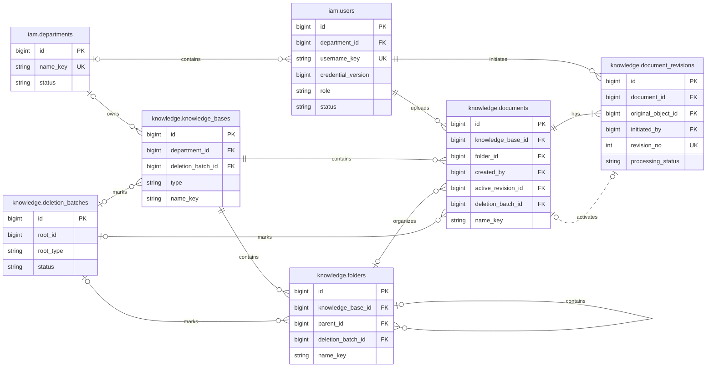
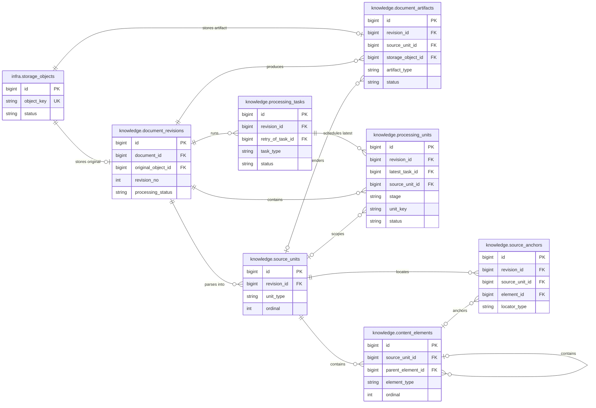
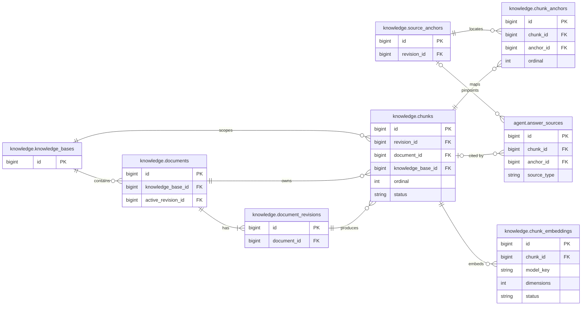
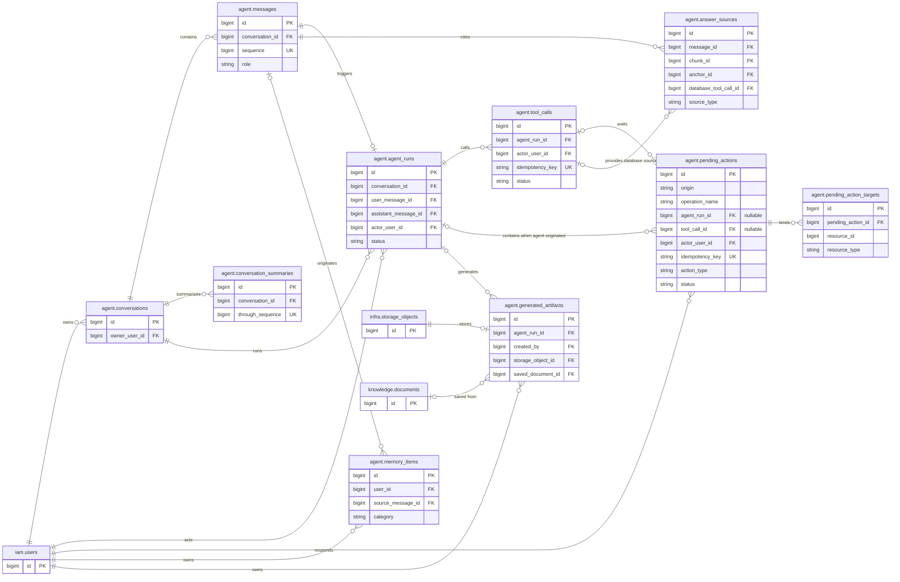
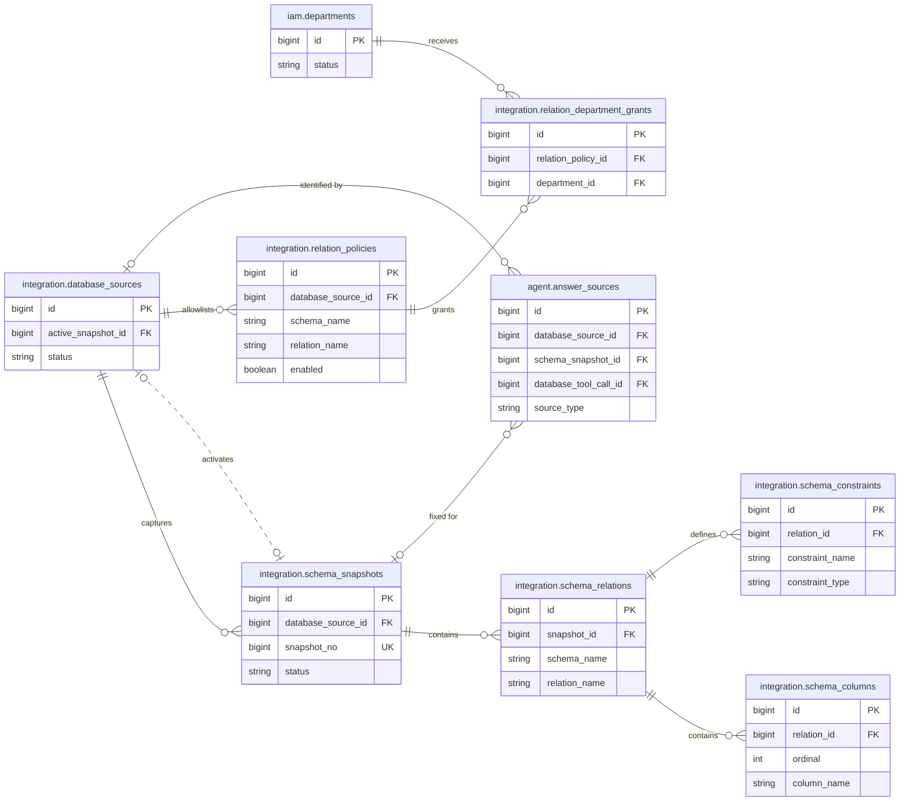
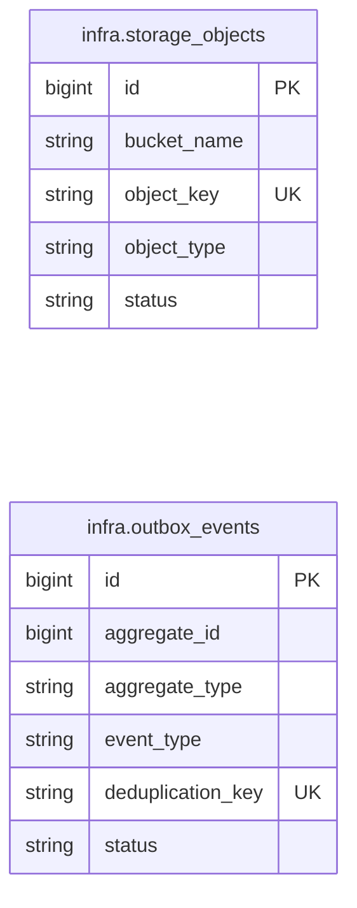

# EnterpriseMind V1 数据库关系与约束设计（确认稿）

## 1. 文档目的

本文档承接《数据库表设计》，确认 EnterpriseMind V1 的表间关系、约束类型和物理删除行为。

本稿严格使用已经确认的 35 张表：

- 不增加产品功能。
- 不增加操作审计、SQL 审计、登录会话或处理尝试历史表。
- 本文不嵌入 DDL 或迁移脚本；确认后的约束清单直接作为迁移生成输入。
- ER 图只展示已存在的表和实际需要的引用关系。
- 所有实体表和关联表均使用 `bigint GENERATED ALWAYS AS IDENTITY` 主键。

`langgraph_checkpoint` 由锁定版本的 LangGraph PostgreSQL Checkpointer 管理，不在本稿展开其内部关系。

## 2. 关系设计原则

### 2.1 数据库约束优先级

同一规则能由 PostgreSQL 可靠保证时，不只依赖应用代码：

1. 主外键保证对象引用存在。
2. 复合外键保证对象属于同一知识库、同一文档或同一来源单元。
3. 唯一约束保证用户名、目录内名称、处理单元和幂等键不重复。
4. `CHECK` 保证类型、状态、范围和条件字段合法。
5. 只有环检测、权限计算、SQL AST 校验等跨行或外部语义交给领域服务。

### 2.2 删除行为

本文中的外键删除行为只针对最终物理删除。进入回收站只是更新删除状态，不触发 `ON DELETE`。

| 行为 | 使用场景 |
|---|---|
| `RESTRICT` | 聚合根、权限主体、MinIO 对象等不能被意外级联删除的数据 |
| `CASCADE` | 只依附于父对象、没有独立产品生命周期的内部数据 |
| `SET NULL` | 父对象删除后仍需保留名称、引用片段或来源快照的历史业务记录 |
| `NO ACTION DEFERRABLE INITIALLY DEFERRED` | 同一事务会同时删除相互引用的内部记录，必须在事务结束时统一检查的数据 |

知识库、文件夹和文档永久清理必须由领域服务按“先清 MinIO、再清内部子表、最后清聚合根”的顺序执行，不能依赖一条顶层 `DELETE` 完成全部工作。

### 2.3 关系图说明

- 实线表示子记录依赖父记录存在。
- 虚线表示可选指针或运行时激活关系。
- 图中只列主键、关键外键、唯一键和状态字段；完整字段以《数据库表设计》为准。
- 为保证可读性，35 张表按领域拆成多张图，跨领域表会在相关图中重复出现。

## 3. 身份、知识库与文档关系



### 3.1 外键与删除行为

| 子表字段 | 父表字段 | 可空 | 物理删除行为 | 说明 |
|---|---|---:|---|---|
| `users.department_id` | `departments.id` | 是 | `RESTRICT` | 普通用户必填，管理员可空 |
| `knowledge_bases.department_id` | `departments.id` | 是 | `RESTRICT` | 仅部门知识库必填 |
| `knowledge_bases.deletion_batch_id` | `deletion_batches.id` | 是 | `RESTRICT` | 只在回收站中使用 |
| `folders.knowledge_base_id` | `knowledge_bases.id` | 否 | `RESTRICT` | 知识库需先清空再永久删除 |
| `folders.deletion_batch_id` | `deletion_batches.id` | 是 | `RESTRICT` | 恢复后清空 |
| `documents.knowledge_base_id` | `knowledge_bases.id` | 否 | `RESTRICT` | 文档不跨知识库移动 |
| `documents.created_by` | `users.id` | 否 | `RESTRICT` | 对应需求中的上传人元数据 |
| `documents.deletion_batch_id` | `deletion_batches.id` | 是 | `RESTRICT` | 恢复后清空 |
| `document_revisions.document_id` | `documents.id` | 否 | `CASCADE` | 内部代次随文档永久删除 |
| `document_revisions.initiated_by` | `users.id` | 否 | `RESTRICT` | 每次上传或覆盖的上传人 |

`documents.active_revision_id` 是循环引用，需在两张表创建后补充，并使用复合外键：

```text
(documents.active_revision_id, documents.id)
→ (document_revisions.id, document_revisions.document_id)
```

该约束可空，删除行为使用 `NO ACTION DEFERRABLE INITIALLY DEFERRED`，保证活跃代次一定属于当前文档，同时允许文档及其内部代次在同一清理事务中删除。`document_revisions` 需要额外唯一键 `(id, document_id)` 支持该复合外键。

`deletion_batches.root_id` 是删除根对象的类型化业务指针，不建立多态外键；领域服务必须按 `root_type` 校验对象。知识库、文件夹和文档上的 `deletion_batch_id` 才是数据库可校验的真实批次关系。

### 3.2 同知识库复合约束

以下关系不能只校验 ID 存在，还必须校验知识库一致：

| 子表字段 | 目标唯一键 | 物理删除行为 | 目的 |
|---|---|---|---|
| `(folders.parent_id, folders.knowledge_base_id)` | `folders(id, knowledge_base_id)` | `RESTRICT` | 父子目录属于同一知识库，目录需自底向上清理 |
| `(documents.folder_id, documents.knowledge_base_id)` | `folders(id, knowledge_base_id)` | `RESTRICT` | 文档目录属于同一知识库，空目录才能永久删除 |

`folders` 和 `documents` 均不提供修改 `knowledge_base_id` 的普通接口。V1 的移动操作只修改 `parent_id` 或 `folder_id`。

## 4. 文档处理与解析关系



### 4.1 外键与删除行为

| 子表字段 | 父表字段 | 可空 | 物理删除行为 |
|---|---|---:|---|
| `document_revisions.original_object_id` | `storage_objects.id` | 否 | `RESTRICT` |
| `document_artifacts.revision_id` | `document_revisions.id` | 否 | `CASCADE` |
| `document_artifacts.storage_object_id` | `storage_objects.id` | 否 | `RESTRICT` |
| `processing_tasks.revision_id` | `document_revisions.id` | 否 | `CASCADE` |
| `processing_tasks.retry_of_task_id` | `processing_tasks.id` | 是 | `SET NULL` |
| `processing_units.revision_id` | `document_revisions.id` | 否 | `CASCADE` |
| `processing_units.latest_task_id` | `processing_tasks.id` | 否 | `NO ACTION DEFERRABLE INITIALLY DEFERRED` |
| `source_units.revision_id` | `document_revisions.id` | 否 | `CASCADE` |
| `content_elements.source_unit_id` | `source_units.id` | 否 | `CASCADE` |

同时承担引用存在和范围一致性校验的外键统一列在 4.2，不在本表重复定义单列外键。

MinIO 对象不能由数据库级联删除。永久清理前先读取 `original_object_id` 和全部 `storage_object_id`，通过 Outbox 完成 MinIO 删除，随后删除业务子记录和 `storage_objects` 登记。

### 4.2 同代次与同来源约束

| 子表字段 | 目标唯一键 | 物理删除行为 | 目的 |
|---|---|---|---|
| `(document_artifacts.source_unit_id, document_artifacts.revision_id)` | `source_units(id, revision_id)` | `SET NULL (source_unit_id)` | 派生物来源单元属于相同代次 |
| `(processing_units.source_unit_id, processing_units.revision_id)` | `source_units(id, revision_id)` | `SET NULL (source_unit_id)` | 处理单元不能引用其他代次的页或 Sheet |
| `(content_elements.parent_element_id, content_elements.source_unit_id)` | `content_elements(id, source_unit_id)` | `CASCADE` | 父子元素属于相同来源单元 |
| `(source_anchors.source_unit_id, source_anchors.revision_id)` | `source_units(id, revision_id)` | `CASCADE` | 锚点来源单元属于相同代次 |
| `(source_anchors.element_id, source_anchors.source_unit_id)` | `content_elements(id, source_unit_id)` | `SET NULL (element_id)` | 锚点元素属于相同来源单元 |

上述复合外键分别承担“引用存在”和“同代次/同来源”校验，实施时不再为相同可选字段重复创建独立单列外键。`SET NULL (column)` 只置空表中明确可空的引用列，保留不可空的代次或来源范围列。

## 5. Chunk、Embedding 与引用关系



### 5.1 外键与删除行为

| 子表字段 | 父表字段 | 可空 | 物理删除行为 |
|---|---|---:|---|
| `chunk_anchors.chunk_id` | `chunks.id` | 否 | `CASCADE` |
| `chunk_anchors.anchor_id` | `source_anchors.id` | 否 | `CASCADE` |
| `chunk_embeddings.chunk_id` | `chunks.id` | 否 | `CASCADE` |

`chunks.document_id` 和 `chunks.knowledge_base_id` 是为检索权限过滤保留的受约束冗余列。使用以下复合外键同时保证引用存在与范围一致，实施时不再重复创建对应单列外键：

| 子表字段 | 目标唯一键 | 物理删除行为 | 目的 |
|---|---|---|---|
| `(chunks.revision_id, chunks.document_id)` | `document_revisions(id, document_id)` | `CASCADE` | Chunk 必须属于对应文档代次 |
| `(chunks.document_id, chunks.knowledge_base_id)` | `documents(id, knowledge_base_id)` | `CASCADE` | Chunk 必须属于对应知识库中的文档 |

`chunk_anchors` 没有冗余 `revision_id`，因此普通外键不能独立阻止 Chunk 与其他代次锚点误连。迁移实现时必须增加可延迟约束触发器，校验 `chunks.revision_id = source_anchors.revision_id`；领域服务仍需在写入前做同样校验。

RAG 可见性不能只读取 `chunks.status`。一个 Chunk 可参与检索必须同时满足：

```text
knowledge_bases.deleted_at IS NULL
AND documents.deleted_at IS NULL
AND documents.active_revision_id = chunks.revision_id
AND document_revisions.id = documents.active_revision_id
AND document_revisions.processing_status IN ('success', 'partial_success')
AND chunks.status = 'ready'
```

这里的处理状态只检查 `active_revision_id` 指向的代次，不检查文档最新代次的聚合状态。覆盖处理中或处理失败的新代次不能遮蔽仍然有效的旧活跃代次。向量召回还必须存在当前 active `model_key` 的 `chunk_embeddings.status = 'ready'` 记录。

## 6. 会话、Agent、Memory 与生成物关系



### 6.1 外键与删除行为

| 子表字段 | 父表字段 | 可空 | 物理删除行为 |
|---|---|---:|---|
| `conversations.owner_user_id` | `users.id` | 否 | `RESTRICT` |
| `messages.conversation_id` | `conversations.id` | 否 | `CASCADE` |
| `conversation_summaries.conversation_id` | `conversations.id` | 否 | `CASCADE` |
| `agent_runs.conversation_id` | `conversations.id` | 否 | `CASCADE` |
| `agent_runs.user_message_id` | `messages.id` | 否 | `CASCADE` |
| `agent_runs.assistant_message_id` | `messages.id` | 是 | `SET NULL` |
| `agent_runs.actor_user_id` | `users.id` | 否 | `RESTRICT` |
| `tool_calls.agent_run_id` | `agent_runs.id` | 否 | `CASCADE` |
| `tool_calls.actor_user_id` | `users.id` | 否 | `RESTRICT` |
| `pending_actions.agent_run_id` | `agent_runs.id` | 是 | `CASCADE` |
| `pending_actions.tool_call_id` | `tool_calls.id` | 是 | `CASCADE` |
| `pending_actions.actor_user_id` | `users.id` | 否 | `RESTRICT` |
| `pending_action_targets.pending_action_id` | `pending_actions.id` | 否 | `CASCADE` |
| `answer_sources.message_id` | `messages.id` | 否 | `CASCADE` |
| `answer_sources.chunk_id` | `chunks.id` | 是 | `SET NULL` |
| `answer_sources.anchor_id` | `source_anchors.id` | 是 | `SET NULL` |
| `answer_sources.database_tool_call_id` | `tool_calls.id` | 是 | `SET NULL` |
| `answer_sources.database_source_id` | `database_sources.id` | 是 | `SET NULL` |
| `answer_sources.schema_snapshot_id` | `schema_snapshots.id` | 是 | `SET NULL` |
| `memory_items.user_id` | `users.id` | 否 | `RESTRICT` |
| `memory_items.source_message_id` | `messages.id` | 是 | `SET NULL` |
| `generated_artifacts.agent_run_id` | `agent_runs.id` | 是 | `SET NULL` |
| `generated_artifacts.created_by` | `users.id` | 否 | `RESTRICT` |
| `generated_artifacts.storage_object_id` | `storage_objects.id` | 否 | `RESTRICT` |
| `generated_artifacts.saved_document_id` | `documents.id` | 是 | `SET NULL` |

会话删除经用户确认后物理删除。`conversations → messages/summaries/runs → tool_calls/pending_actions` 属于会话内部数据，可级联删除；`answer_sources` 随回答消息删除，不作为审计记录保留。LangGraph Checkpoint 不建立业务外键；删除事务按关联 Run 分别写入 Checkpoint 清理 Outbox，聚合删除后由消费者幂等调用 Checkpointer 删除接口。

`pending_action_targets.resource_id` 是多态目标，不建立外键。确认执行前，Tool Gateway 必须根据 `resource_type` 重新加载目标、重新鉴权并核对 `expected_row_version`。

## 7. Database MCP 关系



### 7.1 外键与删除行为

| 子表字段 | 父表字段 | 可空 | 物理删除行为 |
|---|---|---:|---|
| `schema_snapshots.database_source_id` | `database_sources.id` | 否 | `RESTRICT` |
| `schema_relations.snapshot_id` | `schema_snapshots.id` | 否 | `CASCADE` |
| `schema_columns.relation_id` | `schema_relations.id` | 否 | `CASCADE` |
| `schema_constraints.relation_id` | `schema_relations.id` | 否 | `CASCADE` |
| `relation_policies.database_source_id` | `database_sources.id` | 否 | `RESTRICT` |
| `relation_department_grants.relation_policy_id` | `relation_policies.id` | 否 | `CASCADE` |
| `relation_department_grants.department_id` | `departments.id` | 否 | `CASCADE` |

`database_sources.active_snapshot_id` 必须指向自身的快照，使用复合外键：

```text
(database_sources.active_snapshot_id, database_sources.id)
→ (schema_snapshots.id, schema_snapshots.database_source_id)
```

该复合外键使用 `SET NULL (active_snapshot_id)`，只清空可空的活跃快照指针，不清空数据源主键。Schema 刷新只新增快照。抓取完整成功后，才在事务中切换 `active_snapshot_id`；失败快照不能成为 active。

普通用户可访问的关系必须同时满足：

```text
当前用户和所属部门均为 active
AND relation_policies.enabled = true
AND 存在 relation_department_grants
AND 相同 schema_name + relation_name 存在于 active_snapshot_id
```

管理员不要求部门授权，但仍只能访问全局白名单中 enabled、且存在于 active 快照的关系。

## 8. 基础设施关系



`storage_objects` 被文档原文件、文档派生物和 Agent 生成物引用，但自身不反向持有多态 Owner。

`outbox_events.aggregate_id` 不建立多态外键，原因是事件需要在聚合物理删除后继续完成 MinIO 清理或队列投递。`aggregate_type + aggregate_id` 只用于追踪，真正的消费幂等边界是唯一的 `deduplication_key`。

## 9. 唯一约束设计

### 9.1 身份、知识库和文档

| 表 | 唯一键或部分唯一键 | 条件/用途 |
|---|---|---|
| `departments` | `(name_key)` | 部门名称唯一 |
| `users` | `(username_key)` | 登录名唯一 |
| `knowledge_bases` | `(name_key)` | `type = 'public' AND deleted_at IS NULL` |
| `knowledge_bases` | `(department_id, name_key)` | `type = 'department' AND deleted_at IS NULL` |
| `folders` | `(knowledge_base_id, name_key)` | `parent_id IS NULL AND deleted_at IS NULL` |
| `folders` | `(knowledge_base_id, parent_id, name_key)` | `parent_id IS NOT NULL AND deleted_at IS NULL` |
| `folders` | `(id, knowledge_base_id)` | 支持同知识库复合外键 |
| `documents` | `(knowledge_base_id, name_key)` | `folder_id IS NULL AND deleted_at IS NULL` |
| `documents` | `(knowledge_base_id, folder_id, name_key)` | `folder_id IS NOT NULL AND deleted_at IS NULL` |
| `documents` | `(id, knowledge_base_id)` | 支持 Chunk 复合外键 |
| `document_revisions` | `(document_id, revision_no)` | 文档内代次唯一 |
| `document_revisions` | `(id, document_id)` | 支持活跃代次复合外键 |
| `document_revisions` | `(original_object_id)` | 一个原文件对象只属于一个代次 |
| `document_artifacts` | `(revision_id, artifact_type)` | `source_unit_id IS NULL` |
| `document_artifacts` | `(revision_id, source_unit_id, artifact_type)` | `source_unit_id IS NOT NULL` |
| `processing_units` | `(revision_id, stage, unit_key)` | 失败重试复用同一处理单元 |
| `source_units` | `(revision_id, unit_type, ordinal)` | 来源单元顺序稳定 |
| `source_units` | `(id, revision_id)` | 支持同代次复合外键 |
| `content_elements` | `(source_unit_id, ordinal)` | 来源单元内元素顺序唯一 |
| `content_elements` | `(id, source_unit_id)` | 支持同来源复合外键 |
| `chunks` | `(revision_id, ordinal)` | 代次内 Chunk 顺序唯一 |
| `chunk_anchors` | `(chunk_id, anchor_id)` | 避免重复映射 |
| `chunk_anchors` | `(chunk_id, ordinal)` | Chunk 内来源顺序唯一 |
| `chunk_embeddings` | `(chunk_id, model_key)` | 一个模型只生成一个有效向量 |

### 9.2 Agent 与 Database MCP

| 表 | 唯一键或部分唯一键 | 条件/用途 |
|---|---|---|
| `messages` | `(conversation_id, sequence)` | 会话消息严格排序 |
| `conversation_summaries` | `(conversation_id, through_sequence)` | 同一摘要边界不重复 |
| `agent_runs` | `(user_message_id)` | 一条用户消息只触发一个可恢复 Run |
| `agent_runs` | `(assistant_message_id)` | 非空时唯一 |
| `tool_calls` | `(actor_user_id, idempotency_key)` | Tool 幂等 |
| `pending_actions` | `(actor_user_id, idempotency_key)` | 确认或消歧请求幂等 |
| `pending_actions` | `(tool_call_id)` | `tool_call_id IS NOT NULL AND status = 'pending'` |
| `pending_actions` | `(agent_run_id)` | `agent_run_id IS NOT NULL AND status = 'pending'`，同一 Run 同时只等待一个确认或消歧 |
| `pending_action_targets` | `(pending_action_id, ordinal)` | 候选顺序唯一 |
| `pending_action_targets` | `(pending_action_id, resource_type, resource_id)` | 同一目标不重复 |
| `answer_sources` | `(message_id, ordinal)` | 回答来源顺序唯一 |
| `memory_items` | `(user_id, content_fingerprint)` | Memory 去重 |
| `memory_items` | `(user_id, memory_key)` | `memory_key IS NOT NULL`，冲突时更新旧项 |
| `generated_artifacts` | `(storage_object_id)` | 一个对象只对应一个生成物 |
| `database_sources` | `(name)` | 数据源名称唯一 |
| `database_sources` | 配置单例 | 唯一表达式约束保证整张表最多一条记录 |
| `schema_snapshots` | `(database_source_id, snapshot_no)` | 数据源内快照版本唯一 |
| `schema_snapshots` | active 单例 | 同一数据源最多一个 active 快照 |
| `schema_relations` | `(snapshot_id, schema_name, relation_name)` | 快照内关系唯一 |
| `schema_columns` | `(relation_id, column_name)` | 关系内字段名唯一 |
| `schema_columns` | `(relation_id, ordinal)` | 关系内字段顺序唯一 |
| `schema_constraints` | `(relation_id, constraint_name)` | 关系内约束名唯一 |
| `relation_policies` | `(database_source_id, schema_name, relation_name)` | 白名单策略跨快照稳定 |
| `relation_department_grants` | `(relation_policy_id, department_id)` | 部门授权不重复 |
| `storage_objects` | `(bucket_name, object_key)` | MinIO 对象唯一 |
| `outbox_events` | `(deduplication_key)` | 投递和消费幂等 |

## 10. 非空与检查约束

### 10.1 条件字段

| 表 | 检查规则 |
|---|---|
| `users` | `role = 'user'` 时 `department_id IS NOT NULL`；`role = 'admin'` 时允许为空；`credential_version >= 1` |
| `knowledge_bases` | `type = 'public'` 时 `department_id IS NULL`；`type = 'department'` 时非空 |
| 回收站对象 | `deleted_at`、`purge_after`、`deletion_batch_id` 必须全空或全非空，且 `purge_after > deleted_at` |
| `document_revisions` | `revision_no >= 1`、`size_bytes >= 0`；成功激活时 `activated_at` 非空 |
| `processing_tasks` | `stage_current`、`stage_total` 同时为空或同时非空；非空时 `0 <= current <= total` |
| `processing_units` | `attempt_count >= 0`；进度非空时 `0 <= current <= total` |
| `source_units` | `ordinal >= 0`；宽高同时为空或同时为正数 |
| `content_elements` | `ordinal >= 0`、`token_estimate IS NULL OR token_estimate >= 0` |
| `chunks` | `ordinal >= 0`、`token_count >= 0` |
| `chunk_anchors` | `ordinal >= 0`；字符范围同时为空或满足 `0 <= start < end` |
| `chunk_embeddings` | `dimensions > 0`，且向量实际维度等于 `dimensions` |
| `messages` | `role` 仅为 `user` 或 `assistant`；`content_text` 与 `content_parts` 至少一个非空 |
| `agent_runs` | 三类计数均不小于 0；终态必须有 `finished_at` |
| `tool_calls` | `retry_count >= 0`；高风险调用执行前必须存在已接受且仍有效的 Pending Action |
| `pending_actions` | `origin` 仅为 `agent` / `api`；Agent 来源必须有 Run，高风险确认必须有 Tool Call，消歧可无 Tool Call；API 来源只能是确认且不得有 Run 或 Tool Call；非 pending 状态必须有 `resolved_at`；`expires_at > created_at` |
| `memory_items` | `source_type` 仅为 `automatic` / `user_requested` / `user_edited` |
| `generated_artifacts` | `document` 只允许 `docx` / `pdf` / `md`，`spreadsheet` 只允许 `xlsx`，`chart` 只允许 `png` / `pdf` / `xlsx` / `csv`，`database_export` 只允许 `xlsx` / `csv` |
| `deletion_batches` | `purge_after > deleted_at`；成功恢复或永久清理后物理删除批次记录 |
| `database_sources` | 单例约束保证整张表最多一条记录 |
| `schema_snapshots` | `snapshot_no >= 1`；active 快照必须已完成抓取 |
| `schema_relations` | `relation_type` 仅为 `table` 或 `view` |
| `schema_columns` | `ordinal >= 1` |
| `schema_constraints` | `column_names` 非空；`primary_key` 的目标字段为空；`foreign_key` 的目标 Schema、关系和字段均非空，且目标字段数量与本关系字段数量一致 |
| `storage_objects` | `size_bytes >= 0`；`bucket_name` 和 `object_key` 不能为空字符串 |
| `outbox_events` | `attempt_count >= 0`；published 状态必须有 `published_at` |

状态字段的允许值直接采用《数据库表设计》中已确认的集合，不在关系文档增加新状态。

### 10.2 回答来源二选一

`answer_sources.source_type` 只允许 `knowledge` 或 `database`：

- `knowledge`：所有数据库来源字段为空；`source_title` 和 `locator_snapshot` 必填。创建引用时由领域服务校验 `chunk_id` 和实际采用的 `anchor_id` 均必填，且锚点必须属于该 Chunk；底层来源永久删除后两者允许被外键置空。
- `database`：`chunk_id`、`anchor_id` 为空；`referenced_relations`、`queried_at`、`conditions_summary`、`source_title` 和 `locator_snapshot` 必填，且 `locator_snapshot` 必须包含回答当时的 `data_source_name` 与 `database_name`。创建引用时由领域服务校验 `database_tool_call_id`、`database_source_id` 和 `schema_snapshot_id` 必填；关联记录以后删除时允许被外键置空。

条件约束只检查来源类型互斥关系和必须长期保留的快照字段，不把允许 `SET NULL` 的外键声明为永久必填。无论底层来源以后是否删除，`source_title` 和回答时需要的最小定位快照仍随消息保存；不保存 SQL 或数据库结果集。

## 11. 必须由领域服务保证的规则

以下规则无法只靠普通外键和 `CHECK` 完整表达：

1. 文件夹移动前使用递归查询检查目标不是自身或后代，并锁定被移动目录和目标目录。
2. 创建、移动、重命名和恢复时先规范化名称，再依赖唯一索引作为最终并发裁决。
3. 知识库、文档和文件夹操作统一通过 AuthorizationService 计算实时权限。
4. 覆盖确认绑定文档 ID、标准化参数和 `row_version`；执行前重新鉴权和校验版本。
5. 新文档代次处理期间保持旧 `active_revision_id`；新代次达到 `success` 或可激活的 `partial_success` 后才原子切换。
6. `partial_success` 至少包含一个完整通过 Chunk、关键词索引和当前模型 Embedding，且具备同代次有效来源锚点的可检索单元；否则聚合为 `failed`。
7. 删除目录树或知识库时，只给当前活跃后代绑定本次 `deletion_batch_id`；恢复也只恢复本批次记录。
8. 永久清理必须等待 MinIO 删除成功，失败时保留可重试状态。
9. Pending Action 响应者必须是绑定用户，且确认后执行 Tool 前重新检查目标和权限。
10. SQL Guard 每轮基于当前问题和当前 active Schema 快照重新生成并校验 SQL；不得复用或修改旧 SQL 字符串。SQL、SQL 摘要和查询结果不得写入 `tool_calls`、Checkpoint、服务日志或指标。
11. 提供给 LLM 的关系集合必须是全局白名单、用户部门授权和 active Schema 快照的实时交集。
12. LangGraph 恢复 Run 时重新鉴权；涉及企业业务数据库的数据必须重新查询。
13. 自动 Memory 创建时必须绑定当前用户消息；回答终态事务内使用保存点隔离候选失败，并按用户内指纹和稳定键幂等更新。会话以后删除时外键允许把 `source_message_id` 置空，但 Memory 本身保留。

## 12. 关键事务与锁定顺序

### 12.1 文档覆盖

```text
锁定 documents
→ 校验确认绑定和 row_version
→ 登记新 MinIO 原文件
→ 创建 document_revisions
→ 增加 latest_revision_no，但保留 active_revision_id
→ 创建 processing_tasks / processing_units / outbox_events
→ 提交
```

处理成功后的激活事务：

```text
锁定 documents 和目标 document_revisions
→ 确认目标仍为 latest_revision_no
→ 检查成功或可激活 partial_success
→ active_revision_id 指向新代次
→ 新代次 activated_at 写入
→ 旧代次 retired_at 写入
→ 创建旧内容清理 Outbox
→ 提交
```

新代次失败时不更新 `active_revision_id`，因此旧内容自然继续参与 RAG。

### 12.2 文件夹移动

```text
按较小 ID 到较大 ID 顺序锁定源目录和目标目录
→ 检查同一 knowledge_base_id
→ 递归检查目标不是源目录后代
→ 校验权限和名称唯一性
→ 更新 parent_id 与 row_version
→ 提交
```

### 12.3 回收站

删除、恢复和永久清理均先锁定 `deletion_batches`，再按知识库、文件夹、文档的固定顺序加锁，避免并发操作形成死锁。

恢复时如果名称唯一索引冲突，事务回滚并要求用户选择新名称或位置，不自动改名。

### 12.4 高风险 Tool

Agent 来源创建确认时写入 `tool_calls`、`pending_actions` 和 `pending_action_targets`；页面 API 来源只写入后两者，并以 `operation_name` 恢复确定的领域命令。接受确认时先锁定 `pending_actions`，确保仍为 pending 且未过期，再校验用户、权限、绑定摘要和目标版本。原确认绑定的目标或参数发生变化时，必须创建新确认。

### 12.5 Schema 快照切换

新快照使用独立记录构建。只有 relations、columns 和 constraints 全部写入成功后，才锁定 `database_sources` 并切换 `active_snapshot_id`。构建失败只更新新快照状态，不影响旧 active 快照。

## 13. 约束落地顺序

表关系确认后，首版数据库迁移按以下顺序生成：

1. 创建 PostgreSQL Schema 和扩展。
2. 创建无外键依赖的基础表。
3. 创建普通主外键和唯一约束。
4. 创建循环引用需要的可延迟复合外键。
5. 创建部分唯一索引、全文索引和 pgvector 索引。
6. 创建必要的文件夹防环约束触发器。
7. 创建无敏感值的最小初始化数据；迁移完成后由部署初始化步骤在空用户表中使用密码 Secret 幂等创建首个管理员，密码不得写入迁移文件。
8. 编写约束、并发和事务测试。

本步骤确认的是关系与约束，不代表已经执行数据库迁移。
