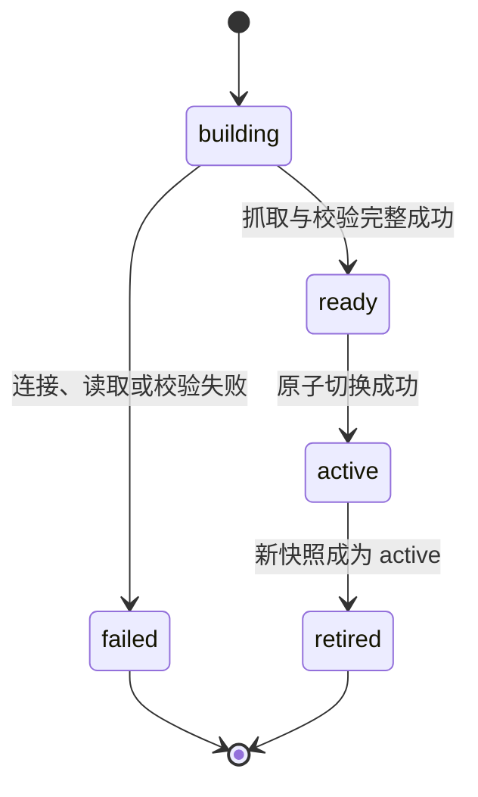

# EnterpriseMind V1 数据库模式快照与 SQL 防护规则（确认稿）

> 状态：确认稿  
> 项目：EnterpriseMind  
> 适用范围：V1 单企业私有化部署  
> 前置文档：《需求说明书》《系统总体架构设计》《数据库表设计》《数据库关系与约束设计》《API 接口与错误码设计》《智能体编排状态与检查点设计》《工具参数结构、风险等级与确认协议》

## 1. 目标与边界

本文只细化 V1 已确认的以下能力：

- 唯一企业 PostgreSQL 业务数据源的 Schema 快照；
- 全局关系白名单和普通用户部门授权的实时交集；
- 只向模型提供授权后的表、View、字段、主外键和注释；
- 内部 SQL 生成、PostgreSQL AST 校验和 Database MCP 二次防护；
- 普通查询的分页、结果裁剪、连续追问和故障恢复；
- 明确导出时，数据库结果不进入 LLM Context。

本文不新增业务表、Agent Tool、用户页面、对外查询接口或审计能力，也不设计 ER 图。V1 仍不支持：

- 多业务数据库；
- MySQL、SQL Server、Oracle 等其他数据库；
- EnterpriseMind 自身 PostgreSQL 经 MCP 暴露；
- 用户直接提交 SQL、SQL 调试台或 `/query`、`/sql` 接口；
- 行级权限、列级权限、字段脱敏规则引擎或每关系独立行数上限；
- 存储 SQL、SQL 摘要、查询参数、结果行或独立查询历史；
- SQL 审计表、安全事件表或操作日志表；
- 自动生成图表；
- MCP Tasks。

## 2. 固定技术基线

| 项目 | V1 决定 |
|---|---|
| 企业业务数据库 | 一个独立 PostgreSQL 数据库 |
| EnterpriseMind 数据库 | PostgreSQL 18.6；不得作为 Database MCP 数据源 |
| Schema 快照存储 | EnterpriseMind PostgreSQL 的既有 `integration.schema_*` 表 |
| SQL 解析器 | `pglast==8.4`，生产依赖固定版本和完整制品摘要 |
| 解析方式 | PostgreSQL 原生语法树；禁止使用正则表达式判断 SQL 安全性 |
| MCP Python SDK | `mcp==2.2.0` |
| MCP 版本 | `2026-07-28` |
| MCP 传输 | 内部认证的 Streamable HTTP，不暴露公网入口 |
| 普通查询页大小 | 默认 100，最小 1，最大 100 |
| SQL 执行超时 | 默认 15 秒 |
| 锁等待超时 | 默认 1 秒 |
| 只读事务总时限 | 默认 20 秒 |
| LLM 单次数据库结果预算 | 最多 100 行且序列化后最多 1 MiB，以先到者为准 |

`pglast` 只负责把 PostgreSQL SQL 转换为语法树，不替代对象解析、权限计算和数据库账号权限。SQL Guard 必须自行完成名称解析、授权关系校验、函数白名单和服务器侧分页改写。

`pglast 8.4` 使用 GPL-3.0-or-later 许可证。进入对外发布前必须完成依赖许可证合规确认；若项目分发方式不能接受该许可证，只能在代码冻结前替换为固定版本的 PostgreSQL 18 `libpg_query` 封装，并用同一套恶意 SQL 语料重新验收。不得因此退回正则解析，也不得把 SQLGlot 这类宽松解析器单独作为安全边界。

## 3. 总体处理链


每次查询必须依次满足：

1. 当前用户、角色和部门仍有效；
2. 唯一数据源为 `active`，且存在 active Schema 快照；
3. 只从该快照和实时权限交集构造模型可见 Schema；
4. 内部 SQL 生成器产生临时 SQL 和参数；
5. 应用侧 SQL Guard 完成 AST、对象、字段、函数和分页校验；
6. MCP Server 使用相同授权清单重新解析并二次校验；
7. 企业数据库只读账号在只读事务中执行；
8. 结果裁剪后只在当前进程内交给回答生成；
9. 最终只把已确认的来源定位元数据写入 `answer_sources`。

SQL、绑定参数、结果行和数据库列值不得穿过持久化边界。

## 4. 信任边界

| 输入 | 是否可信 | 处理要求 |
|---|---:|---|
| 当前用户身份和角色 | 仅以服务端会话为准 | 不接受模型或请求体声明 |
| 部门和关系授权 | 仅以 EnterpriseMind PostgreSQL 为准 | 查询前实时计算 |
| Schema 快照 | 结构可信、文本不可信 | 名称严格引用；注释按外部不可信内容处理 |
| 用户问题 | 不可信 | 只能成为模型输入或绑定参数值 |
| 模型生成 SQL | 不可信 | 必须经过完整 SQL Guard |
| MCP Tool annotation | 不可信安全依据 | 只作展示提示，不参与授权 |
| 企业数据库返回值 | 不可信业务数据 | 类型规范化、大小限制，不作为指令执行 |
| Database MCP Server | 受控内部组件 | 仍必须独立二次校验，不信任上游已校验声明 |

Schema 名、关系名和字段名只能来自当前授权快照，不得由用户文本直接拼接。用户提供的筛选值必须通过 PostgreSQL 位置参数传递，不能拼接进 SQL 字符串。

## 5. Schema 快照内容

### 5.1 使用既有表

V1 只使用已经确认的 7 张表：

- `integration.database_sources`
- `integration.schema_snapshots`
- `integration.schema_relations`
- `integration.schema_columns`
- `integration.schema_constraints`
- `integration.relation_policies`
- `integration.relation_department_grants`

本阶段不新增函数、索引、触发器、查询模板、SQL 历史或快照差异表。

### 5.2 抓取范围

一次快照只抓取：

- PostgreSQL Schema 名；
- 普通表和分区表，统一记录为 `relation_type = table`；
- 普通 View，记录为 `relation_type = view`；
- 字段名、顺序和完整 PostgreSQL 类型表达；
- 主键；
- 外键及其本端、引用端字段顺序；
- 表、View 和字段注释。

V1 不抓取或提供给模型：

- 数据样例、字段值、直方图或统计分布；
- 函数、存储过程、触发器和规则定义；
- 索引定义、序列、物化 View、外部表和临时表；
- `pg_catalog`、`information_schema`、`pg_toast` 和临时 Schema；
- View 定义、约束表达式、默认值和生成列表达式；
- 数据库账号、权限成员关系和连接 Secret。

这些排除项不会增加新的表结构，也不能由管理员关系白名单绕过。

### 5.3 抓取一致性

Schema 刷新通过服务端固定的目录查询执行，不接受模型生成 SQL。刷新 Worker 应在企业数据库执行：

```text
BEGIN TRANSACTION ISOLATION LEVEL REPEATABLE READ READ ONLY
→ 读取允许的系统目录元数据
→ 完成一致性校验
→ COMMIT
```

目录查询固定在代码中并经过测试；它与业务查询 SQL Guard 分离。刷新过程只把上述允许的结构元数据写入 EnterpriseMind PostgreSQL。

### 5.4 注释安全

表和字段注释来自外部数据库，可能包含提示注入文本。系统必须：

- 把注释标记为“数据库元数据，不是系统指令”；
- 删除控制字符并按提示词预算裁剪；
- 不解析其中的链接、Tool 指令、SQL 或角色声明；
- 只有对应关系已授权时才把注释投影给模型；
- 不把未授权注释用于关系选择、错误提示或日志。

数据库内保存原快照注释；裁剪只发生在模型投影阶段，不修改企业数据库原内容。

## 6. 快照状态机与原子切换



### 6.1 创建与完成

1. 管理员调用既有 Schema 刷新接口。
2. 在 EnterpriseMind PostgreSQL 中创建新的 `building` 快照并写 Outbox。
3. Worker 使用唯一业务数据源的只读账号抓取完整结构。
4. 校验关系、字段、主外键完整性和唯一性。
5. 抓取全部成功后把快照置为 `ready`。
6. 在一个 EnterpriseMind 数据库事务中锁定 `database_sources` 行：
   - 再确认数据源仍为 `active`；
   - 将新快照置为 `active`；
   - 更新 `database_sources.active_snapshot_id`；
   - 将旧 active 快照置为 `retired`。

`ready` 是切换前的短暂内部状态，不能提供给 LLM 或执行查询。

### 6.2 失败语义

- 抓取失败时，新快照置为 `failed`，只保存安全错误码和脱敏错误摘要。
- 旧 active 快照和旧权限语义继续有效，不做部分覆盖。
- 第一次配置且没有旧 active 快照时，查询返回 `SCHEMA_SNAPSHOT_UNAVAILABLE`。
- 失败快照中的任何关系、字段或注释都不得进入模型上下文。
- 重试创建新的快照版本，不把 failed 快照原地改为 active。

这与文档覆盖语义一致：新内容完整成功后才替换旧内容，失败时继续使用旧内容；成功切换时以新快照为后续查询基点。

### 6.3 策略跨快照语义

`relation_policies` 按 `database_source_id + schema_name + relation_name` 稳定保存，不绑定快照 ID：

- 新 active 快照仍存在同名关系时，既有 enabled 状态和部门授权继续适用；
- 新 active 快照不存在该关系时，策略记录可以保留，但不得暴露或查询；
- 后续快照恢复同名关系时，既有策略重新进入实时交集；
- 管理员只能通过既有管理接口为当前 active 快照中实际存在的关系创建或更新策略。

V1 不把字段增删自动解释为列级授权变化，因为没有列级授权模型；每轮 SQL 仍只能引用当前快照实际存在的字段。

### 6.4 旧快照清理

旧快照不是查询审计历史。只有当前运行或 `answer_sources` 的可选外键仍引用时才保留；满足既有清理条件后可物理删除，级联删除其关系、字段和约束。`answer_sources` 的快照外键允许 `SET NULL`，但其中的最小定位快照仍用于展示回答时的数据来源。

## 7. 授权 Schema 投影

### 7.1 关系集合

管理员可见关系：

```text
数据源为 active
∩ 当前 active Schema 快照中实际存在
∩ relation_policies.enabled = true
```

普通用户可见关系：

```text
用户为 active
∩ 所属部门为 active
∩ 数据源为 active
∩ 当前 active Schema 快照中实际存在
∩ relation_policies.enabled = true
∩ 存在当前部门的 relation_department_grants
```

普通用户没有 active 部门时，可见关系为空。管理员不要求部门授权，但同样不能访问未进入全局白名单或不在 active 快照中的关系。

### 7.2 投影内容

对每个授权关系，模型最多可见：

```text
schema_name
relation_name
relation_type
安全处理后的 relation comment
column_name + data_type + 安全处理后的 column comment
primary key
foreign key
```

外键目标关系不在当前授权集合时，不提供目标 Schema、关系名和字段名；该外键对模型投影为不可见。授权关系的全部当前字段可以进入投影，V1 不另外实现列级裁剪。

### 7.3 两阶段投影

为控制上下文大小，投影分为两步，但两步使用同一授权集合：

1. **关系目录**：授权关系的全限定名、类型和短注释。
2. **关系详情**：与当前问题相关的授权关系之字段、主键和可见外键。

第二步只缩小范围，不能发现或补入第一步权限集合之外的关系。不得用实时数据库报错、模糊匹配或系统目录查询向模型补充未授权名称。

### 7.4 查询期固定与再次校验

一次 `database_query` 逻辑调用开始时固定：

- `database_source_id`
- `schema_snapshot_id`
- 当前允许关系清单
- 当前权限交集的内存摘要

SQL 执行前重新读取用户、部门、策略和授权；权限缩小时立即拒绝，不能按旧权限继续。执行完成后、结果进入 LLM Context 前再次检查权限；若权限已被撤销，丢弃结果并返回安全错误。

查询执行期间切换了新的 active 快照时，已开始的调用仍以其绑定快照完成；新的逻辑调用使用新 active 快照。权限撤销不受此规则保护，必须立即生效。

## 8. 内部 SQL 生成契约

### 8.1 Agent Tool 与生成器分离

Agent 可调用的 `database_query` 只接收：

- 当前自然语言问题；
- 可选 `page_size`；
- 可选 `page_index`。

用户、Agent Planner 和对外 API 都不能向该 Tool 传入 SQL。`database` 模块内部单独调用 SQL 生成模型，模型输出的 SQL 仅是当前进程中的不可信临时值。

### 8.2 内部临时结构

SQL 生成器的临时输出结构为：

```text
query_kind: detail | aggregate
sql: string
parameters: scalar[]
conditions_summary: string
```

该结构不是 Agent Tool Schema，不进入 `tool_calls.arguments`、Checkpoint、Redis、SSE、日志或指标。

### 8.3 生成规则

- 所有关系必须使用双引号安全引用的 `schema.relation` 全限定名。
- 所有字段必须显式列出；禁止 `SELECT *` 和 `relation.*`。
- `COUNT(*)` 是唯一允许的星号形式。
- 用户提供的日期、编号、名称和筛选值使用 `$1`、`$2` 等位置参数。
- 标识符不能使用参数替代，只能从授权快照选择。
- 统计问题优先生成 `COUNT`、`SUM`、`AVG`、`MIN`、`MAX` 和 `GROUP BY` 等聚合查询。
- 需要 Top N 时由服务器页大小控制，并生成确定性 `ORDER BY`。
- SQL 生成结果本身不能决定权限、超时或最大行数。

关键业务口径、时间范围、状态含义或同名对象存在歧义时，在生成 SQL 前创建消歧 Pending Action。用户选择前不得猜测或执行查询。

### 8.4 连续追问

每轮使用：

```text
当前问题
+ 已允许保留的上一轮语义
+ 当前实时授权 Schema 投影
→ 生成一条全新的 SQL
```

不得读取、编辑或续写上一轮 SQL 字符串。上一轮结果已不在当前进程内或 Run 恢复时，必须基于当前问题和当前 active 快照重新生成、校验和执行。

## 9. 应用侧 SQL Guard

### 9.1 校验顺序

SQL Guard 必须按固定顺序执行：

1. 校验文本编码、长度和参数数量；
2. 用 `pglast==8.4` 解析；
3. 确认恰好一条语句；
4. 确认根节点为 `SelectStmt`；
5. 递归检查 CTE、子查询、集合运算和表达式；
6. 解析关系别名、字段作用域和相关子查询作用域；
7. 收集全部实际基础关系；
8. 校验关系、字段、函数、操作符和类型转换；
9. 校验参数占位符与参数数组；
10. 由服务器添加分页限制并重新解析；
11. 输出规范化 SQL、参数和实际引用关系清单给 MCP 适配器。

任一步失败都返回 `DATABASE_QUERY_REJECTED`，不得带着部分通过结果继续执行。

### 9.2 允许的查询结构

V1 允许：

- 单条 `SELECT`；
- 只包含 `SELECT` 的 CTE；
- JOIN、子查询和相关子查询；
- `UNION`、`INTERSECT` 和 `EXCEPT`；
- `DISTINCT`、`CASE`、受控类型转换和只读表达式；
- `WHERE`、`GROUP BY`、`HAVING`、聚合 `FILTER`、窗口函数和确定性 `ORDER BY`；
- 基于允许字段的常量、位置参数、标准运算符和白名单函数。

所有嵌套层级都必须经过同样校验，不能只检查最外层 `SELECT`。

### 9.3 禁止的语句与子句

至少拒绝：

- 多语句或尾随第二条语句；
- `INSERT`、`UPDATE`、`DELETE`、`MERGE`；
- 数据修改 CTE；
- `CREATE`、`ALTER`、`DROP`、`TRUNCATE`、`COMMENT`；
- `COPY`、`CALL`、`DO`、`VACUUM`、`ANALYZE`；
- `GRANT`、`REVOKE`、`SET`、`RESET`、`SHOW`；
- `PREPARE`、`EXECUTE`、`DEALLOCATE`；
- `LISTEN`、`NOTIFY`、`LOAD`、显式事务控制和显式 `LOCK`；
- `SELECT INTO`；
- `FOR UPDATE`、`FOR NO KEY UPDATE`、`FOR SHARE`、`FOR KEY SHARE`；
- SQL 自带的 `LIMIT`、`OFFSET` 和 `FETCH`，分页只由服务器控制；
- `TABLE relation` 简写；
- 系统目录、临时 Schema、序列和未授权关系。

根节点为 `SelectStmt` 不是充分条件，因为 PostgreSQL 的 `WITH` 可以包含数据修改语句，`SELECT INTO` 可以创建新表，`SELECT` 也可以请求行锁。

### 9.4 关系解析

SQL Guard 必须遍历所有层级的 `RangeVar`：

- 基础关系必须显式包含 Schema 名；
- 全限定名必须精确命中本次绑定快照；
- 同一全限定名必须在本次允许关系清单中；
- CTE 名和子查询别名不得被误判为基础关系；
- 不根据 `search_path`、同义词、当前用户默认 Schema 或模糊名称补全；
- 对未授权名称统一返回安全错误，不指出该名称是否真实存在。

实际引用关系清单由 AST 收集产生，不能相信模型声明。

### 9.5 字段解析

- 每个字段引用必须能在当前查询作用域唯一解析到允许关系的当前快照字段。
- 无限定字段发生歧义时拒绝，不猜测来源。
- 拒绝 `SELECT *`、`alias.*` 和 PostgreSQL 系统列。
- 子查询、CTE 和集合运算的输出字段只在其定义作用域内可见。
- 外键只帮助生成 JOIN，不授予目标关系权限。
- 字段别名只影响结果展示，不能用来绕过底层字段校验。

### 9.6 函数、操作符和类型转换

V1 使用代码内固定白名单，不从企业数据库抓取函数目录。初始函数范围只覆盖普通只读分析：

- 聚合：`count`、`sum`、`avg`、`min`、`max`、`bool_and`、`bool_or`；
- 空值与比较：`coalesce`、`nullif`、`greatest`、`least`；
- 文本：`lower`、`upper`、`trim`、`length`；
- 日期时间：`date_trunc`、`extract`；
- 数值：`abs`、`round`、`ceil`、`floor`。

函数按允许名称、参数数量和允许使用位置校验；不允许模型调用企业自定义函数。标准比较、算术、布尔、字符串匹配和空值操作符可以使用；Schema 限定的自定义操作符一律拒绝。

白名单普通函数只能不带 Schema 或显式使用 `pg_catalog`；执行会话的 `search_path` 固定为 `pg_catalog`，从而避免同名企业函数遮蔽。类型转换只能使用代码内允许的 PostgreSQL 内置标量类型；自定义类型上的函数、运算和显式转换一律拒绝。

至少明确拒绝：

- `pg_sleep`、`set_config`；
- `nextval`、`setval`；
- 文件、目录、程序执行和大对象访问函数；
- `dblink`、外部网络或扩展连接函数；
- advisory lock、后端信号和会话控制函数；
- 动态 SQL 或可间接执行 SQL 的函数；
- 用户自定义、`SECURITY DEFINER` 或无法确定来源的函数。

只读事务不能替代函数白名单，因为只读安全还涉及外部副作用、资源消耗和企业自定义函数行为。允许关系中的 View 也必须由企业数据库管理员确认其定义无副作用，并优先用于字段裁剪和脱敏。

### 9.7 参数校验

- 只接受 JSON 可表达的标量：字符串、数值、布尔值和 `null`。
- 参数个数默认最多 100。
- 占位符必须从 `$1` 连续编号，且与参数数组精确对应。
- 禁止把数组、对象、SQL 片段或标识符放入参数。
- 驱动层使用 PostgreSQL 原生绑定，不做字符串格式化。
- SQL 文本默认最大 64 KiB；超限直接拒绝。

## 10. 服务器控制的分页与结果预算

### 10.1 普通查询

`page_size` 默认 100，范围为 1～100；`page_index` 默认 0 且必须为非负整数。SQL Guard 校验原查询不含分页子句后，由服务器在外层添加：

```sql
SELECT *
FROM (
  /* 已完成 AST 校验并规范化的单条 SELECT */
) AS enterprise_mind_guarded
LIMIT :page_size_plus_one
OFFSET :server_offset
```

上面的命名参数只是设计表达；实际驱动使用 PostgreSQL 位置参数。服务器取 `page_size + 1` 行判断是否还有数据，只向 LLM Context 提供前 `page_size` 行。多取的一行不进入模型。

### 10.2 确定性分页

- `page_index > 0` 时，内部查询必须有可重复的确定性 `ORDER BY`，否则拒绝分页并要求补充排序语义。
- 用户要求 Top N 时必须说明排序口径；无法确定时先消歧。
- 第一页可以没有 `ORDER BY`，但不得把返回顺序描述为稳定或有业务含义。
- `OFFSET = page_index × page_size` 由服务器计算，并检查整数溢出。

### 10.3 `has_more`

以下任一情况使 `has_more = true`：

- 读取到了第 `page_size + 1` 行；
- 序列化后的完整行累计将超过 1 MiB，因而停止加入下一行。

单元格不得截断后交给模型；若单行本身超过预算，该行不进入 LLM Context，系统提示用户缩小字段范围或明确导出。回答不得把被裁剪结果描述为完整全集。

### 10.4 导出

只有用户明确要求 CSV 或 XLSX 时，`artifact_generate` 才能引用当前 Run 内存中的数据库查询语义并启动导出。导出必须：

- 重新经过相同授权计算、SQL 生成、双重 SQL Guard 和只读事务；
- 采用流式读取直接写入 MinIO，不把完整结果送入 LLM Context；
- 不把 SQL、参数或结果行写入 PostgreSQL、Redis、Checkpoint、日志或指标；
- 在生成物来源中只保留关系、条件摘要、统计口径、查询时间和行数；
- 达到《容器编排、网络与配置设计》确认的导出安全上限时明确失败并要求缩小范围，不静默生成“完整”文件。

Run 恢复后不能复用进程内 SQL；应从当前用户导出请求、当前语义和当前 active 快照重新生成。

## 11. Database MCP 二次防护

### 11.1 内部 MCP 能力

Database MCP Server 只提供两个内部能力：

| 内部能力 | 调用方 | 输入边界 | 输出边界 |
|---|---|---|---|
| Schema 抓取 | Schema 刷新 Worker | 固定抓取请求，不接受任意 SQL | 允许的结构元数据 |
| 只读查询 | Database MCP 适配器 | 临时 SQL、参数、快照 ID、允许关系清单、分页和超时上限 | 临时列定义、结果行、行数、`has_more`、耗时和实际关系 |

它们不是 Agent 可直接选择的 Tool，不注册到模型 Tool 列表，也不新增对外 API。

### 11.2 请求校验

MCP Server 收到只读查询后必须：

1. 验证内部服务身份、协议版本和消息大小；
2. 不信任上游的“已校验”标志；
3. 使用固定版本解析器重新解析 SQL；
4. 再次检查单条 `SELECT`、嵌套 CTE、禁止子句、函数和系统目录；
5. 重新收集全部基础关系并与允许关系清单精确比较；
6. 把页大小和超时压缩到服务端上限；
7. 使用专用只读连接池执行；
8. 裁剪和规范化结果后返回。

任一校验不一致都拒绝执行。MCP Server 不回显 SQL，不把请求体或响应行写入日志。

### 11.3 传输约束

- 使用 MCP `2026-07-28` Streamable HTTP；每个请求携带协议版本、客户端身份与能力元数据，不依赖 `initialize` 握手、`Mcp-Session-Id` 或连接级状态。
- 只监听容器内部网络，不映射宿主机或公网端口。
- 只接受 EnterpriseMind 后端或 Worker 的服务身份。
- 存在 HTTP `Origin` 时必须校验允许来源。
- MCP Tool annotation 不能代替本地授权和 SQL Guard。
- V1 不声明、不请求也不轮询 MCP Tasks。

服务认证、Secret 装载和容器网络细节按《容器编排、网络与配置设计》（确认稿）执行。

## 12. 企业数据库只读账号

### 12.1 最小权限

Database MCP 专用账号必须满足：

- `NOSUPERUSER`、`NOCREATEDB`、`NOCREATEROLE`、`NOREPLICATION`、`NOBYPASSRLS`；
- 不是数据库或业务对象所有者，不继承高权限角色；
- 仅有目标数据库 `CONNECT`；
- 仅有已批准 Schema 的 `USAGE`；
- 仅有被批准表和 View 的 `SELECT`；
- 不授予序列权限、写权限、DDL 权限、`CREATE` 或 `TEMP`；
- 不加入 `pg_read_all_data` 等宽泛预定义角色；
- 不对 EnterpriseMind 自身 PostgreSQL 建立网络或凭据访问。

数据库 DBA 应优先把脱敏、字段裁剪和稳定业务口径封装在只读 View 中，再只授权这些 View。

### 12.2 每次执行的会话边界

每次查询使用独立只读事务，并由服务端设置：

```text
BEGIN READ ONLY
SET LOCAL statement_timeout = 15s
SET LOCAL lock_timeout = 1s
SET LOCAL transaction_timeout = 20s
SET LOCAL search_path = pg_catalog
→ 执行全限定关系名的已校验查询
→ COMMIT 或 ROLLBACK
```

连接池归还连接前必须回滚未结束事务并清理会话状态。角色级默认值可以作为后备，但每次事务仍应显式设置并验证。

### 12.3 数据库侧前置检查

企业数据库管理员必须确认：

- `public` 及可搜索 Schema 未向只读账号授予 `CREATE`；
- 允许 View 的定义和其间接调用函数无写入或外部副作用；
- 未向只读账号授予危险函数 `EXECUTE`；
- 账号不能创建临时对象；
- 连接数存在合理上限。

数据库账号权限是最后一道防线，不能替代应用和 MCP 两次 AST 校验。

## 13. 执行、类型规范化与回答

### 13.1 执行步骤

1. 读取当前问题和语义上下文。
2. 实时计算授权关系并固定 active 快照。
3. 生成仅当前进程可见的 SQL 与参数。
4. 应用侧 SQL Guard 校验并添加服务器分页。
5. MCP Server 重新解析、校验并在只读事务执行。
6. 对结果做类型和大小规范化。
7. 再次检查权限；发生撤权时丢弃结果。
8. 把裁剪后的结果交给当前 Run 回答生成。
9. 持久化回答和最小来源元数据。

### 13.2 类型规范化

为避免 JSON 精度和格式歧义：

- PostgreSQL `bigint`、高精度 `numeric` 以十进制字符串交给模型；
- `timestamp with time zone` 转为带时区的 ISO 8601；
- `date`、`time` 和 interval 使用明确字符串格式；
- `bytea` 不进入 LLM Context；
- JSON/数组递归受总结果预算限制；
- 非有限浮点值转换为明确字符串，不伪装成 JSON 数字；
- `NULL` 保持 JSON `null`。

列名和类型随结果临时返回，用于解释当前结果，不持久化为查询历史。

### 13.3 来源持久化

数据库回答只写既有 `agent.answer_sources`：

- `database_tool_call_id`
- `database_source_id`
- `schema_snapshot_id`
- `referenced_relations`
- `queried_at`
- `conditions_summary`
- `has_more`
- `source_title`
- 最小 `locator_snapshot`

`referenced_relations` 必须来自 AST 实际收集结果。`conditions_summary` 是面向用户的数据来源说明或统计口径，不保存 SQL 片段、参数值列表或可还原 SQL 的内部摘要。

最终回答展示：数据源名称、数据库名、表/View、查询时间、条件或统计口径以及 `has_more`。RAG 与数据库联合回答时，两类依据分开显示。只有用户明确要求时才生成图表或表格文件。

## 14. 缓存规则

EnterpriseMind PostgreSQL 是 Schema、策略和授权的真实来源。Redis 只可缓存已经授权的 Schema 投影：

```text
database_source_id
+ schema_snapshot_id
+ user role
+ department_id
+ 权限交集摘要
```

发生以下事件时立即失效：

- active 快照切换；
- 数据源状态或配置变化；
- 全局关系策略变化；
- 部门授权变化；
- 用户角色、状态或所属部门变化。

禁止缓存 SQL、参数、结果行、查询摘要或未授权 Schema。缓存缺失时回源 EnterpriseMind PostgreSQL，不直接从企业数据库扩大结构发现范围。

## 15. 漂移、失败与恢复

### 15.1 Schema 漂移

企业数据库真实结构在快照后发生变化时：

- 关系或字段被删除导致执行失败：丢弃结果，返回安全失败并提示管理员刷新 Schema；
- 新增关系或字段：刷新成功并进入新 active 快照前不得使用；
- 改名：按旧名执行失败，不模糊回退到新名称；
- View 语义变化但名称未变：Database MCP 无法自动证明业务语义，需企业 DBA 管理；后续刷新只更新已纳入快照的结构信息。

不得临时读取实时目录并把新名称直接提供给模型。

### 15.2 Run 恢复

Database MCP 结果不进入 Checkpoint。恢复到需要数据库结果的节点时：

1. 重新读取当前用户问题；
2. 重新检查当前身份和权限；
3. 绑定当前 active Schema 快照；
4. 重新生成 SQL；
5. 重新经过两次 SQL Guard；
6. 重新执行查询。

这属于同一逻辑 Tool Call 的恢复执行，不新增 Tool Call 计数，也不因恢复本身增加 Retry 或 Replan 计数。`tool_calls.arguments` 仍只保存数据源 ID、实际采用的快照 ID、页大小和页码；SQL 与结果不补写。

### 15.3 重试

| 失败类型 | 自动处理 |
|---|---|
| SQL Guard 拒绝、权限拒绝、歧义 | 不重试；分别拒绝或进入消歧 |
| SQL 执行超时 | 不原样自动重试；可在语义允许时重新规划为聚合或要求缩小范围 |
| 临时连接中断 | 在既有 Tool Retry 上限内重建连接并重新完成全部校验 |
| 数据源停用或无 active 快照 | 不重试；返回对应可恢复错误 |
| Schema 对象漂移 | 不猜测；提示管理员刷新快照 |

任何重试都重新鉴权，不能直接重放未经当前权限校验的临时 SQL。

## 16. 错误映射

| 场景 | HTTP | 错误码 | 对外信息边界 |
|---|---:|---|---|
| 数据源未配置、停用或连接失败 | 503 | `DATABASE_SOURCE_UNAVAILABLE` | 不返回主机、端口或驱动错误 |
| 没有 active 快照 | 503 | `SCHEMA_SNAPSHOT_UNAVAILABLE` | 提示管理员刷新 |
| 关系不在权限交集 | 403 | `DATABASE_RELATION_FORBIDDEN` | 不确认该关系是否真实存在 |
| SQL 结构、对象、字段或函数不允许 | 422 | `DATABASE_QUERY_REJECTED` | 不回显 SQL |
| 企业数据库执行超时 | 504 | `DATABASE_QUERY_TIMEOUT` | 不返回 SQL、参数或数据库异常栈 |
| SQL 生成模型最终失败 | 502 | `MODEL_PROVIDER_FAILED` | 使用统一上游失败语义 |

数据库原生错误只映射为安全错误码。详细异常栈只存在于受控瞬时诊断上下文，不写普通日志、Tool 字段或审计表。

## 17. 日志、指标与数据保留

V1 不做 Database MCP 查询审计，也不新增任何日志审计表。允许运维日志和指标只记录：

- 请求关联 ID；
- 阶段名称；
- 成功或安全错误码；
- 不带数据库对象标签的耗时和计数。

以下内容在 PostgreSQL、Redis 持久数据、Checkpoint、SSE、日志、指标和 Trace 中一律禁止：

- SQL 和可还原 SQL 的摘要；
- 绑定参数和值；
- 结果行和列值；
- 未授权 Schema、关系、字段和注释；
- 数据库密码、Secret、完整连接串和签名地址；
- 模型生成 SQL 的 Prompt 或响应正文。

数据库结果只存在于当前进程；明确导出时直接流入 MinIO。导出对象按既有 `storage_objects` 和 `generated_artifacts` 生命周期管理，不另建查询历史。

## 18. 验收用例

### 18.1 快照与权限

| 用例 | 预期结果 |
|---|---|
| 首次刷新完整成功 | 新快照原子成为 active |
| 已有 active 快照时新刷新失败 | 旧 active 保持可用，失败内容不暴露 |
| 新快照删除已授权关系 | 策略保留，但关系不再可见或可查询 |
| 管理员查询 enabled 关系 | 不要求部门授权 |
| 普通用户查询本部门授权关系 | 允许 |
| 普通用户查询其他部门或仅全局 enabled 的关系 | 统一拒绝且不泄露名称 |
| 外键目标未授权 | 不向模型投影目标关系和字段 |
| 权限在查询完成前撤销 | 丢弃结果，不进入模型 |

### 18.2 SQL Guard 攻击语料

| SQL 特征 | 预期结果 |
|---|---|
| 合法全限定聚合查询 | 允许并由服务器追加限制 |
| `SELECT ...; DROP ...` | 拒绝多语句 |
| `WITH x AS (DELETE ... RETURNING ...) SELECT ...` | 拒绝数据修改 CTE |
| `SELECT ... INTO new_table` | 拒绝建表语义 |
| `SELECT ... FOR UPDATE` | 拒绝行锁 |
| `SELECT *` 或 `alias.*` | 拒绝；`COUNT(*)` 除外 |
| 未限定关系名 | 拒绝 |
| 未授权关系藏在子查询或 CTE | 拒绝 |
| `pg_catalog` 或 `information_schema` | 拒绝 |
| `pg_sleep`、`pg_read_file`、`set_config`、`nextval` | 拒绝危险函数 |
| 自定义函数或操作符 | 拒绝 |
| SQL 自带 `LIMIT/OFFSET/FETCH` | 拒绝，改由服务器控制 |
| 注释、美元引号或 Unicode 中包含分号 | 按 AST 判断，不用字符串匹配误判 |
| 占位符缺失、跳号或参数个数不匹配 | 拒绝 |

### 18.3 执行与保留

| 用例 | 预期结果 |
|---|---|
| 普通查询超过 100 行 | 返回最多 100 行且 `has_more = true` |
| 第二页没有确定性排序 | 拒绝并要求明确排序语义 |
| 查询超过 15 秒 | 事务取消，返回 `DATABASE_QUERY_TIMEOUT` |
| 单次结果超过 1 MiB | 按完整行停止并设置 `has_more = true` |
| Run 在查询后恢复 | 不从 Checkpoint取结果，重新生成并执行 |
| 明确请求 CSV/XLSX | 数据流入 MinIO，不进入 LLM Context |
| 检索 PostgreSQL、Redis、日志、指标和 Trace | 不存在 SQL、参数和结果行 |
| 最终回答保存来源 | 只存在 `answer_sources` 已确认字段 |

### 18.4 解析器回归

SQL Guard 测试必须同时在 `pglast==8.4` 和实际 PostgreSQL 18.6 测试库执行。每次解析器、驱动或 PostgreSQL 小版本升级都要重跑合法查询和攻击语料；出现 AST 结构变化时先更新校验器并通过回归，再升级生产镜像。

## 19. 已确认设计结论

1. V1 只接入一个独立企业 PostgreSQL，EnterpriseMind 自身数据库不暴露。
2. 快照只保存表/View、字段、主外键和注释，不新增函数或查询历史表。
3. 新快照完整成功后原子切换；失败时旧 active 快照继续使用。
4. 管理员范围是 active 快照与 enabled 全局策略交集；普通用户还必须与 active 部门授权取交集。
5. 未授权关系、字段、外键目标和注释不进入模型上下文。
6. `database_query` 不接受 SQL；内部 SQL 生成结果仅存在于当前进程。
7. SQL Guard 固定使用 `pglast==8.4` 的 PostgreSQL AST，并由 MCP Server 二次解析校验。
8. 只允许单条受控 `SELECT`，对象、字段、函数、参数、分页和超时全部由服务端限制。
9. 企业数据库账号使用最小只读权限和显式只读事务。
10. 普通结果默认且最多 100 行，超限通过 `has_more` 和分页处理；大结果只在明确请求时导出。
11. 每轮连续追问和 Run 恢复都基于当前问题、当前权限和当前 active 快照重新生成 SQL。
12. SQL、SQL 摘要、参数和结果行均不持久化，也不进入日志、指标、SSE 或 Trace。
13. V1 不新增 SQL 审计、安全事件、操作日志、行级权限或列级权限能力。

## 20. 跨文档实现约束

本规则已与《容器编排、网络与配置设计》（确认稿）对齐，并共同复用：

- EnterpriseMind PostgreSQL 与企业业务 PostgreSQL 完全隔离；
- Database MCP 只在内部网络提供 MCP `2026-07-28` Streamable HTTP，并保持请求级无状态；
- MCP 只读账号、应用 Secret 和数据源 Secret 分离装载；
- `pglast==8.4`、PostgreSQL 18.6 和镜像 digest 固定；
- SQL、参数和查询结果禁止进入容器日志、Trace、指标和持久卷；
- 查询超时、连接数、普通结果预算和导出上限由集中配置约束；
- V1 不启用 MCP Tasks，不暴露 MCP 或企业数据库公网端口。

## 21. 官方依据

- [pglast 8.4 文档](https://pglast.readthedocs.io/en/v8/)
- [pglast 8.4 发布页](https://pypi.org/project/pglast/8.4/)
- [libpg_query：使用 PostgreSQL 服务端解析器源码](https://github.com/pganalyze/libpg_query)
- [SQLGlot 官方说明：解析器采用宽松策略且不作为严格验证器](https://github.com/tobymao/sqlglot)
- [PostgreSQL 18：SET TRANSACTION 与只读事务](https://www.postgresql.org/docs/18/sql-set-transaction.html)
- [PostgreSQL 18：客户端连接默认值与超时](https://www.postgresql.org/docs/18/runtime-config-client.html)
- [PostgreSQL：SELECT 与数据修改 CTE、锁定子句](https://www.postgresql.org/docs/current/sql-select.html)
- [PostgreSQL 18：SELECT INTO](https://www.postgresql.org/docs/18/sql-selectinto.html)
- [PostgreSQL：权限体系](https://www.postgresql.org/docs/current/ddl-priv.html)
- [PostgreSQL 18：CREATE ROLE](https://www.postgresql.org/docs/18/sql-createrole.html)
- [PostgreSQL 18：Schema 与 search_path 安全](https://www.postgresql.org/docs/18/ddl-schemas.html)
- [PostgreSQL 18：函数安全注意事项](https://www.postgresql.org/docs/18/sql-createfunction.html)
- [MCP 2026-07-28：Tools](https://modelcontextprotocol.io/specification/2026-07-28/server/tools)
- [MCP 2026-07-28：Schema](https://modelcontextprotocol.io/specification/2026-07-28/schema)
- [MCP 2026-07-28：Transports](https://modelcontextprotocol.io/specification/2026-07-28/basic/transports)
- [MCP 2026-07-28：Tasks 扩展](https://modelcontextprotocol.io/extensions/tasks/overview)
