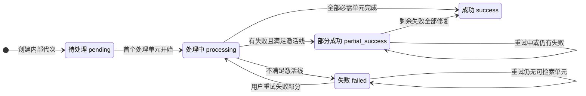
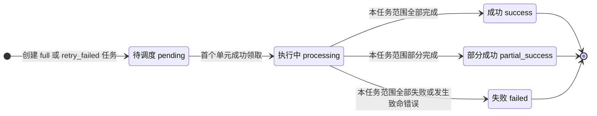
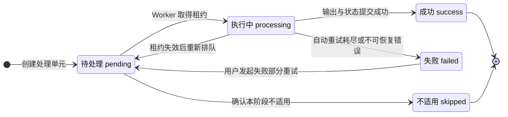
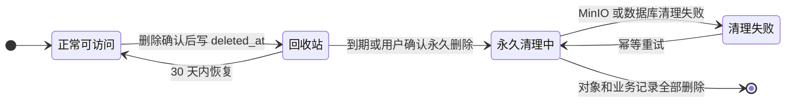

# EnterpriseMind V1 文档处理状态机与任务协议（确认稿）

## 1. 文档目的

本文档定义 EnterpriseMind V1 从原文件保存到解析、OCR、Vision、表格与代码提取、Chunk、Embedding、关键词索引、激活、失败重试和清理的状态流转及 Worker 协议。

本稿只覆盖文档处理链，不展开：

- Agent Run、Tool 和 Pending Action 状态机。
- RAG 候选数、RRF、Rerank 和阈值参数。
- Chunk、来源锚点和定位 JSON 的详细结构。
- Database MCP Schema 刷新和 SQL Guard 协议。
- 本阶段对应的可执行代码、数据库迁移和 Redis 配置；这些将在协议确认后的实施阶段生成，不再作为项目级限制。

## 2. 状态所有权

PostgreSQL 是文档处理状态的唯一真实来源。Redis 只负责投递任务，WebSocket 只负责推送已经提交的状态变化。

| 层级 | 数据表 | 表达内容 | 是否决定 RAG 可见性 |
|---|---|---|---|
| 文档 | `knowledge.documents` | 最新内部代次的聚合处理状态和当前活跃代次指针 | `active_revision_id` 参与决定 |
| 处理代次 | `knowledge.document_revisions` | 一次初始上传、覆盖或生成内容写入的整体结果 | 活跃代次状态参与决定 |
| 聚合任务 | `knowledge.processing_tasks` | 一次完整处理或失败部分重试的调度结果 | 否 |
| 处理单元 | `knowledge.processing_units` | 页、Slide、Sheet、Chunk 等最小可重试单元的当前状态 | 间接决定 |
| Chunk | `knowledge.chunks` | 关键词检索和 Rerank 使用的内容单元 | 必须为 `ready` |
| Embedding | `knowledge.chunk_embeddings` | 当前模型对应的向量状态 | 向量召回必须为 `ready` |
| 派生文件 | `knowledge.document_artifacts` | 预览、页图、OCR/Vision 等 MinIO 派生物状态 | 不单独决定 |

关键原则：

- `documents.processing_status` 表示最新代次的聚合结果，不等于当前可检索内容状态。
- RAG 只读取 `documents.active_revision_id` 指向的 `success` 或可激活 `partial_success` 代次。
- 覆盖中新代次的 `pending`、`processing` 或 `failed` 不得遮蔽旧活跃代次。
- `recycle_bin` 是 `deleted_at IS NOT NULL` 时的 API 有效状态，不写入 `processing_status`。

## 3. 文档代次聚合状态机

### 3.1 状态图

### 3.2 状态定义

| 状态 | 定义 | 是否可成为活跃代次 |
|---|---|---:|
| `pending` | 代次、完整处理任务和初始处理单元已创建，尚无单元开始 | 否 |
| `processing` | 至少一个处理单元正在执行，且当前代次尚无可保持的 `partial_success` 语义 | 否 |
| `success` | 所有必需处理单元均为 `success` 或确定不适用的 `skipped`，激活条件满足 | 是 |
| `partial_success` | 存在最终失败单元，但至少有一个完整可检索单元 | 是 |
| `failed` | 发生致命失败，或任务结束后没有任何完整可检索单元 | 否 |

`success` 和 `partial_success` 对一个处理代次不是历史版本能力。新覆盖会创建新的内部代次，不把旧代次重新改回 `processing`。

### 3.3 文档聚合状态

`documents.processing_status` 通常与最新 `document_revisions.processing_status` 一致，但有一个必须保留的例外：

- 已激活的 `partial_success` 代次重试失败单元时，代次和文档状态继续保持 `partial_success`；进行中的状态由新 `processing_tasks.status = processing` 表达。
- 重试完成后，全部修复则转为 `success`，仍有失败则保持 `partial_success`。

这样可以保证重试期间已有的可检索 Chunk 不会因为聚合状态暂时改成 `processing` 而退出 RAG。

## 4. 任务与处理单元状态机

### 4.1 聚合任务状态

任务终态不重新打开。用户重试会创建新的 `task_type = retry_failed` 任务，并通过 `retry_of_task_id` 指向上一任务。

### 4.2 处理单元状态

处理单元规则：

- `(revision_id, stage, unit_key)` 唯一，同一逻辑单元重试时复用原记录。
- `attempt_count` 在每次成功领取租约、开始一个新的单元执行尝试时递增；同一租约内的 Provider 自动重试不单独计数。
- `skipped` 只表示已确认该阶段不适用，不能用于隐藏失败或依赖未满足。
- 单元因上游失败而不能创建下游结果时，不伪造 `skipped`；由上游失败参与聚合。
- `success` 单元不因其他单元重试而回退。

## 5. 处理阶段与依赖

### 5.1 阶段集合

V1 处理阶段严格使用数据库表设计中已确认的集合：

| 阶段 | 处理范围 | 主要输出 |
|---|---|---|
| `parse` | 文档级 | `source_units`、基础 `content_elements` |
| `ocr` | 页、图片或无法可靠提取文本的单元 | OCR 文本、Bounding Box、锚点 |
| `vision` | 架构图、流程图、图表、截图和 PPT 图片 | 可检索语义描述 |
| `table` | 表格或 Sheet | 表头、行列、单元格、合并区域和位置 |
| `code` | 代码元素 | 语言、章节、父标题、前后解释关系和位置 |
| `chunk` | 可切分来源单元 | 结构化 Chunk 与 Chunk—锚点关系 |
| `embedding` | Chunk | 当前模型向量 |
| `keyword_index` | Chunk | 规范化检索文本和全文检索向量 |
| `preview` | 文档或来源单元 | PDF、页图、缩略图等预览派生物 |
| `activate` | 文档代次 | 聚合状态与活跃代次切换 |

原文件保存和完整性校验发生在处理任务创建前，不额外增加 `save` 阶段。

### 5.2 依赖矩阵

| 阶段 | 前置条件 | 并行规则 |
|---|---|---|
| `parse` | 原始 Storage Object 已验证可用 | 每个代次一个主解析单元 |
| `preview` | 原始 Storage Object 可读 | 可与主解析并行；Office 转换按文档执行 |
| `ocr` | 解析或文件检测确认需要 OCR | 不同页或图片可并行 |
| `vision` | 已识别图片区域并可读取图像 | 不同图片可并行，可与 OCR 并行 |
| `table` | 已识别表格或 Sheet | 不同表格/Sheet 可并行 |
| `code` | 已识别代码元素 | 不同代码元素可并行 |
| `chunk` | 当前来源单元所需的解析、OCR、Vision、表格和代码分支已完成 | 不同来源单元可并行 |
| `embedding` | 对应 Chunk 已成功生成 | 不同 Chunk 可并行 |
| `keyword_index` | 对应 Chunk 已成功生成 | 可与该 Chunk 的 Embedding 并行 |
| `activate` | 所有可继续的前置单元已进入终态 | 每个代次只执行一次聚合判断 |

解析完成前只创建文档级 `parse` 和适用的 `preview` 单元。页、Slide、Sheet、图片和 Chunk 等下游单元在上游结构确定后按唯一键幂等创建。

### 5.3 单元键

`unit_key` 只使用服务端生成的稳定标识，不使用用户可修改的文档名或路径：

| 范围 | 单元键形式 |
|---|---|
| 文档级 | `document` |
| 页、Slide、Sheet、图片 | `{unit_type}:{source_unit_id}` |
| 解析元素 | `element:{content_element_id}` |
| Chunk | `chunk:{chunk_id}` |
| 激活 | `revision` |

## 6. 成功、部分成功与激活

### 6.1 完整可检索单元

一个完整可检索单元必须同时满足：

1. `chunks.status = ready`。
2. 关键词规范化文本和 `search_vector` 已成功建立。
3. 当前 active Embedding 模型对应的 `chunk_embeddings.status = ready`。
4. Chunk 所引用的来源锚点属于同一文档代次。

前三项是已经确认的索引成功线；同代次来源锚点是 `ready` Chunk 的完整性和可引用约束。因此缺少有效锚点的 Chunk 同样不能用于 `partial_success` 激活。Embedding 维度继续由实际 Provider 决定，本协议不写死维度。

### 6.2 聚合判定

| 条件 | 代次结果 |
|---|---|
| 所有必需单元为 `success` 或确定不适用的 `skipped`，且存在完整可检索单元 | `success` |
| 存在最终失败单元，但至少存在一个完整可检索单元 | `partial_success` |
| 不存在完整可检索单元 | `failed` |
| 原文件丢失、无法读取或主解析发生致命失败 | `failed` |

`partial_success` 必须在 `failure_summary` 中保存失败阶段、来源单元、稳定错误码和数量，不保存堆栈、凭据或敏感原文。

### 6.3 激活事务

激活时按以下顺序执行：

1. 锁定 `documents`，再锁定目标 `document_revisions`。
2. 确认知识库和文档不在回收站。
3. 确认目标仍为文档最新代次。
4. 重新计算聚合结果，确认是 `success` 或可激活的 `partial_success`。
5. 原子更新新代次 `activated_at` 和 `documents.active_revision_id`。
6. 如果存在旧活跃代次，写入其 `retired_at`。
7. 同一事务创建旧代次清理 Outbox 事件。

激活事务不批量修改全部 Chunk。RAG 通过 `active_revision_id` 在事务提交时原子切换；旧内容从该提交点起退出检索。

## 7. 初次上传与覆盖协议

### 7.1 初次上传

1. 服务端校验扩展名、MIME、内容类型、大小和安全限制。
2. 使用服务端生成的随机 Object Key 保存原文件到 MinIO，并验证大小与摘要。
3. 在单个 PostgreSQL 事务中创建 `storage_objects`、`documents`、首个 `document_revisions`、`processing_tasks`、初始 `processing_units` 和 `outbox_events`。
4. 初始 `active_revision_id` 为空，文档在激活前不能参与 RAG。
5. 事务提交后由 Dispatcher 投递 Redis。
6. 如果数据库事务失败，MinIO 中未登记对象由孤儿扫描任务在安全时间窗后清理。

### 7.2 覆盖确认

1. 覆盖请求先把候选文件登记为 `storage_objects.status = staged`，不创建可检索代次。
2. Pending Action 绑定文档 ID、候选 Storage Object ID、规范化名称、用户、权限版本和文档 `row_version`。
3. 用户拒绝或确认过期时，候选对象进入异步删除流程。
4. 用户接受后，服务端重新鉴权并锁定文档。
5. 若文档存在 `pending` 或 `processing` 的最新非终态代次，以 `DOCUMENT_PROCESSING_IN_PROGRESS` 拒绝再次覆盖，避免产生无法表达的并行候选代次。
6. 校验通过后创建新代次、完整处理任务、初始单元和 Outbox，并把候选对象转为 `available`。
7. 覆盖处理期间保持旧 `active_revision_id` 不变。

覆盖结果：

| 新代次结果 | active_revision_id | 旧内容 |
|---|---|---|
| `success` | 切换到新代次 | 提交后退出 RAG并异步清理 |
| 可激活 `partial_success` | 切换到新代次 | 提交后退出 RAG并异步清理 |
| `failed` | 保持旧代次；首次上传则继续为空 | 继续参与 RAG |

## 8. 失败与重试协议

### 8.1 自动重试

- LLM、Embedding、Rerank、Vision 和 OCR Provider 的临时网络错误、超时和部分 5xx 最多自动重试 3 次。
- 鉴权失败、参数错误、模型不存在和确定性文件损坏不自动重试。
- 自动重试期间处理单元保持 `processing`；耗尽后才转为 `failed`。
- 同一租约内的 Provider 自动重试属于同一次单元执行尝试，不重复增加 `processing_units.attempt_count`，也不创建尝试历史表。

### 8.2 用户重试失败部分

用户重试无需二次确认，事务内执行：

1. 锁定目标代次，确认它仍是文档最新代次且不在清理中。
2. 确认没有其他非终态处理任务。
3. 选择最终失败单元及其必须重建的下游依赖。
4. 创建一个新的 `retry_failed` 任务并关联上一任务。
5. 复用选中 `processing_units`，更新 `latest_task_id`，将 `failed` 重置为 `pending`。
6. 创建唯一 Outbox 事件并提交。

已成功单元和可用 Chunk 不重做。失败阶段曾产生但未就绪的派生记录、Chunk 或 Embedding，在重试输出提交前按所属单元清理或替换，不能与新输出同时成为 `ready`。

### 8.3 活跃部分成功代次的重试

当 `partial_success` 已经是活跃代次时：

- 代次和文档聚合状态保持 `partial_success`。
- 新的 `processing_tasks` 表达正在重试。
- 已有完整可检索单元持续参与 RAG。
- 重试全部修复后转为 `success`；仍有失败时保持 `partial_success`。
- 重试任务自身可以是 `success`、`partial_success` 或 `failed`，不能反向把仍有可检索内容的活跃代次改成 `failed`。

## 9. Worker 租约与幂等协议

### 9.1 单元领取

Worker 只领取 `pending` 单元，并以单条受条件保护的更新完成：

- 校验 `latest_task_id` 等于当前任务。
- 写入唯一 `lease_owner` 和 `lease_expires_at`。
- 状态改为 `processing`。
- `attempt_count` 加一，表示开始一次新的单元执行尝试。

Worker 执行外部解析或模型调用期间不持有长数据库事务。长任务必须在租约到期前续租。

### 9.2 结果提交

结果写入和单元状态更新必须在同一数据库事务中，并再次校验：

- 单元仍为 `processing`。
- `latest_task_id` 和 `lease_owner` 仍匹配。
- 租约未失效。
- 代次、文档和知识库仍存在，且没有进入永久清理阶段。

任一条件不满足时拒绝提交。迟到 Worker 可以丢弃结果，不能覆盖新 Worker 状态、重新激活旧代次或恢复已删除内容。

### 9.3 租约恢复

- 恢复器只把租约已过期的 `processing` 单元原子改回 `pending`，并清空租约字段。
- 新 Worker 领取后使用新的唯一 `lease_owner`。
- 旧 Worker 后续提交因租约身份不匹配而失败。
- 外部调用已成功但数据库提交失败时允许重复执行；唯一约束、确定性单元键和受保护提交保证不会产生两个有效结果。

## 10. Outbox 与 Redis 任务协议

### 10.1 Outbox 状态机

`published` 只用于短期防重复，不作为操作日志永久保存。

### 10.2 投递语义

- PostgreSQL 事务只负责写业务状态与 Outbox，不在事务中同步调用 Redis。
- Dispatcher 使用租约领取事件，成功投递后标记 `published`。
- Redis 采用至少一次投递语义；消费者必须按 `deduplication_key` 幂等。
- Worker 收到消息后以事件 ID 重新读取 PostgreSQL，不能把 Redis 消息当作状态真实来源。
- Redis 消息只包含事件、聚合和任务标识，不包含文件正文、签名下载地址、凭据或模型请求正文。
- Worker 只有在结果已经持久化后才确认消费；进程崩溃导致重投时按相同单元协议处理。

### 10.3 文档处理事件范围

V1 只需要以下文档处理类事件：

| 事件 | 用途 |
|---|---|
| `document.processing.requested` | 启动初次上传、覆盖或生成内容写入的完整任务 |
| `document.retry.requested` | 调度失败单元及其下游依赖 |
| `document.revision_cleanup.requested` | 清理成功切换后退出检索的旧代次 |
| `document.purge.requested` | 启动回收站内容永久清理 |
| `storage.delete.requested` | 删除已确认不再引用的 MinIO 对象 |

不为每个进度变化创建 Outbox 或历史事件记录。

## 11. 回收站与清理并发

### 11.1 回收站覆盖状态

回收站状态与处理状态正交：

- 进入回收站立即通过权限和 RAG 过滤关闭访问，不修改原 `processing_status`。
- V1 不增加文档处理 `cancelled` 状态；回收站中的既有内部处理可以完成，但结果仍不可见。
- 恢复后重新使用原处理状态。若最新代次已在回收期间达到可激活状态，恢复事务重新执行激活判定。

### 11.2 永久清理

永久清理按以下顺序执行：

1. 锁定 `deletion_batches` 并改为 `purging`，阻止新处理单元领取。
2. 等待已经领取的单元提交或租约失效；迟到提交因清理状态或租约校验失败。
3. 枚举原文件、预览和全部派生 Storage Object，标记 `pending_delete` 并创建删除 Outbox。
4. Worker 幂等删除 MinIO 对象并更新对象状态。
5. 所有对象删除成功后，按子表到聚合根的顺序物理删除数据库记录。
6. 最后物理删除 `deletion_batches`，不保留已清理操作历史。

任一步失败都保持可重试状态，不能把仍有对象或业务记录的批次视为完成。

### 11.3 旧代次清理

新代次激活时旧代次已写入 `retired_at`，从此不再领取新单元。清理 Worker 等待旧租约完成或失效后，删除旧代次的原文件、预览、解析/OCR/Vision/表格结果、Chunk、Embedding 和检索数据，不能删除当前活跃代次的数据。

## 12. 进度与实时推送

### 12.1 阶段进度

- 不计算统一总百分比。
- `current_stage` 表示当前最早尚未完成的阻塞阶段。
- `stage_total` 是本阶段已创建且适用的处理单元数量。
- `stage_current` 是本阶段已经进入 `success`、`failed` 或 `skipped` 终态的单元数量。
- 总数尚无法确定时，`stage_current` 和 `stage_total` 同时为空。
- 并行分支可分别执行，但文档级展示仍使用上述确定性阶段顺序。

### 12.2 WebSocket 事件

数据库事务提交后才允许发布状态事件。事件字段限定为：

| 字段 | 说明 |
|---|---|
| `document_id` | 文档 ID |
| `processing_task_id` | 当前任务 ID |
| `processing_status` | 文档当前 API 有效状态 |
| `current_stage` | 当前高层阶段 |
| `stage_current` / `stage_total` | 阶段内进度 |
| `failed_unit_count` | 当前最终失败单元数量 |
| `updated_at` | 状态提交时间 |

事件不包含原文、模型输入输出、内部堆栈或敏感错误。断线重连后调用文档处理状态接口读取 PostgreSQL 快照，不补建事件历史表。

## 13. 事务与锁定顺序

为避免并发覆盖和死锁，统一遵守：

1. 先锁 `documents`。
2. 再按 ID 锁 `document_revisions`。
3. 再锁 `processing_tasks`。
4. 处理多个 `processing_units` 时按 ID 升序锁定。
5. 最后写 `storage_objects` 状态和 `outbox_events`。

补充规则：

- 外部 MinIO、Redis 和 Provider 调用不放在数据库事务内。
- 同一文档最多存在一个 `pending` 或 `processing` 的最新候选代次。
- 同一代次最多存在一个非终态处理任务。
- Worker 不能直接修改 `documents.active_revision_id`；只有激活领域服务可以修改。
- 代次不是最新、文档已永久清理或确认绑定失效时，事务必须失败而不是静默改目标。

## 14. 处理错误分类

`error_code` 使用稳定分类，`error_message` 只保存脱敏后的当前失败说明：

| 错误码 | 典型来源 | 自动重试 |
|---|---|---:|
| `SOURCE_OBJECT_UNAVAILABLE` | 原文件不存在或 MinIO 无法读取 | 临时存储错误可重试 |
| `FILE_CONTENT_INVALID` | 文件内容与类型不一致或文件损坏 | 否 |
| `PARSE_FAILED` | 主解析器无法解析 | 否，允许用户重试 |
| `OCR_PROVIDER_FAILED` | OCR 服务临时或最终失败 | 临时错误最多 3 次 |
| `VISION_PROVIDER_FAILED` | Vision 服务临时或最终失败 | 临时错误最多 3 次 |
| `TABLE_EXTRACTION_FAILED` | 表格结构提取失败 | 否，允许用户重试 |
| `CODE_EXTRACTION_FAILED` | 代码结构提取失败 | 否，允许用户重试 |
| `PREVIEW_GENERATION_FAILED` | Office 转换或预览生成失败 | 临时错误可重试 |
| `CHUNK_BUILD_FAILED` | 结构化切分失败 | 否，允许用户重试 |
| `EMBEDDING_PROVIDER_FAILED` | Embedding 服务失败 | 临时错误最多 3 次 |
| `KEYWORD_INDEX_FAILED` | 关键词索引写入失败 | 事务重试后仍失败则终止单元 |
| `PROCESSING_LEASE_LOST` | Worker 租约已失效或被接管 | 当前 Worker 不再提交 |
| `ACTIVATION_CONFLICT` | 目标不再是最新代次或文档状态变化 | 不自动改目标 |

Provider 鉴权失败、参数错误或模型不存在均视为不可自动重试，即使使用同一错误码，也必须在安全消息中指出需要管理员修复配置。

## 15. 明确不增加的能力

本协议不增加：

- 面向用户的文档版本浏览、回滚或历史恢复。
- 文档处理暂停、取消或优先级队列。
- 每次 Worker 尝试历史、进度历史或持久化事件历史。
- 多套同时 active 的文档代次。
- 自动回退写操作；失败时旧 `active_revision_id` 本来就未改变。
- 在回收站状态之外新增归档、停用或审核状态。
- 固定 Embedding 维度或数据库模型配置。

## 16. 必须通过的协议测试

| 场景 | 验收结果 |
|---|---|
| 首次上传完整成功 | 新代次激活，Chunk 可被关键词和向量检索 |
| 首次上传全部失败 | `active_revision_id` 为空，文档不可检索 |
| 覆盖处理中 | 旧活跃内容持续可检索 |
| 覆盖成功 | 提交点原子切换，新内容可见、旧内容不可见 |
| 覆盖失败 | `active_revision_id` 不变，旧内容继续可检索 |
| 覆盖部分成功且达到激活线 | 新代次激活并记录失败位置，旧内容退出 |
| 部分成功重试中 | 已有成功 Chunk 持续可检索，聚合状态不回退为 `processing` |
| 重试修复全部失败单元 | 代次从 `partial_success` 转为 `success` |
| Redis 重复投递 | 不生成重复单元、Chunk、Embedding 或派生物 |
| Worker 租约过期后迟到提交 | 迟到结果被拒绝，不能覆盖新 Worker 状态 |
| 旧代次 Worker 迟到 | 可以提交受控历史结果，但不能重新激活；清理前等待租约结束 |
| 处理中进入回收站 | RAG 和正常访问立即关闭，处理状态不伪造为取消 |
| 回收期间处理完成后恢复 | 恢复时重新判定最新代次是否可激活 |
| 永久清理与 Worker 并发 | 阻止新领取，租约收敛后删除，不遗留已登记 MinIO 对象 |
| Outbox 已投递但确认丢失 | 重投后消费者幂等，业务结果不重复 |

## 17. 后续设计输入

本协议已与《内容分块、来源锚点与索引结构设计》（确认稿）对齐，并共同复用：

- `source_units`、`content_elements`、`source_anchors`、`chunks` 和 `chunk_anchors` 的边界。
- 完整可检索单元和 `partial_success` 激活线。
- 单元键、租约、幂等与失败部分重试规则。
- `active_revision_id` 的唯一可见性语义。
