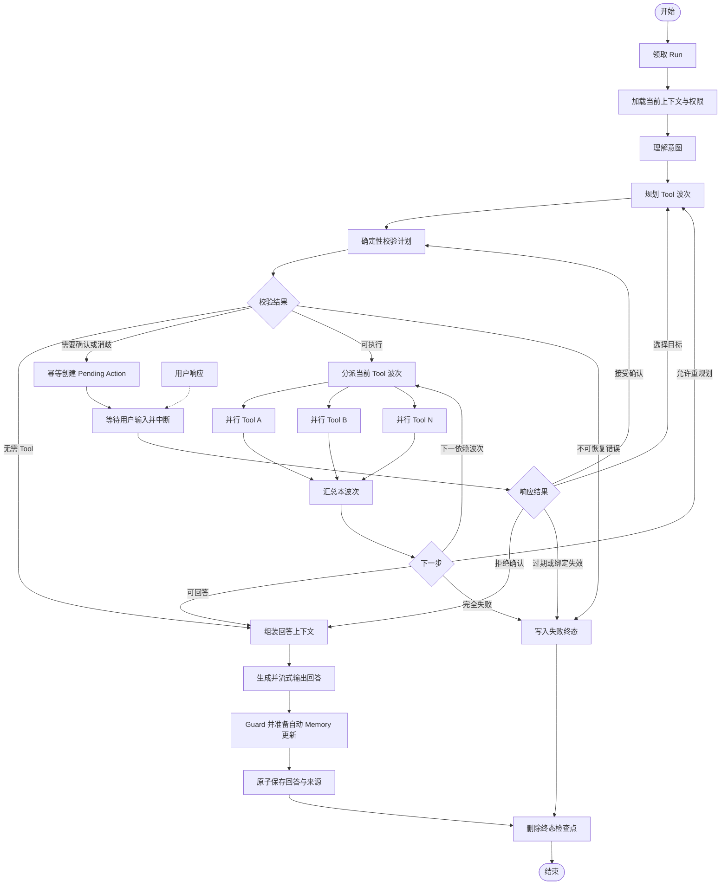
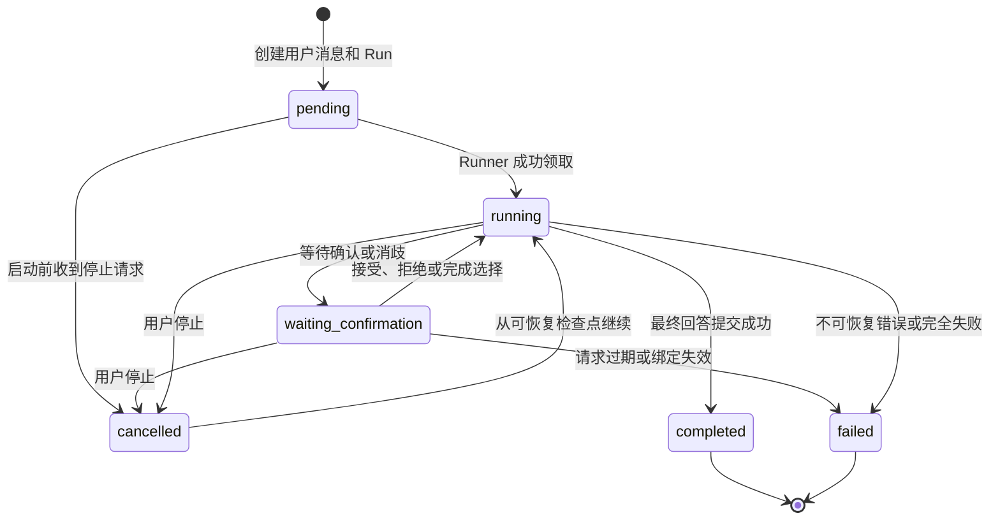

# EnterpriseMind V1 智能体编排状态与检查点设计（确认稿）

> 状态：确认稿  
> 日期：2026-09-12  
> 上游依据：《需求说明书》《系统总体架构设计》《数据库表设计》《数据库关系与约束设计》《API 接口与错误码设计》《检索增强生成参数与离线评测方案》

## 1. 目的与边界

本文档只定义 EnterpriseMind V1 的 LangGraph 状态、节点、边、并行执行、停止与恢复、人工确认以及 PostgreSQL 检查点协议，为后续实现提供确定边界。

本文不新增业务表、用户页面、Run 状态、Tool 类型或高风险操作；Tool Schema、风险等级细则和 SQL Guard 语法规则分别以对应确认稿为准，不在本文重复定义。

V1 明确不采用：

- LangChain 默认 Agent 或其他自动代理框架承载核心流程；
- LangGraph Store 保存业务 Memory；
- LangSmith 托管服务作为运行必需依赖；
- 时间旅行、任意历史检查点回放或分叉等用户功能；
- 检查点内容作为日志、审计记录或业务查询来源；
- Beta 状态通道或依赖实验性执行语义的设计。

## 2. 版本与实现基线

截至 2026-09-12，V1 固定以下直接依赖：

| 组件 | 固定版本 | 用途 |
|---|---:|---|
| `langgraph` | `1.2.11` | `StateGraph`、条件边、`Send`、`Command`、`interrupt` 和流式执行 |
| `langgraph-checkpoint-postgres` | `3.1.2` | PostgreSQL 异步检查点保存器 |

两个包均要求 Python 3.10 或更高版本。项目依赖锁文件继续固定其传递依赖的精确版本；业务代码不单独依赖或直接调用内部的 `langgraph-checkpoint` 实现。

实现约定：

1. 使用 Graph API 的 `StateGraph`，不使用 Functional API 编排主流程。
2. 节点统一使用异步函数，并使用 `AsyncPostgresSaver`。
3. 只使用稳定的 State、Node、Edge、Reducer、`Send`、`Command(resume=...)` 和 `interrupt()` 能力。
4. Provider 超时与临时错误重试由确定性适配层完成；V1 不依赖 1.2 中仍标为 Alpha 的节点超时和错误处理能力。
5. 生产启用 `LANGGRAPH_STRICT_MSGPACK=true`；状态只包含本文允许的基础类型和受控结构，不允许反序列化任意业务类。
6. `AsyncPostgresSaver.setup()` 只在受控初始化或版本升级阶段执行，不在每次请求时执行。
7. 手工提供 Psycopg 连接或连接池时，按官方要求配置 `autocommit=True` 和 `row_factory=dict_row`。

LangGraph 会在每个 super-step 保存检查点，因此本文节点就是经过控制的恢复边界。“只在关键节点保存”通过保持节点粒度与第 6 节一致实现，不在节点内部为 Token、单条结果或普通日志额外创建业务检查点。

以上版本是首版实现基线。升级时必须先通过本文第 15 节的兼容性测试，不能仅按宽松版本范围自动升级。

## 3. 三类状态的职责边界

| 状态类别 | 所有者 | 内容 | 是否为业务事实 |
|---|---|---|---:|
| 业务运行状态 | `agent.agent_runs`、`agent.tool_calls`、`agent.pending_actions`、`agent.messages` | Run 状态、计数、Tool 状态、确认结果、最终消息 | 是 |
| 图执行状态 | LangGraph PostgreSQL Checkpointer | 当前节点、条件分支所需的最小状态、待恢复中间写入 | 否 |
| 当前进程临时状态 | Agent Runner 内存 | Database MCP SQL、结果行、尚未提交的回答增量 | 否，进程结束即丢弃 |

必须遵守：

- 业务表是状态、权限和最终结果的唯一事实来源；检查点不能覆盖业务表中的新状态。
- 恢复前重新读取 `agent_runs`、Tool 状态、Pending Action 和当前权限，不能相信旧检查点中的权限结论。
- 会话摘要和 Memory 只用于辅助理解，涉及企业事实的回答必须重新执行 RAG 或 Database MCP。
- SQL、SQL 摘要、查询结果行、Prompt、模型内部推理和访问令牌不得进入检查点。
- LangGraph Store 不替代 `agent.memory_items`；跨 Run 的 Memory 仍通过既定业务表和 Memory Guard 管理。

## 4. 检查点线程标识

每个 `agent_runs` 使用独立 LangGraph 线程：

```text
thread_id = "agent-run:" + agent_run_id
```

例如业务 Run ID 为 `128` 时，`thread_id` 为 `agent-run:128`。

选择每个 Run 独立线程，而不是每个会话共用线程，原因是：

- 会话上下文已经由 `messages`、`conversation_summaries` 和 `memory_items` 持久化，无需在检查点中复制整段会话；
- 一个 Run 的停止、确认、失败或删除不会污染同会话的其他 Run；
- 完成后可按 Run 精确删除全部检查点，避免长会话无限累积；
- `thread_id` 可由 `bigint` 业务主键确定生成，不需要新增 UUID 业务主键。

LangGraph 内部生成的 checkpoint ID 属于框架协议，不是 EnterpriseMind 业务主键，也不写入业务表。根图使用固定空命名空间；子图不是 V1 必需能力，因此不定义业务化 `checkpoint_ns`。

同一 `thread_id` 在任意时刻只能有一个图执行实例。Runner 在执行和恢复前按 `agent_run_id` 获取 PostgreSQL 会话级 advisory lock；未取得锁时不启动第二个实例。连接断开时锁自动释放，其他实例才能接管。

## 5. 图状态模型

### 5.1 状态字段

图状态采用 `TypedDict`。字段分为以下四组：

| 字段 | 类型 | 说明 |
|---|---|---|
| `state_schema_version` | `int` | 状态结构版本，V1 固定为 `1` |
| `agent_run_id` | `int` | 对应 `agent.agent_runs.id` |
| `conversation_id` | `int` | 对应会话 ID |
| `actor_user_id` | `int` | 发起用户 ID；恢复时只作为定位值，仍需重新鉴权 |
| `user_message_id` | `int` | 本轮用户消息 ID，正文按需从业务表加载 |
| `intent_kind` | `str \| None` | 受控意图类别，不保存思维链 |
| `requires_enterprise_facts` | `bool` | 是否必须重新获取企业事实 |
| `plan_steps` | `list[PlanStep]` | 仅含 Tool Call ID、依赖关系、执行波次和用途的受控计划 |
| `current_wave` | `int` | 当前执行波次，从 `0` 开始 |
| `successful_tool_call_ids` | `list[int]` | 已成功的逻辑 Tool Call ID |
| `failed_tool_call_ids` | `list[int]` | 已最终失败的逻辑 Tool Call ID |
| `knowledge_chunk_ids` | `list[int]` | 经过权限过滤和排序的候选 Chunk ID |
| `citation_anchor_ids` | `list[int]` | 待写入回答来源的 Anchor ID |
| `database_replay_required` | `bool` | 当前回答是否必须在本次进程重新执行 Database MCP |
| `pending_action_id` | `int \| None` | 当前等待的确认或消歧记录 ID |
| `decision` | `str \| None` | 条件边使用的受控路由结果 |
| `terminal_code` | `str \| None` | 最终安全错误码或取消原因 |
| `terminal_message` | `str \| None` | 可向用户展示的简短信息，不保存内部异常栈 |

`PlanStep` 只允许：

```text
tool_call_id
tool_name
wave
depends_on_tool_call_ids
purpose（受控枚举，不是模型自由文本）
requires_database_replay
```

Tool 参数以 `tool_calls.arguments` 为准；Database MCP 仍只保存已确认允许的非 SQL 控制字段。图状态不保存用户消息正文、会话消息列表、Memory 正文、完整 Chunk 正文、Tool 原始输出或最终回答草稿。

### 5.2 运行时上下文

不进入检查点的 `RunContext` 包含：

```text
request_id
access_token_claims
current_permission_scope
user_input
recent_messages
conversation_summary
memory_items
automatic_memory_candidates
authorized_tool_context
database_sql
database_result_rows
database_result_metadata
answer_stream_buffer
```

其中 `automatic_memory_candidates` 只存在于当前进程，来自当前用户消息的长期偏好、工作上下文或持续任务上下文候选，不包含企业事实、Tool/RAG/Database MCP 结果或 Assistant 生成内容。`database_result_metadata` 在进程内可含生成回答所需的列信息；写入 `tool_calls.result_summary` 时只能保留状态、返回行数、`has_more` 和错误分类。

进程重启、显式停止后恢复或 Runner 接管时，`RunContext` 一律重新创建。任一节点需要的临时上下文不存在时，必须按业务 ID 重新加载并重新鉴权，不能假设 `load_context` 的进程内数据仍然存在。若计划包含 Database MCP，`database_replay_required` 强制为 `true`，必须重新生成、校验和执行 SQL。

### 5.3 Reducer 规则

默认字段采用覆盖更新。并行节点可能同时更新的 ID 列表必须使用确定性去重 Reducer：

1. 只接受整数 ID，不接受节点返回的正文或任意对象。
2. 按 `plan_steps` 中的顺序合并，同一 ID 只保留一次。
3. 重试、恢复或同一结果重复写入不会增加重复项。
4. 不使用简单的列表相加处理 Tool 结果，避免恢复时产生重复结果。

`current_wave`、`decision`、`pending_action_id` 和终态字段只能由指定节点覆盖，不允许多个并行 Tool 节点直接修改。

## 6. 主图节点

| 节点标识 | 对外步骤 | 职责 | 允许的持久化副作用 |
|---|---|---|---|
| `claim_run` | 理解 | 确认 Runner 已持有 Run 锁，校验 Run 可执行并转为 `running` | 更新 `agent_runs` |
| `load_context` | 理解 | 加载用户消息、最近消息、摘要、Memory 和当前权限；达到集中配置的 Token 阈值时，对更早且尚未覆盖的消息生成新摘要并保留近期原文 | 可追加 `conversation_summaries` |
| `understand` | 理解 | 识别意图、是否需要企业事实和是否需要 Tool；只从当前用户消息产生自动 Memory 候选 | 无 |
| `plan` | 理解 | 在当前进程内解析 LLM 输出，经 Tool Registry 做结构校验和规范化后，形成有向无环的 Tool 步骤与执行波次 | 只为校验通过且目标已确定的步骤创建或复用 `tool_calls`，更新计数 |
| `guard_plan` | 理解 | 校验次数、Tool Schema、权限、对象唯一性和风险入口 | 更新 Tool 安全失败状态 |
| `prepare_pending_action` | 等待确认 | 幂等创建确认或消歧记录及目标快照 | 写入 `pending_actions` 和目标表 |
| `wait_for_user` | 等待确认 | 调用一次 `interrupt()`；恢复后只返回 Pending Action ID 和状态 | 无 |
| `dispatch_wave` | 检索/查询 | 根据当前波次生成并行 `Send`，有依赖的波次保持串行 | 无 |
| `execute_tool` | 检索/查询 | 经 Tool Gateway 执行一个逻辑 Tool Call | 更新 `tool_calls`；业务写操作由对应领域事务完成 |
| `collect_results` | 合并 | 合并本波次 ID，判断下一波、重规划、部分回答或失败 | 更新 Run 计数和安全失败摘要 |
| `assemble_answer_context` | 合并 | 重新鉴权并按 ID 获取受控上下文；必要时重放 Database MCP | 无 |
| `generate_answer` | 生成 | 根据上下文生成回答、引用和局限说明，并通过 SSE 输出增量；管理员发起本地用户创建或密码重置时可附加服务端白名单客户端动作 | 创建或复用 `streaming` Assistant 消息 |
| `prepare_memory_updates` | 生成 | 对当前用户消息的自动 Memory 候选执行 Memory Guard，并在当前进程形成待提交更新；失败时使用空更新继续 | 无 |
| `persist_terminal` | 生成 | 在同一事务写入最终消息、来源、Run 终态和已通过 Guard 的自动 Memory 更新 | 更新 `messages`、`answer_sources`、`agent_runs`，创建、更新或不写入 `memory_items` |
| `finish_cancelled` | — | 响应停止请求并保留可恢复检查点 | 更新 Run/消息为 `cancelled`/`stopped` |
| `finish_failed` | — | 写入安全失败结果 | 更新 Run/消息为 `failed` |

节点只返回本节点改变的字段，不返回完整 State。所有节点入口都先读取当前 Run 状态；一旦发现 `cancel_requested_at` 非空或状态已经是终态，立即停止继续规划和启动新 Tool。

`generate_answer` 创建 Assistant 消息时必须同时写入 `agent_runs.assistant_message_id`；节点重入时按该 ID 复用原消息，不能追加第二条同一 Run 的流式回答。

## 7. 主流程与条件边



图中并行 Tool 数量由当前波次和全局并发配置共同限制；没有依赖关系的调用可并行，有依赖关系的调用必须进入后续波次。V1 不允许 LLM 直接构造任意图或绕过固定条件边。

### 7.1 规划约束

- `plan_steps` 必须是无环依赖图；发现环、未知 Tool 或无效参数时不执行。
- LLM 原始 Tool 请求只存在于当前节点内存；只有通过 JSON Schema 校验、字段白名单、类型转换和规范化的参数才能写入 `tool_calls`。校验失败的原始输出不得进入 State 或 Checkpoint。
- 对象仍然模糊时不创建实际 Tool Call；先创建 `tool_call_id` 为空的消歧 Pending Action，用户选择后再规划并物化调用。
- 需要企业事实但计划中没有 RAG 或 Database MCP 时，`guard_plan` 要求重规划；不能仅依赖 Memory 或会话摘要回答。
- 消歧完成后若所选操作属于高风险，必须再创建独立确认，不能把“选择对象”当作“同意执行”。
- 高风险 Tool 必须在规范化参数、目标快照和权限版本均确定后才能创建确认。

### 7.2 并行与汇合

`dispatch_wave` 使用 `Send("execute_tool", ...)` 为当前波次内每个逻辑 Tool Call 创建独立输入。每个分支只接收 `agent_run_id`、`tool_call_id` 和当前波次，不复制完整主状态。

同一波次全部分支结束后才进入一次 `collect_results`。汇总规则为：

- 全部成功：执行下一依赖波次或生成回答；
- 部分成功：若成功结果足以回答，则继续并明确失败来源和局限；
- 失败结果可能通过换参数或换 Tool 修复，且未达到 Replan 上限：重新规划；
- 问题完全依赖失败 Tool：进入失败终态，不得编造企业事实。

### 7.3 会话摘要与自动 Memory

`load_context` 先读取最新 `conversation_summaries.through_sequence`，再读取该序号之后的消息。当较早未摘要消息达到集中配置的 Token 阈值时，只把较早部分压缩为一条覆盖到固定 `through_sequence` 的新摘要，并继续保留近期消息原文。相同 `(conversation_id, through_sequence)` 重入必须复用既有摘要；摘要失败时继续使用可装入模型上下文的近期原文，不能把摘要当企业事实或回答引用。

自动 Memory 只处理当前用户消息。候选输出按不可信模型输出处理，必须满足固定分类、长度和敏感内容规则，并生成用户内稳定 `memory_key` 与 `content_fingerprint`。`prepare_memory_updates` 只在当前进程形成待提交数据；`persist_terminal` 再在用户锁或行锁内与成功回答同事务执行：相同指纹不写入，相同非空稳定键更新旧项，否则创建 `source_type = automatic` 的新项并绑定 `source_message_id`。Memory 写入使用事务内保存点隔离，候选自身的约束或并发失败只回滚该保存点并继续提交回答；如果整个终态事务失败，则回答和自动 Memory 都不提交。节点重入依靠数据库唯一约束收敛，不创建重复 Memory；冲突或 Guard 失败只放弃对应候选，不把正文写入错误信息。用户明确要求记住时仍通过 `memory_create` Tool 执行，不与自动路径重复写入。

## 8. Tool Call、Replan 与 Retry 计数

V1 默认配置：

| 配置项 | 默认值 | 计数语义 |
|---|---:|---|
| `agent.max_tool_calls` | `12` | 一个 Run 最多创建 12 个逻辑 `tool_calls` |
| `agent.max_replans` | `2` | 首次规划不计数，因结果不足或可修复错误重新规划时计数 |
| `tool.max_retries` | `3` | 每个 Tool 初次尝试后最多再重试 3 次 |

计数必须写入业务表并原子检查：

- 创建新的逻辑 `tool_calls` 时，`agent_runs.tool_call_count + 1`；同一幂等键恢复或重放不增加。
- 首次 `plan` 不增加 `replan_count`；从 `collect_results` 回到 `plan` 时增加 1。
- Tool 的初次执行不是 Retry；只有临时错误后的再次执行增加 `tool_calls.retry_count` 和 `agent_runs.retry_count`。
- Database MCP 因进程丢失临时结果而在恢复时重新查询，属于同一逻辑调用的安全重放，不增加 Tool Call 或 Retry 计数。
- 达到任一上限后不再创建调用或重规划，使用 `RUN_LIMIT_REACHED` 结束；已有充分结果时可生成带局限说明的回答。

临时网络错误、超时、限流和允许重试的部分 5xx 使用指数退避并加入抖动；鉴权失败、参数错误、模型不存在、权限拒绝和 SQL Guard 拒绝均不重试。重试范围由对应 Provider/Tool 适配层明确判断，不使用“所有异常都重试”。

LLM Provider 仍按既定统一规则最多自动重试 3 次，但不记入 Tool 的 `retry_count`；Tool Call、Replan 和 Tool Retry 三类执行上限不能被模型调用重试混为一项。

## 9. 确认与消歧中断协议

### 9.1 中断前

`prepare_pending_action` 在独立节点中完成以下事务：

1. 在持有 Run 锁的前提下，按 `agent_run_id + pending` 复用或创建当前唯一 `origin = agent` 的 Pending Action；
2. 保存规范化参数、binding hash 和目标 `row_version`；
3. 高风险调用把 `tool_calls.status` 更新为 `waiting_confirmation`；
4. 把 `agent_runs.status` 更新为 `waiting_confirmation`；
5. 提交后再进入 `wait_for_user`。

消歧发生在实际 Tool 参数确定前，因此 `pending_actions.tool_call_id` 可以为空；选择目标后回到 `plan` 重新生成确定参数。高风险确认必须绑定非空 Tool Call。

页面资源接口创建的 `origin = api` Pending Action 不进入本图，也不需要 `agent_run_id`；它由同一确认服务直接恢复绑定的领域命令。

### 9.2 中断节点

`wait_for_user` 只执行一次固定位置的 `interrupt()`，中断负载只包含：

```text
pending_action_id
action_type
safe_prompt
```

它不创建记录、不更新业务对象，不在 `interrupt()` 前执行非幂等副作用，也不捕获 LangGraph 的中断异常。

### 9.3 响应与恢复

Pending Action 响应接口先在数据库事务中锁定并解析记录，然后使用同一 `thread_id` 调用：

```text
Command(resume={pending_action_id, resolved_status})
```

恢复负载只是唤醒信号。`wait_for_user` 从头重新执行后必须按 ID 重新读取数据库，并校验：

- 响应者仍是绑定用户；
- 用户、部门和目标权限仍有效；
- Pending Action 未过期且状态与响应一致；
- binding hash、规范化参数和目标 `row_version` 未变化。

接受确认后再次进入 `guard_plan`；拒绝确认时取消对应 Tool Call，Run 回到回答流程并告知“未执行”，最终 Run 状态为 `completed` 而不是 `cancelled`。过期或绑定失效不执行 Tool，Run 以相应安全错误码结束。

响应事务与 LangGraph 唤醒不是同一事务。若响应已经提交但唤醒失败，现有恢复器扫描 `waiting_confirmation` Run，取得 Run 锁后向仍停在该 `interrupt` 的线程补发同一 ID 和状态；同一个 `Idempotency-Key` 的接口重试返回原响应，不重复解析 Pending Action。

现有 Scheduler 发现 Pending Action 到期时，先把其状态原子更新为 `expired`，再取得 Run 锁并以相同 `thread_id` 发送只含 ID 和 `expired` 状态的恢复信号，使 Run 进入失败终态并清理检查点；重复处理必须幂等。

## 10. Run 状态机



状态规则：

- `completed` 和 `failed` 是不可恢复终态；用户可发起新的消息，但不能重开原 Run。
- `cancelled` 只有仍存在可恢复检查点时才能通过 `/resume` 回到 `running`。
- `waiting_confirmation` 只能通过 Pending Action 响应接口恢复，不能用通用 `/resume` 绕过确认。
- Pending Action 被拒绝后先恢复为 `running`，生成“操作未执行”的正常回答，再进入 `completed`。
- 所有终态必须设置 `finished_at`；从 `cancelled` 恢复时清空 `finished_at` 和作为当前取消信号的 `cancel_requested_at`。

## 11. 停止与继续

### 11.1 停止

`POST /agent-runs/{run_id}/stop` 的最小语义为：

1. 锁定 Run，确认当前为 `pending`、`running` 或 `waiting_confirmation`；
2. 设置 `cancel_requested_at` 并把状态更新为 `cancelled`；
3. 如存在未解决 Pending Action，将其更新为 `cancelled`；
4. 通知当前 Runner 取消尚未开始的分支；
5. 若正在流式生成，把已发送且仍在进程缓冲区中的文本写为 `messages.status = stopped`；
6. 保留最近可用检查点。

每个节点入口、外部调用前和业务写事务提交前都必须重新检查停止信号。已经提交的业务事务不能回滚，因此停止是节点边界和提交边界上的协作式停止，不承诺撤销已经成功的操作。

等待确认或消歧期间停止时，原 Pending Action 已被取消；继续 Run 后如仍需该操作，必须基于当前权限和目标状态重新创建，不能复用旧响应。

### 11.2 继续

`POST /agent-runs/{run_id}/resume` 必须：

1. 校验请求用户仍拥有会话且 Run 为 `cancelled`；
2. 确认可读取该 `thread_id` 的检查点；
3. 获取同一 Run advisory lock；
4. 重新鉴权并清空当前取消信号；
5. 将 Run 转为 `running`，使用相同 `thread_id` 从最近检查点继续；
6. 重新执行所有依赖实时业务数据的读取，Database MCP 必须重新生成并执行 SQL；
7. 若存在 `stopped` Assistant 消息，复用该消息 ID、重新置为 `streaming` 并清空旧 `completed_at`，最终以新生成的完整正文替换旧的截断正文。

无检查点、Run 已完成/失败、会话已删除或状态不允许时返回 `RUN_NOT_RESUMABLE`。

## 12. 崩溃恢复与幂等

检查点只保证图在节点边界恢复，不能把检查点事务与领域事务合并为一个事务。因此所有有副作用节点按“可能至少执行一次”设计：

- `tool_calls` 以 `(actor_user_id, idempotency_key)` 去重；
- 如果 `plan` 的业务事务已创建 Tool Call、但节点状态尚未成功写入 Checkpoint 就发生崩溃，重入时在 Run 锁内清理“未启动、未绑定 Pending Action、且未被当前 `plan_steps` 引用”的孤立 Tool Call，并同步修正计数后再规划；已经启动或产生副作用的调用绝不能按此规则删除；
- 执行前读取已有 Tool 状态，已成功的非 Database MCP 调用直接复用受控结果摘要；
- 业务写 Tool 在领域事务内再次鉴权、校验目标版本和停止信号；
- 高风险操作必须重新验证已接受确认；
- Database MCP 即使已有 `success` Tool Call，也因结果未持久化而重新只读查询；
- 最终消息、回答来源和 Run `completed` 在一个数据库事务中提交；若业务终态已提交而检查点未推进，恢复器只清理检查点，不重复生成回答。

Runner 启动和周期恢复流程只扫描 `pending`、`running` 状态的业务 Run。取得 advisory lock 后：

- 有检查点则继续；
- `pending` 且尚无检查点时，从 `user_message_id` 构造初始状态；
- `running` 且无检查点时标记 `failed`，使用安全内部错误，不能猜测此前执行位置；
- `waiting_confirmation` 且 Pending Action 仍为 `pending` 时不执行 Tool；若检查点尚未真正停在 `interrupt`，只推进到 `wait_for_user` 并再次持久化中断；
- `waiting_confirmation` 且 Pending Action 已解析时，向对应 `interrupt` 补发只含 ID 和状态的恢复信号；
- `cancelled` 不自动恢复，必须由用户调用 `/resume`。

## 13. Database MCP 临时结果协议

Database MCP 是本图唯一需要跨节点使用但禁止持久化正文结果的路径：

1. `execute_tool` 在当前 Runner 内存中以 `tool_call_id` 保存 SQL、结果行和列元数据。
2. 返回 State 的内容只有 Tool Call ID、成功/失败和 `database_replay_required`。
3. `assemble_answer_context` 先检查当前内存是否存在对应结果；不存在时重新读取用户问题和 active Schema 快照，重新生成 SQL，经过 SQL Guard 后再次执行。
4. 任何恢复、进程切换或显式停止后继续都视为内存结果不存在。
5. 生成完成后立即清空 SQL 和结果行；SSE、日志、指标、异常栈、Tool 表和检查点均不得包含这些内容。
6. 用户明确请求导出时，结果只写入对应 MinIO 生成文件；图状态只保存 `generated_artifact_id`，不保存导出数据。

数据库查询重放必须基于当前权限、当前 active Schema 快照和当前问题重新生成，不能从历史 Tool 摘要还原或修改旧 SQL。

## 14. 检查点存储、清理与安全

### 14.1 Schema 与权限

- 检查点使用独立 `langgraph_checkpoint` Schema。
- Checkpointer 连接固定使用 `langgraph_checkpoint` 作为首个 `search_path`，防止框架内部表落入 `public` 或业务 Schema。
- Schema 内部表只由固定版本 `AsyncPostgresSaver` 的 `setup()` 和 API 管理。
- 领域迁移不复制其表结构，领域 Repository 不直接查询或更新内部表。
- Checkpointer 数据库角色只获得该 Schema 所需权限，不获得企业业务数据源凭据。
- 检查点与业务数据库一起备份，但恢复后仍按业务 Run 状态判断是否允许继续。

### 14.2 生命周期

| Run 状态 | 检查点策略 |
|---|---|
| `pending` / `running` | 保留，用于故障接管 |
| `waiting_confirmation` | 保留至响应、取消或过期 |
| `cancelled` | 保留至用户继续或会话删除 |
| `completed` / `failed` | 业务终态提交后调用 `adelete_thread(thread_id)` 删除全部检查点和中间写入 |

终态清理失败不能回滚已经提交的回答或把成功 Run 改成失败。后台清理器从终态 `agent_runs` 确定生成 `thread_id`，重复调用删除接口，删除操作必须幂等。

会话确认删除时，在同一业务事务中为每个关联 Run 写入一个只含 Run ID 的现有 Outbox 事件，并物理删除会话聚合；消费者随后逐个调用 `adelete_thread`。这样不新增日志表，也能在服务崩溃后完成残留检查点清理。Outbox 成功事件仍按既定保留策略删除。

V1 不做“保留最新一个检查点”的局部裁剪：一个 Run 生命周期短，结束后整体删除；对仍需恢复的 Run 不删除祖先检查点，避免破坏恢复链。

### 14.3 内容安全

检查点允许保存的内容只有第 5.1 节字段。实现必须提供自动化扫描，断言以下内容不存在于 Checkpointer 表：

- Database MCP SQL、查询结果行和数据库凭据；
- Bearer Token、MinIO 临时签名 URL、Provider Key；
- Prompt、模型内部推理、异常栈；
- 未经过权限过滤的 Chunk 正文或 Schema 信息；
- 用户会话、Memory 和最终答案的正文副本。

## 15. 图版本兼容与发布

LangGraph 恢复时会让已有检查点使用当前部署的图代码，因此 V1 发布遵守：

1. 不删除或重命名仍可能被暂停 Run 引用的节点。
2. State 新字段只能先作为可选字段加入，并提供默认值。
3. 旧字段至少保留到所有 `pending`、`running`、`waiting_confirmation` 和 `cancelled` Run 都不再依赖。
4. 行为发生变化时读取 `state_schema_version` 做显式兼容分支，不让旧 Run 静默采用不兼容语义。
5. 升级 `langgraph` 或 Checkpointer 前，在生产数据副本上验证旧检查点可加载、可恢复、可中断并可删除。
6. 若无法保证兼容，先停止创建新 Run，处理或明确终止在途 Run，再部署破坏性变更。

V1 不提供用户可见的历史回放和图分叉，因此兼容范围只覆盖当前可恢复 Run。

## 16. SSE 映射

| 图动作 | `agent_runs.current_step` | SSE 事件 |
|---|---|---|
| 加载上下文、理解、规划、校验 | `理解` | `step.updated` |
| RAG 或文档读取 Tool | `检索` | `step.updated` |
| Database MCP | `查询` | `step.updated` |
| 多 Tool 汇总、上下文组装 | `合并` | `step.updated` |
| LLM 生成 | `生成` | `step.updated`、`answer.delta` |
| 进入确认或消歧 | `等待确认` | `run.status`、`pending_action.required` |
| 最终提交 | 空或保留最后一步 | `run.completed` / `run.failed` / `run.cancelled` |

SSE 是状态投影而不是事实存储。客户端断线重连后先读取 `agent_runs` 和消息；V1 不从 Checkpointer 内部表回放已错过的 Token 增量。事件不得包含 Prompt、思维链、SQL、结果行或无权限对象详情。

## 17. 验收用例

| 场景 | 必须满足的结果 |
|---|---|
| 普通知识问答 | 单 Run 独立 `thread_id`，完成后消息与引用提交，检查点删除 |
| RAG 与 Database MCP 并行 | 同波次并行；只合并授权结果；检查点中无 SQL 和结果行 |
| 有依赖的多 Tool | 后一波只在依赖成功后执行 |
| 并行分支重复回传 | Reducer 按 Tool Call ID 去重，顺序稳定 |
| Tool 临时失败 | 初次尝试后最多重试 3 次；计数准确且仅重试可恢复错误 |
| 部分 Tool 失败 | 能回答时标明缺失来源和局限；完全依赖失败 Tool 时不编造 |
| 对象模糊 | 先消歧；选择高风险目标后仍需独立确认 |
| 确认拒绝 | Tool 不执行，Run 正常回答“未执行”并进入 `completed` |
| 确认后目标变化 | 返回绑定变化错误，不执行，也不静默替换目标 |
| 停止运行 | 新 Tool 不再启动，Run 为 `cancelled`，保留最近检查点 |
| 继续已停止运行 | 重新鉴权；Database MCP 重查；同一逻辑 Tool 不重复产生业务副作用 |
| Tool 提交后进程崩溃 | 恢复后按幂等键复用已提交结果，不重复写业务对象 |
| Database MCP 后进程崩溃 | 不复用历史 SQL/结果，重新生成、Guard 和只读查询 |
| 回答提交后进程崩溃 | 业务 Run 已完成时不重复生成，只补做检查点清理 |
| 同 Run 并发恢复 | 只有取得 advisory lock 的实例执行 |
| 会话删除 | 业务聚合删除，Outbox 最终驱动所有关联 Checkpoint 删除 |
| 长会话达到摘要阈值 | 只摘要较早消息并保留近期原文；摘要不能作为企业事实引用 |
| 自动提取 Memory | 只读取当前用户消息；经过 Memory Guard；重复候选不新增，冲突更新旧项 |
| 自动 Memory 提取失败 | 回答仍按原结果完成；不保存候选正文或错误正文 |
| 图版本升级 | 旧在途检查点仍可加载和恢复，无节点名或必填字段破坏 |
| 敏感内容扫描 | 检查点、日志、SSE 和指标中均无 SQL、结果行、令牌和思维链 |

## 18. 本阶段确认结论

1. V1 使用 `langgraph==1.2.11` 与 `langgraph-checkpoint-postgres==3.1.2`，采用异步 Graph API。
2. 一个 `agent_run` 对应一个 `thread_id = agent-run:{id}`，不新增 UUID 业务主键。
3. 业务表是事实来源；检查点只保存恢复所需的最小状态和业务 ID。
4. Database MCP SQL 与结果仅存在于当前进程内存，恢复时强制重查。
5. 无依赖 Tool 通过 `Send` 按波次并行，有依赖 Tool 串行；Reducer 以 Tool Call ID 确定性去重。
6. 确认和消歧使用独立 Pending Action 后进入 `interrupt()`；恢复负载不作为可信业务输入。
7. Tool Call、Replan、Retry 独立计数，默认上限分别为 12、2、3。
8. `cancelled` 保留检查点并允许用户继续；`completed` 和 `failed` 提交业务终态后删除检查点。
9. V1 不启用 LangGraph Store、用户时间旅行、检查点审计或实验性状态通道。
10. 长会话达到集中配置的 Token 阈值后只摘要较早消息；自动 Memory 只从当前用户消息提取并经过 Memory Guard，失败不改变回答终态。
11. Agent 不接收密码参数；管理员发起用户创建或密码重置时只返回受控管理页面动作，密码由页面直交专用 API。

## 19. 跨文档实现约束

本设计已与《工具参数结构、风险等级与确认协议》（确认稿）对齐，并共同复用：

- `tool_calls` 是逻辑调用与幂等边界；
- Tool 参数不直接来自未经校验的模型输出；
- 对象消歧先于高风险确认；
- 确认绑定 Tool、规范化参数、目标、权限版本和 `row_version`；
- 恢复和执行前都重新鉴权；
- Database MCP 参数、结果和重放规则不得突破本文边界。

## 20. 官方依据

- [LangGraph 1.2.11 发布包](https://pypi.org/project/langgraph/1.2.11/)
- [LangGraph PostgreSQL Checkpointer 3.1.2 发布包](https://pypi.org/project/langgraph-checkpoint-postgres/3.1.2/)
- [Graph API 与 State、Reducer、Send、Command](https://docs.langchain.com/oss/python/langgraph/graph-api)
- [持久化与线程检查点](https://docs.langchain.com/oss/python/langgraph/persistence)
- [Interrupt 与恢复规则](https://docs.langchain.com/oss/python/langgraph/interrupts)
- [故障、重试与超时能力状态](https://docs.langchain.com/oss/python/langgraph/fault-tolerance)
- [图版本兼容规则](https://docs.langchain.com/oss/python/langgraph/backward-compatibility)
- [PostgreSQL Checkpointer 官方说明](https://github.com/langchain-ai/langgraph/blob/main/libs/checkpoint-postgres/README.md)
- [异步删除线程检查点接口](https://reference.langchain.com/python/langgraph.checkpoint.postgres/aio/AsyncPostgresSaver/adelete_thread)
