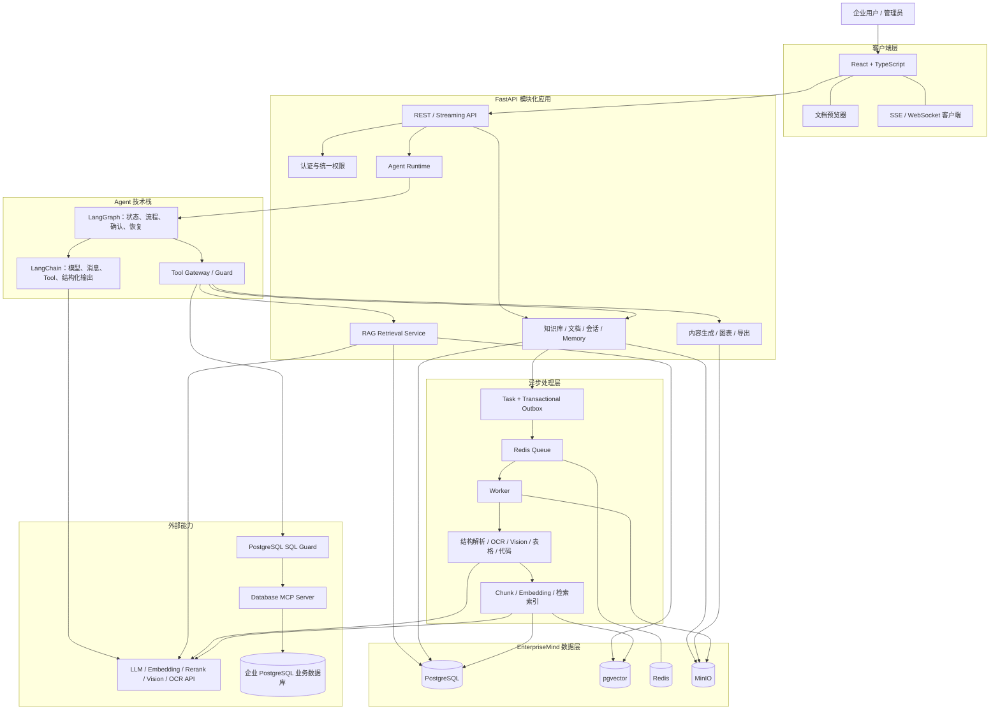
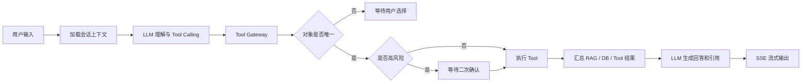

# EnterpriseMind V1 系统总体架构设计（确认稿）

## 1. 文档目的

本文档依据《EnterpriseMind V1 需求说明书》定义系统总体架构、模块边界、核心链路、数据职责、安全边界和部署形态，作为详细设计、代码组织、任务拆分和技术验收的基础。

当前已确认的关键决策：

- 系统面向单一企业私有化部署，不考虑多租户。
- 企业业务数据库为 PostgreSQL，通过独立 Database MCP Server 只读访问。
- EnterpriseMind 自身 PostgreSQL 不通过 MCP 暴露，与企业业务数据库保持独立的连接、账号和权限边界。
- V1 普通用户可管理其有权访问知识库中的文档与文件夹：所有有效用户可管理公共知识库内容，部门成员可管理本部门知识库内容。
- 知识库本身的创建、编辑、删除、恢复和迁移仅限管理员。
- Agent 使用自定义 LangGraph 编排；LangChain 作为模型、消息、Tool 和结构化输出的组件层，不使用默认 Agent 承载核心业务流程。

## 2. 架构结论

EnterpriseMind V1 采用：

> 模块化单体 FastAPI + LangGraph Agent 编排 + LangChain 组件适配 + Redis 异步 Worker + PostgreSQL/pgvector + MinIO + 独立 Database MCP Server。

V1 不拆分大量微服务。身份权限、知识库、文档、RAG、会话、Memory、Agent 和导出能力作为 FastAPI 应用中的独立领域模块；长耗时文档处理、安全边界不同的 Database MCP 和基础设施以独立进程或容器部署。

该架构优先保证：

1. 权限和业务规则只有一个确定性执行入口。
2. Agent 编排与领域能力解耦。
3. 在线请求与离线文档处理隔离。
4. PostgreSQL 作为长期业务状态的真实来源。
5. Redis、MinIO 和外部模型服务故障时能够重试、恢复和追踪。
6. Worker、API 和模型调用能力可独立扩展。

## 3. 系统上下文与总体组件



## 4. 逻辑分层

### 4.1 展示层

React + TypeScript 前端负责：

- 登录和会话交互。
- Agent 流式回答与高层执行状态展示。
- 知识库、文件夹、文档、回收站和 Memory 管理。
- 管理员的用户、密码重置、部门、知识库和 Database MCP 配置。
- 文档预览、引用跳转与高亮。
- 二次确认和模糊对象选择。

前端不负责最终权限判断，也不保存任务真实状态。

### 4.2 API 与应用层

FastAPI 负责协议接入、请求校验、身份解析、事务边界、领域服务调用以及 SSE/WebSocket 连接。路由层不得直接操作 PostgreSQL、MinIO 或企业业务数据库。

建议模块：

```text
identity        用户、登录、部门
authorization   角色和动态权限范围
knowledge       知识库、文件夹、文档
ingestion       上传、处理任务、状态和重试
retrieval       关键词、向量、RRF、Rerank、上下文合并
citation        来源锚点、预览定位、高亮
agent           LangGraph、Tool、确认、取消和恢复
conversation    会话、消息和摘要
memory          长期 Memory 与 Memory Guard
database        Schema、权限、SQL Guard 和 MCP 适配
export          内容、图表和文件导出
admin           系统配置接口
```

### 4.3 Agent 编排层

- LangGraph 管理 State、Node、条件边、循环、并行任务、Checkpoint、Human-in-the-loop、取消、恢复和执行上限。
- LangChain 提供模型接口、消息类型、Tool Schema、结构化输出、Prompt 组装和流式调用适配。
- Tool Gateway 统一执行对象消歧、权限、参数、风险确认、幂等和调用次数检查。
- 领域服务执行实际业务操作；LLM 和 LangChain Tool 都不能绕过领域服务直接修改数据。

### 4.4 领域服务层

领域服务承载确定性规则，包括：

- 用户和部门状态约束。
- 知识库访问与管理权限。
- 文件夹和文档同名、移动、覆盖与回收站规则。
- 文档处理状态机。
- RAG 权限过滤和引用生成。
- Memory Guard。
- PostgreSQL Schema 暴露与 SQL 安全检查。
- 高风险操作确认。

### 4.5 基础设施层

- PostgreSQL：业务状态和长期数据。
- pgvector：Chunk 向量与相似度检索。
- Redis：异步队列、短期缓存和实时事件。
- MinIO：文件实体和生成物。
- 外部 Provider：LLM、Embedding、Rerank、Vision、OCR。
- Database MCP Server：企业 PostgreSQL 的受控只读访问边界。

## 5. 权限架构

### 5.1 V1 权限规则

| 对象 | 管理员 | 普通用户 |
|---|---|---|
| 用户、部门 | 全部管理 | 无管理权限 |
| 公共知识库本身 | 全部管理 | 仅访问 |
| 公共知识库文档/文件夹 | 全部管理 | 所有有效用户可管理 |
| 部门知识库本身 | 全部管理 | 仅访问所属部门知识库 |
| 部门知识库文档/文件夹 | 全部管理 | 所属部门成员可管理 |
| Database MCP 配置 | 全部管理 | 无管理权限 |
| Database MCP 查询 | 可使用 | 按部门表/View权限使用 |

文档“管理”包括上传、重命名、移动、删除、恢复、覆盖和失败重试；其中删除、覆盖等高风险操作仍须二次确认。

### 5.2 统一授权服务

建立统一 `AuthorizationService`，根据用户角色、用户状态、部门状态、知识库类型和部门归属计算：

```text
accessible_knowledge_base_ids
manageable_document_knowledge_base_ids
allowed_database_relations
allowed_admin_actions
```

权限必须在服务端以下位置执行：

1. API 请求进入领域服务时。
2. 关键词和向量检索查询中。
3. 检索结果返回及引用预览前。
4. Tool 执行前。
5. 高风险操作确认后。
6. Checkpoint 恢复后。
7. Database MCP Schema 暴露和 SQL 执行前。

权限缓存只能用于加速，最终执行必须重新校验，确保知识库迁移、用户停用和部门变更立即生效。

## 6. Agent 在线执行架构



Agent 运行上下文分为检查点状态、当前进程临时上下文和业务事实三层。检查点只保存恢复所需的最小标识与执行游标：

```text
state_schema_version
run_id
conversation_id
actor_user_id
user_message_id
intent_kind
plan_steps（只含已校验的 Tool Call ID、依赖和波次）
successful_tool_call_ids
failed_tool_call_ids
knowledge_chunk_ids
citation_anchor_ids
pending_action_id
database_replay_required
```

用户输入、最近消息、会话摘要、Memory 正文、当前权限、Database MCP SQL 与结果行以及回答流缓冲区只存在于当前进程内存；丢失后按业务 ID 重新加载并重新鉴权。Run 状态、三类计数、Tool 状态、Pending Action 和最终消息以业务表为准，不以 Checkpoint 为准。

非 Database MCP Tool 的受控结果摘要保存在 `tool_calls.result_summary`，检查点仅保存对应 ID。Database MCP 的 SQL 和查询结果仅存在于当前执行进程内存，不进入 LangGraph Checkpoint；恢复任务时必须重新生成、校验并执行查询。具体字段和恢复规则见《智能体编排状态与检查点设计》。

企业事实不得只依赖历史摘要和 Memory；回答涉及企业事实时必须重新执行 RAG 或 Database MCP。

## 7. Tool Gateway 与确认机制

所有 Tool 使用统一调用信封：

```text
tool_call_id
agent_run_id
tool_name
arguments
actor_user_id
permission_scope_version
idempotency_key
pending_action_id
```

统一处理顺序：

```text
Schema 校验
→ 对象解析与消歧
→ 当前权限检查
→ 风险等级判断
→ 必要时等待确认
→ 幂等检查
→ 领域服务执行
→ 结果标准化
→ 保存 Tool Call 状态
```

Database MCP 调用在运行时信封中临时携带 SQL，但持久化 Tool Call 状态前必须移除 SQL、SQL 摘要和结果行，只保留数据源、Schema 快照、分页参数、状态、返回行数和 `has_more` 等非 SQL 信息。

确认对象应绑定来源、领域操作、用户、Tool 名称（如有）、标准化参数、目标资源、资源当前修订号和有效期。Agent 来源绑定 Run 和 Tool Call；页面 API 来源不伪造 Run。确认后重新鉴权并检查资源是否变化，防止等待期间产生越权或误操作。

## 8. 文档上传与异步处理


### 8.1 Transactional Outbox

文档、处理任务和 Outbox 事件在同一个 PostgreSQL 事务中写入。Dispatcher 读取 Outbox 并投递 Redis，成功后标记已投递，避免数据库写入与队列投递不一致。

### 8.2 内部处理代次

文档增加内部字段：

```text
document_id
latest_revision_no
active_revision_id
```

内部处理代次不向用户提供版本历史能力，只用于保障覆盖、失败重试和并发处理时新旧解析结果不会混用。新代次完整处理成功或部分成功后，以事务方式切换可检索范围。

覆盖确认后创建新的 `document_revisions` 记录并递增 `latest_revision_no`，但旧 `active_revision_id` 在新代次处理期间保持不变。新代次完整成功，或达到可激活的 `partial_success` 条件后，事务性切换 `active_revision_id`；切换成功后旧代次才退出检索，并通过后台清理任务删除。新代次处理失败时继续使用旧活跃代次；首次上传没有旧代次可回退。

### 8.3 Worker 幂等

Worker 以 `document_id + revision_id + stage + unit` 作为幂等边界。任务重试不能生成重复 Chunk、重复 Embedding 或覆盖更新代次的状态。

任务可按负载拆分队列：

```text
parse
ocr
vision
embedding
preview
export
cleanup
```

## 9. RAG 架构

### 9.1 V1 检索方案

推荐默认使用：

```text
PostgreSQL Full Text Search + pg_trgm + 中文预分词
+
pgvector
```

这样可在 V1 避免增加 OpenSearch/Elasticsearch 运维成本，并便于将权限、回收站状态和处理代次过滤统一注入检索查询。中文关键词召回必须通过离线评测验证；V1 内只调整已确认的预分词、`pg_trgm`、融合和 Rerank 参数。引入独立搜索引擎属于 V1 之后重新评审的架构变更，不是本版降级路径。

### 9.2 检索流程

```text
Query 理解和范围收缩
→ 权限范围计算
→ 关键词与向量并行召回
→ RRF 融合
→ Rerank
→ 相关性阈值过滤
→ 相邻 Chunk 合并
→ 去重
→ 最多 10 个上下文
→ 回答与引用
```

权限过滤、`active_revision_id` 指向代次的可激活处理状态、Chunk 就绪状态和回收站状态必须同时应用在关键词和向量检索中。不能使用最新代次或文档聚合处理状态遮蔽仍有效的旧活跃代次；因此覆盖处理中或处理失败时旧内容继续参与检索，成功切换后旧内容才退出。LLM 可以缩小知识库范围，不能扩大权限范围。

### 9.3 引用数据模型

解析阶段生成统一来源锚点：

| 格式 | 来源锚点 |
|---|---|
| PDF/图片 | 页码、Bounding Box、页面尺寸 |
| DOC/DOCX | 标题路径、段落标识、字符范围 |
| PPT/PPTX | Slide、Shape 标识、Bounding Box |
| XLS/XLSX/CSV | Sheet、单元格范围、表头上下文 |
| Markdown/TXT | 行号或字符偏移 |

Chunk 可关联多个来源锚点；回答引用指向实际采用的锚点和原文片段。预览服务根据锚点转换为前端高亮坐标。

## 10. Database MCP 与 PostgreSQL SQL Guard

### 10.1 安全边界

- Database MCP Server 使用独立的 PostgreSQL 只读账号。
- 优先只开放经过脱敏和字段裁剪的 View。
- EnterpriseMind 自身 PostgreSQL 的凭据、Schema 和网络入口不提供给 MCP Server。
- MCP Server 只接收经过 EnterpriseMind SQL Guard 验证的请求，但自身仍需再次执行对象白名单、超时和行数限制。

### 10.2 Schema 范围

提供给 LLM 的 Schema 是：

```text
全局白名单
∩ 当前用户部门权限
∩ 当前有效 Schema 快照
```

无权限的表名、字段名和注释不进入模型上下文。

Schema 快照保存在 EnterpriseMind PostgreSQL，包含 PostgreSQL Schema、表/View、字段类型、主外键和注释。管理员手动刷新时生成新快照，正在执行的查询固定使用本次运行绑定的快照版本。

### 10.3 SQL Guard

SQL Guard 固定使用 `pglast==8.4` 解析 PostgreSQL AST；详细规则见《数据库模式快照与 SQL 防护规则》。至少校验：

- 仅允许单条只读查询。
- 表、View、Schema 和字段是否存在且在权限范围内。
- 禁止 DML、DDL、COPY、DO、CALL 和危险函数。
- 限制系统目录访问。
- 强制 statement timeout。
- 强制最大返回行数，普通查询默认 100 行。
- 大数据通过分页或 CSV/XLSX 导出，不进入 LLM Context。

连续追问每轮重新根据当前问题、上一轮语义和当前 Schema 生成 SQL，不直接修改旧 SQL 字符串。

## 11. 数据存储职责

| 组件 | 职责 | 不承担的职责 |
|---|---|---|
| EnterpriseMind PostgreSQL | 用户、权限、知识库、文档元数据、任务、会话、Memory、Agent Run、Checkpoint、Schema 快照 | 原始大文件、企业业务查询 |
| pgvector | Chunk Embedding 和向量检索 | 权限真实来源 |
| Redis | 任务队列、短期缓存、实时事件 | 长期任务真实状态 |
| MinIO | 原始文件、预览文件、生成文件、导出文件 | 业务状态和权限 |
| 企业 PostgreSQL | 企业结构化业务数据 | EnterpriseMind 自身状态 |
| Database MCP Server | 受控 Schema 和只读查询 | 权限推断和写操作 |

建议将 pgvector 与 EnterpriseMind PostgreSQL 部署在同一数据库实例，但保持独立表和索引；企业 PostgreSQL 是完全独立的数据源。

## 12. 状态、实时通信与恢复

### 12.1 文档任务

文档保留聚合状态，阶段执行另存明细：

```text
stage
unit
attempt
status
current
total
error_code
error_message
started_at
finished_at
```

PostgreSQL 是真实来源。Worker 更新 PostgreSQL 后发布 Redis 事件，由 `api` 内置的 WebSocket 端点推送前端；客户端重连后从 PostgreSQL 获取最新快照。V1 不部署独立 WebSocket Gateway。

### 12.2 Agent Run

Agent Run 状态为 `pending`、`running`、`waiting_confirmation`、`cancelled`、`completed` 和 `failed`。SSE 用于最终回答和高层步骤流式输出。

Checkpoint 只在关键节点保存到 PostgreSQL，且不得包含 Database MCP 的 SQL 或查询结果。恢复时重新执行权限校验；涉及企业 PostgreSQL 实时数据时强制重新生成、校验并执行查询。

## 13. 模型 Provider 架构

统一定义以下接口：

```text
LLMProvider
EmbeddingProvider
RerankProvider
VisionProvider
OCRProvider
```

LangChain 可作为 LLM、消息和 Tool Calling 适配层，但领域代码依赖 EnterpriseMind 自己的 Provider 接口，避免业务逻辑绑定某个模型厂商或 LangChain 具体实现。

Provider 统一处理超时、错误分类、最多三次临时错误重试、调用指标和敏感信息过滤。鉴权失败、参数错误和模型不存在等不可恢复错误不重试。

## 14. 安全设计

- 密码使用强密码哈希算法保存，不保存明文或可逆密文。全新系统由一次性初始化任务从部署配置和密码 Secret 幂等创建首个管理员，不内置默认凭据。
- 管理员重置用户密码时只提交新密码到专用 API；服务端更新密码哈希并递增 `credential_version`，使目标用户全部旧访问令牌失效。V1 不提供自助修改或找回密码。
- 所有文件下载和预览都经过鉴权，或使用短时效签名地址。
- 上传文件执行类型、扩展名、MIME、大小和内容一致性检查。
- Office 转换和文档解析在受限 Worker 环境运行。
- 文档文本、图片理解结果和数据库内容均作为不可信数据，防止其中的 Prompt Injection 改变系统指令或扩大 Tool 权限。
- Tool 参数、SQL、MinIO Object Key 和文件路径均由后端校验。
- 非敏感配置可通过环境变量覆盖；密码、Token、模型凭据等 Secret 只以 Secret 文件注入，环境变量只保存对应 `*_FILE` 路径。Secret 值不写入 Prompt、日志、镜像和代码库。
- V1 不建立持久化操作审计表或 SQL 审计记录。登录失败、权限拒绝、Tool 失败等运行诊断只进入脱敏的服务日志和指标；会话、Tool 和回答来源等业务状态只按功能生命周期保存，不能扩展为独立审计能力。

## 15. 部署架构

Docker Compose 长期服务固定为：

```text
reverse-proxy
frontend
api
worker
scheduler
postgresql
redis
minio
database-mcp-server
office-converter
```

V1 的 OCR、Embedding 和通用后台任务统一由 `worker` 容器处理，通过任务类型和并发槽控制资源；拆分 Worker 属于 V1 之后的部署调整。`scheduler` 负责 Outbox 投递、回收站到期清理、孤儿任务修复和周期性维护。

网络边界建议：

- 只有 `reverse-proxy` 对企业用户网络开放。
- PostgreSQL、Redis 和 MinIO 只开放给内部服务网络。
- Database MCP Server 只允许连接指定企业 PostgreSQL。
- 企业 PostgreSQL 只接受 MCP Server 使用只读账号访问。
- 外部模型 API 通过可配置的企业出口访问。

## 16. 可观测性与运维

至少记录以下关联标识：

```text
request_id
conversation_id
agent_run_id
tool_call_id
document_id
processing_task_id
```

关键指标包括：

- API 延迟和错误率。
- Agent Run 成功、失败、取消和等待确认数量。
- Tool 调用次数、耗时和失败原因。
- 文档各阶段吞吐、耗时和失败率。
- 队列长度和最老任务等待时间。
- RAG 各阶段候选数、过滤数和最终 Context 数。
- 模型调用延迟、Token、重试和错误类型。
- Database MCP 查询耗时、超时和截断数量。

上线前应明确 PostgreSQL、MinIO 和配置数据的备份与恢复方案。

## 17. 建议代码结构

```text
backend/
├─ src/enterprise_mind/
│  ├─ api/
│  ├─ identity/
│  ├─ authorization/
│  ├─ knowledge/
│  ├─ ingestion/
│  ├─ retrieval/
│  ├─ citation/
│  ├─ agent/
│  │  ├─ graph.py
│  │  ├─ state.py
│  │  ├─ nodes/
│  │  └─ tools/
│  ├─ conversation/
│  ├─ memory/
│  ├─ database/
│  ├─ export/
│  ├─ providers/
│  └─ infrastructure/
├─ prompts/
│  ├─ agent/
│  ├─ rag/
│  ├─ database/
│  ├─ memory/
│  ├─ vision/
│  └─ conversation/
└─ tests/

frontend/
├─ src/features/
│  ├─ auth/
│  ├─ agent/
│  ├─ knowledge/
│  ├─ preview/
│  ├─ recycle-bin/
│  ├─ memory/
│  └─ admin/
└─ src/shared/
```

## 18. 建议实施顺序

1. 工程骨架、配置、数据库迁移、首个管理员初始化和基础身份认证。
2. 用户、部门、知识库及统一权限服务。
3. PDF/Markdown/TXT/CSV 上传、MinIO、任务队列和基础解析。
4. Chunk、Embedding、混合检索、RRF、Rerank 和引用。
5. Agent、LangGraph、LangChain Tool、SSE 和会话。
6. 文件夹、覆盖、失败重试、回收站和确认机制。
7. DOC/DOCX、PPT/PPTX、XLS/XLSX、PNG/JPG/JPEG/WEBP、Office 预览、OCR、Vision 和复杂表格。
8. PostgreSQL Database MCP、Schema 权限和 SQL Guard。
9. Memory、内容生成、图表和文件导出。
10. Checkpoint 恢复、完整评测、压测、备份和安全加固。

首个可验收纵向闭环应为：

```text
登录
→ 获得知识库权限
→ 上传 PDF/Markdown/TXT
→ 异步解析和索引
→ Agent 检索
→ 生成有依据的回答
→ 点击引用定位原文
```

## 19. 已完成的详细设计清单

总体架构对应的详细设计已全部产出并确认：

1. 数据库表及关系约束设计：见《数据库表设计》和《数据库关系与约束设计》（确认稿）。
2. API 接口与错误码设计：见《API 接口与错误码设计》（确认稿）。
3. 文档处理状态机和任务协议：见《文档处理状态机与任务协议》（确认稿）。
4. 内容分块、来源锚点与索引结构设计：见《内容分块、来源锚点与索引结构设计》（确认稿）。
5. 检索增强生成参数与离线评测方案：见《检索增强生成参数与离线评测方案》（确认稿）。
6. 智能体编排状态与检查点设计：见《智能体编排状态与检查点设计》（确认稿）。
7. 工具参数结构、风险等级和确认协议：见《工具参数结构、风险等级与确认协议》（确认稿）。
8. 数据库模式快照与 SQL 防护规则：见《数据库模式快照与 SQL 防护规则》（确认稿）。
9. 容器编排、网络与配置设计：见《容器编排、网络与配置设计》（确认稿）。
10. 测试策略与 V1 验收用例：见《测试策略与 V1 验收用例》（确认稿）。
